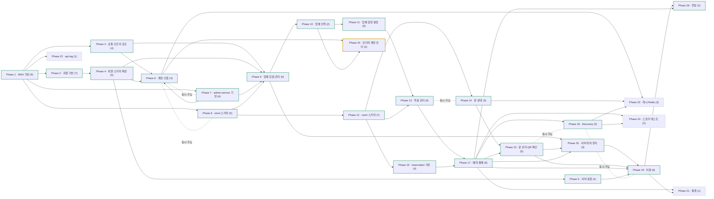

# Roadmap — roomless (무인 객실 대여 플랫폼 — 입점 업체가 객실을 운영하고 이용자가 지도에서 찾아 예약 · QR 입장 · 이용)

## Direction

게이트웨이 + 서비스 MSA 위에서, 총관리자가 입점을 승인한 업체가 층별 호실 · 객실 그룹 · 그룹별 상품(대실 · 숙박)을 운영하고, 이용자는 지도에서 업체를 찾아 호실과 시간대를 골라 예약 · 결제한 뒤 QR 로 입장해 이용 · 연장한다. 업체(store)는 입점 신청 · 상태 · 소개를 가진 새 모델로 처음부터 다시 만든다. 방향은 언제든 바뀔 수 있다.

## 한눈에 보는 흐름

- Phase 1 — MSA 기반 · 유닛 9개 · 의존: — · 푼다: Phase 2, 3, 5, 7, 8, 22 · 파일 집합: apps/, libs/, compose.*.yml, docker/, scripts/ · done
- Phase 2 — 회원 기반 · 유닛 7개 · 의존: Phase 1 · 푼다: Phase 4 · 파일 집합: apps/user-service/src/user, apps/gateway/src/api/v1/user, apps/gateway/src/guards · done
- Phase 3 — 공통 인프라 포트 · 유닛 4개 · 의존: Phase 1 · 푼다: Phase 6, 9, 11 · 파일 집합: libs/integration, libs/common/src/dto, libs/common/src/utils, tsconfig.json, package.json, .env.example, compose.gateway.yml, AGENTS.md, docs/ · done
- Phase 4 — 회원 스키마 확장 · 유닛 5개 · 의존: Phase 2, 3 · 푼다: Phase 5, 6, 9 · 파일 집합: libs/database(entities · migrations · seeder), libs/contracts/src/user, apps/user-service/src/user, apps/gateway/src/api/v1/user, AGENTS.md, docs/ · done
- Phase 5 — 서버 분할 · 유닛 4개 · 의존: Phase 1, 4 · 푼다: Phase 19 · 파일 집합: apps/scheduler, apps/user-service(crontabs · 루트 모듈 · 인증번호 확인), libs/messaging(CommandDispatcher), libs/database(연결 대기 제한), compose.scheduler.yml, nest-cli.json, Dockerfile, docker/, .env.example, README.md, AGENTS.md, docs/ · done
- Phase 6 — 계정·인증 · 유닛 4개 · 의존: Phase 3, 4, 7 · 푼다: Phase 20, 23 · 파일 집합: apps/user-service/src/user, apps/admin-service/src/{manager,admin}, apps/gateway/src/api/v1/{user-service/user, admin-service/manager, admin-service/admin} · guards, libs/account, libs/contracts/src/{user,manager,admin}, libs/database(entities · migrations · seeder), README.md, AGENTS.md, docs/ · done
- Phase 7 — admin-service 기반 · 유닛 4개 · 의존: Phase 1 · 푼다: Phase 9 · 파일 집합: apps/admin-service, compose.admin-service.yml, docker/, libs/messaging, apps/gateway/src/modules/transport · done
- Phase 8 — store 스키마 · 유닛 5개 · 의존: Phase 1 · 푼다: Phase 9, 12 · 파일 집합: libs/database/src/entities/store, libs/database/src/seeder, libs/database/src/migrations · done
- Phase 9 — 업체 입점·관리 · 유닛 5개 · 의존: Phase 3, 4, 7, 8 · 푼다: Phase 10, 25 · 파일 집합: apps/admin-service/src/store, apps/gateway/src/api/v1/admin-service/store, libs/contracts/src/store · done
- Phase 10 — 업체 인력 · 유닛 2개 · 의존: Phase 9 · 푼다: Phase 11, 20 · 파일 집합: apps/admin-service/src/{manager,store}, apps/gateway/src/api/v1/admin-service/{manager,store}, libs/contracts/src/{manager,store} · done
- Phase 11 — 업체 운영 설정 · 유닛 9개 · 의존: Phase 10 (+ Phase 3) · 푼다: Phase 13 · 파일 집합: apps/admin-service/src/store, apps/gateway/src/api/v1/admin-service/store, libs/contracts/src/store · done
- Phase 12 — room 스키마 · 유닛 7개 · 의존: Phase 8 · 푼다: Phase 13, 14, 16 · 파일 집합: libs/database/src/entities/room · store, libs/database/src/migrations, libs/database/src/soft-delete.ts, apps/*/repositories · done
- Phase 13 — 객실 관리 · 유닛 6개 · 의존: Phase 11, 12 · 푼다: Phase 17 · 파일 집합: apps/admin-service/src/room, apps/gateway/src/api/v1/admin-service/room, libs/contracts/src/room · done
- Phase 14 — 문 상태 · 유닛 3개 · 의존: Phase 12 · 푼다: Phase 15, 23 · 파일 집합: libs/integration/src/{redis,door}, apps/user-service/src/door, apps/gateway/src/api/v1/user-service/door, libs/contracts/src/door, compose.redis.yml, compose.*.yml, scripts/docker-network.mjs, package.json, .env.example, README.md, AGENTS.md, docs/ · done
- Phase 16 — reservation 기반 · 유닛 4개 · 의존: Phase 12 · 푼다: Phase 17 · 파일 집합: libs/database/src/entities/{reservation,payment}, libs/database/src/migrations, libs/integration/src/payment · done
- Phase 17 — 예약·결제 · 유닛 8개 · 의존: Phase 13, 16 (+ Phase 3, 11) · 푼다: Phase 15, 18, 19, 21, 25, 26 · 파일 집합: apps/user-service/src/reservation, apps/scheduler/src/reservation, apps/gateway/src/api/v1/user-service/reservation, libs/contracts/src/reservation, libs/integration/src/payment, apps/admin-service/src/{store,room}(환불 규정 · 연박 박수 · 삭제 금지), libs/database(entities · migrations) · done
- Phase 15 — 문 관리·QR 확인 · 유닛 5개 · 의존: Phase 14, 17 · 푼다: Phase 19, 25 · 파일 집합: apps/admin-service/src/{room,store}(문 상태 · 바로 열기 · 소켓 처리 · 시크릿), apps/user-service/src/{reservation,door 삭제}(내 예약 QR), apps/scheduler/src/reservation(QR 맞추기), apps/gateway/src/modules/door-socket, libs/integration/src/door, libs/database(t_room_qr · door_secret), libs/contracts/src/{door,room,store,reservation} · done
- Phase 18 — discovery · 유닛 5개 · 의존: Phase 17 · 푼다: Phase 23 · 파일 집합: apps/user-service/src/{discovery,reservation}, apps/gateway/src/api/v1/user-service/discovery, libs/contracts/src/{discovery,reservation} · done
- Phase 25 — 서버 위치 정리 · 유닛 3개 · 의존: Phase 9, Phase 15, Phase 17 · 푼다: Phase 19 · 파일 집합: apps/user-service/src/{door,store}(새) · reservation(매니저 기능 빼기), apps/admin-service/src/reservation(새) · {room,store}(이용자 · 문 소켓 처리 빼기), apps/gateway/src/api/v1/{user-service/store(새), admin-service/reservation(새), admin-service/store, user-service/reservation}, apps/gateway/src/modules/door-socket, libs/contracts/src/{door,room,store,reservation}, README.md, AGENTS.md, docs/ · done
- Phase 19 — 이용 · 유닛 6개 · 의존: Phase 5, Phase 15, Phase 17, Phase 25 · 푼다: Phase 21, 26 · 파일 집합: apps/scheduler/src/reservation(crontabs · repository · 모듈 SmsModule), apps/user-service/src/{reservation,door}, apps/admin-service/src/reservation, apps/gateway/src/api/v1/{user-service,admin-service}/reservation, libs/contracts/src/reservation, libs/database(entities · migrations · seeder), compose.scheduler.yml, .env.example, README.md, AGENTS.md, docs/ · done
- Phase 26 — 연장 · 유닛 2개 · 의존: Phase 19 · 푼다: — · 파일 집합: apps/user-service/src/{reservation,discovery}, apps/scheduler/src/reservation, apps/admin-service/src/{room,store}, apps/gateway/src/api/v1/user-service/reservation, libs/contracts/src/{reservation,room,discovery}, libs/database(entities · migrations), README.md, AGENTS.md, docs/ · done
- Phase 20 — 관리자 계정 관리 · 유닛 2개 · 의존: Phase 6, 10 · 푼다: — · 파일 집합: apps/admin-service/src/{user(새 — 이용자 관리),manager(업체 관리자 관리)}, apps/user-service/src/{user,reservation}(이용 제한 이용자), apps/gateway/src/api/v1/admin-service/{user,manager}, libs/contracts/src/{user,manager}, README.md, AGENTS.md, docs/ · in-progress
- Phase 21 — 통계 · 유닛 1개 · 의존: Phase 17, 19 · 푼다: — · 파일 집합: apps/admin-service/src/stats, apps/gateway/src/api/v1/admin-service/stats, libs/contracts/src/stats · todo
- Phase 22 — api-log · 유닛 1개 · 의존: Phase 1 · 푼다: — · 파일 집합: apps/gateway(인터셉터), libs/database/src/entities/api-log, libs/database/src/migrations · todo
- Phase 23 — 캐시(Redis) · 유닛 3개 · 의존: Phase 6, 14, 18 · 푼다: — · 파일 집합: libs/integration/src/cache, apps/gateway/src/guards, apps/{user,admin}-service(무효화), apps/admin-service/src/discovery · todo
- Phase 24 — 스토리 테스트 · 유닛 2개 · 의존: Phase 17, 18 · 푼다: — · 파일 집합: test/story(시나리오 · 실행기), scripts, package.json, compose(테스트 DB 초기화), docs/guides, README.md · todo

동시 가능: Phase 9·Phase 12 · Phase 9·Phase 22 (지금 바로 — Phase 12 · 22 는 둘 다 마이그레이션을 더해 서로는 함께 돌리지 않는다) / Phase 13·Phase 14 / Phase 15·Phase 18 / Phase 18·Phase 19 — 마이그레이션을 추가하는 Phase 끼리는 `MIGRATIONS` 등록 파일이 겹쳐 동시에 돌리지 않는다(Phase 4 · 8 · 12 · 16 · 22).

지금: Phase 20 진행 중 · Next up: Phase 20

## 지금 할 일
Phase 20 관리자 계정 관리 시작하기
- #84 이용자 관리
- #85 업체 관리자 관리
- ok → 다음
- 사용자 — `.env`: `RABBITMQ_ADMIN_SERVICE_PASSWORD` · `REDIS_PASSWORD` · `REDIS_URL`(gateway · user-service · admin-service · scheduler 모두 — 비밀번호는 `REDIS_PASSWORD` 와 같게) · `TOSS_SECRET_KEY`(토스 테스트 키 `test_sk_…` — user-service · scheduler, 비면 예약 · 결제 요청만 503) · `AWS_S3_PUBLIC_URL`(CloudFront 주소) · `USER_WEB_URL`(이용자 프론트 주소 — scheduler QR 확인 링크 SMS · admin-service 이용 중 취소 요청 승인 링크, 비면 링크 SMS 안 보냄 · 취소 요청 503) · AWS 키는 scheduler 에도 넘어간다(QR 링크 SMS — SNS 권한) · `BCRYPT_CODE` 는 user-service · admin-service 가 같은 값(문 시크릿 확인 · 업체 총관리자 비밀번호 해시를 Phase 25 부터 user-service 도 한다) — `.env.example` 참고
- 사용자 — AWS: CloudFront 배포 + OAC, 버킷 정책은 `store/*` 만 · 퍼블릭 액세스 차단 4항목 켬(docs/guides/aws-setup.md 1 · 5단계)
- 사용자 — 인프라: `npm run docker:network` → `npm run docker:rabbitmq`(admin-service 브로커 계정 생성) → `npm run docker:redis`. 로컬 실행은 hosts 에 `127.0.0.1 redis`(docs/guides/redis-setup.md), admin-service 는 `npm run start:admin-service`(:4002)
- 사용자 — 마이그레이션 13개를 순서대로(`npm run db:migrate` 또는 Docker migrate 컨테이너 — 남은 것을 순서대로 적용): `LoginScopeStoreDetail` → `StoreSchema` → `StoreFile` → `StoreCodeManagerScope` → `StoreOperation` → `StoreReservationPolicy` → `RoomSchema`(적용 계정에 PostgreSQL 확장 `btree_gist` 생성 권한 — RDS 13+ 는 DB 의 CREATE 권한) → `RoomState` → `ReservationSchema` → `ReservationBooking` → `RoomQrDoorSecret` → `ReservationUsage` → `ReservationExtension`
- 사용자 — 마이그레이션이 바꾸는 기존 데이터: 회원 `login_scope` 를 권한으로 채움 · 기존 업체는 영업중지 · 좌표 0 · 업체코드 채움 · `t_store_image` 삭제 · `head_manager_phone` → `owner_phone` · 매니저 아이디 · 휴대폰 유일성은 업체 단위 · 기존 브레이크는 매일 · 업체 예약 가능 72시간 · 100% 환불 마감 60분(1시간 × 60) · 마감 뒤 환불 50% · 업체 상품 설정 3행(연박 1 ~ 30박 · 연장 가능 · 최대 3회) · 편의시설 `store_detail` 삭제 · 스탠바이 호실 → 예약가능 · 이용중 → 사용중 · 예약에 환불 비율 50 저장. 이미 있던 입점 신청은 업체 총관리자 아이디 · 비밀번호가 비어 있어 반려 후 다시 신청. 예약의 `checked_in_at` · `completed_at` 삭제(쓰던 코드 없음 — 값 없음). 새로 생기는 것: 업체 정보 파일 · 일시 예약불가 · 예약 · 구간 · 결제(+ 룩업 3) · `t_room_qr` · `t_door_open_log` · `t_reservation_cancel_request`(+ 요청 상태 룩업 — 시드는 user-service 부팅) 테이블, 정지 사유 · `door_secret` · 예약 `qr_link_sent_at` 컬럼, store 테이블 5개 소프트 삭제(`is_deleted`), 결제 부분 환불 CHECK, 예약 구간 결제 대기 부분 유니크(예약당 1개)
- 사용자 — 앱을 새 이미지로 다시 띄우기: user-service(migrate 포함) → admin-service → scheduler → gateway(`npm run docker:up` 순서 — gateway-lb 는 `/ws/` 설정 때문에 다시 만든다. gateway 는 반드시 마지막 — 옮긴 명령 `user.store.application*` · `admin.reservation.*` 을 서비스가 먼저 받게). scheduler crontab(결제 대기 만료(연장 구간 포함) · 늦은 승인 · 환불 · QR 동기화 · 이용 시작 · 종료 전환 · QR 확인 링크 SMS)은 `NODE_ENV=production` 에서만 돈다. 첫 회차에 이미 시작한 확정 예약은 이용 중 · 호실 사용중이 되고, 끝 전 예약에는 링크 SMS 가 한 번 간다
- 사용자 — 프론트: 업체 예약 규정 `refund_deadline_hours` → `refund_deadline_minutes` + `late_refund_percent`, 업체 상품 설정 연박 `min_nights` · `max_nights` · 연장 `is_extendable` · `max_extensions`(Phase 26 — 상품 설정 PUT 에 필수, 1 ~ 10회), 이용 중 예약의 연장 버튼(Phase 26 — `GET /api/v1/user-service/reservation/:reservation_id/extension` 으로 가능 여부 · 사유 · 새 끝 · 금액 → `POST …/:reservation_id/extension` → done 의 `payment_id` 를 orderId 로 토스 결제창(5분 안) → 같은 `/payment-confirm`, 결제하지 않으면 그 예약은 다시 연장 불가), 결제창 orderId = 예약 결과의 `payment_id` → 토스 승인 뒤 `POST /api/v1/user-service/reservation/payment-confirm`, 내 예약 QR `GET /api/v1/user-service/reservation/:reservation_id/qr`(Phase 19 — 이용 중에만, 시작 시각부터 · 시작 전은 400), 예약 1건 화면 `/reservation/<id>`(QR 링크 SMS 가 여는 주소 — "QR 확인" 버튼) · 취소 동의 화면 `/reservation/<id>/cancel-request`(로그인 후 `GET …/cancel-request` → `PATCH …/cancel-request/approve` · `…/reject`) · 사용중지 전액 환불 취소 버튼(목록 · 상세 `is_room_disabled` 1 이면 이용 중이어도 기존 취소 API), 업체 화면의 이용 중 예약 취소 요청 `POST /api/v1/admin-service/reservation/:reservation_id/use-cancel-request` · 현황의 `cancel_request_state_id`(업체 취소 `store-cancel` 은 시작 전 예약만), 결제 확인 결과 상태가 이미 시작한 예약이면 `CHECKED_IN`, 호실 목록의 문 상태 · 바로 열기, 업체 총관리자 문 시크릿 설정, 업체 둘러보기 API 3개(지도 중심 + 같은 반경으로 다시 조회 · is_truncated 면 반경 줄이기 안내), 예약 가능 시간 응답이 그룹 → 시간대 → 호수(금액은 그룹 price · 지금 바로는 is_now 1 시간대), 지금 바로 예약은 is_now: 1(시작 시각 없이 · 오늘), 경로 10개 변경(Phase 25 — 요청 · 응답 같음): 입점 신청 7개 `/api/v1/admin-service/store/application…` → `/api/v1/user-service/store/application…`, 업체 예약 현황 · 업체 취소 · 호실 이동 `/api/v1/user-service/reservation/{store, :id/store-cancel, :id/room}` → `/api/v1/admin-service/reservation/…`
- 사용자 — 문 쪽 프로그램에 연동 규격 변경 알리기(HTTP 문 열기 · 닫기 → 문 소켓 — README "문 소켓"), 업체 총관리자가 시크릿을 먼저 정한다. 확인: 토스는 docs/guides/toss-setup.md 6절, 문 소켓은 `.beaver/output/report/door/door-manage-report.md` 의 7단계

## Scope & Actors

| 행위자 (`t_auth`) | 페이지 | 하는 일 |
|---|---|---|
| 총관리자 `SUPER_ADMIN` / `ADMIN` | 관리자 (admin-service · `admin` 도메인) | 아이디 로그인 · 비밀번호 변경(찾기 · 초기화 없음), 입점 신청 승인 · 반려, 업체 등록 · 상태 관리(영업중지 등), 업체 총관리자 계정 생성, 이용자 관리, 업체 관리자 관리, 전체 통계 |
| 업체 총관리자 `HEAD_MANAGER` | 매니저 (admin-service · `manager` 도메인) | 업체 관리자 권한 전부 + 업체 관리자 계정 등록 · 수정 · 삭제 |
| 업체 관리자 `MANAGER` | 매니저 (admin-service · `manager` 도메인) | 아이디 로그인 · 비밀번호 변경 · 등록된 휴대폰으로 아이디 찾기 · 비밀번호 초기화(총매니저도 같다), 자기 업체 1곳 — 업체 소개 · 영업시간 · 브레이크타임 · 정비시간, 층별 호실 · 객실 그룹 · 상품 · 기간 가격 · 호실 문(상태 확인 · 바로 열기), 호실 상태 전이, 예약 현황 · 예약 취소 · 호실 이동, 자기 업체 통계 |
| 이용자 `USER` | 이용자 (user-service · `user` 도메인) | 성인만(청소년보호법) SNS 가입 · 로그인(비밀번호 없음) 후 휴대폰 SMS 인증 · SMS로 아이디(가입한 SNS) 찾기, 지도 검색, 호실 · 시간대 선택 예약 · 결제 · 취소, 내 예약 방 · QR 확인(로그인 웹페이지), QR 입장, 연장, 입점 신청 |
| 문 쪽 타 업체 프로그램 | — (업체 ID + 업체 문 시크릿 — 문 소켓 `/ws/v1/door`) | 업체 단위로 문 소켓에 붙어 예약자 QR 을 서버에 확인받고(`door.verify`), 잠금을 알리고(`door.closed`), 관리자 바로 열기 명령(`door.open`)을 받는다 — 문 자체를 여닫는 것은 그 프로그램 몫 |
| 시스템 | — | scheduler 서버의 crontab(탈퇴 자동처리 · 결제 대기 만료 · 환불 · QR 동기화 · QR 확인 링크 발송 · 이용 종료 자동 완료), 서비스의 브로커 명령 처리 |

업체 총관리자와 업체 관리자는 객실 관리 권한이 같다. 다른 점은 업체 관리자 계정을 관리할 수 있는지 하나다.

**업체별로 달라지는 축** — 영업시간 · 브레이크타임(요일 반복) / 정비시간(퇴실 후 n분) / 층 · 호실 · 객실 그룹 / 그룹별 상품(이름 · 이용시간 · 가격) · 기간별 가격 / 업체 소개 · 사진 · 편의시설 / 호실 문.

## Non-Goals / External Boundaries

- **문 · 기기** — 도어락 · 문 쪽 QR 리더 프로그램(타 업체)은 업체 몫이고, 문을 여닫는 것도 그 프로그램이 한다. 우리는 호실 문마다 QR 정보 · 열림/닫힘 · 마지막 시각을 Redis 에 두고 문 열기(QR) · 닫기 API 만 연다. 전등 · 에어컨 등 기기 제어 · 기기 플랫폼 연동은 하지 않는다 (사용자 결정 2026-11-01 · Phase 14).
- **AWS 리소스 세팅** — IAM · S3 버킷 · SMS 샌드박스 해제 · 지출 한도는 사용자가 `docs/guides/aws-setup.md` 대로 한다. 코드는 처음부터 실제 연동이다(mock 없음). 이메일 · 알림톡 · 푸시는 쓰지 않는다.
- **프론트엔드** — 관리자 페이지 · 이용자 페이지(Next.js)는 별도 레포.
- **후순위(별도 기획)** — Phases & Units 끝의 "후순위" 표.

## Phases & Units

### Phase 1 — MSA 기반 (게이트웨이 · 서비스 · 메시징 · DB · Docker 토대) · depends: —
| # | Unit | Goal | Key decision | Depends | Status |
|---|------|------|--------------|---------|--------|
| 1 | NestJS 12 ESM 모노레포 | `apps/gateway` · `apps/user-service` · `libs/common\|contracts\|database\|messaging` | — | — | done(71ad77b) |
| 2 | TypeORM + PostgreSQL + 오프라인 마이그레이션 | 도메인별 엔티티 · Init 마이그레이션 · `db:generate` · `db:check`(PGlite) | — | 1 | done(71ad77b) |
| 3 | 트랜잭션 · 룩업 seeder | nestjs-cls `@Transactional()`, `SeederService` | — | 2 | done(71ad77b) |
| 4 | RabbitMQ 토폴로지 · 자동 재연결 | cmd · event · dlx · quorum 명령 큐 · 인스턴스별 결과 큐 | — | 1 | done(71ad77b) |
| 5 | 게이트웨이 전달 계층 · Swagger | 내부 HTTP · 요청 단위 SSE · JWT 전략 | — | 4 | done(71ad77b) |
| 6 | 전송 중립 실패 본문 | `ApiFailResultDto` · `toFailResult` | — | 1 | done(71ad77b) |
| 7 | 게이트웨이 전용 수신 | 전역 `InternalAuthGuard` · 브로커 계정 분리 · 발행자 검증 · CORS | — | 4, 5 | done(71ad77b) |
| 8 | Docker 4묶음 · 로드밸런싱 · 작업 잠금 | compose 4묶음 · nginx LB · `JobLockService` · `.env` 하나 = 서버 설정 | — | 7 | done(6ab1df1) |
| 9 | Vitest 테스트 체계 | 큐 경로 · 동기 경로 · FakeBroker · Data-Access Smoke | — | 1 | done(71ad77b) |

**Expected entry points** — 기반 Phase (공개 API 없음): `apps/gateway/src/modules/transport/` · `libs/messaging/src/messaging.module.ts` · `libs/database/src/job-lock/job-lock.service.ts` · `compose.*.yml`.

### Phase 2 — 회원 기반 (가입 · 로그인 · 탈퇴 · JWT) · depends: Phase 1
| # | Unit | Goal | Key decision | Depends | Status |
|---|------|------|--------------|---------|--------|
| 10 | 권한 · 상태 · SNS 룩업 시드 | `SUPER_ADMIN` · `ADMIN` · `HEAD_MANAGER` · `MANAGER` · `USER` | — | 3 | done(71ad77b) |
| 11 | JWT 인증 | 게이트웨이 `PassportJwtAuthGuard`, 회원 상태는 user-service 조회 | — | 5 | done(71ad77b) |
| 12 | 역할 가드 | `RolesGuard` · `@Roles` 정의(핸들러 적용은 관리자 API 에서) | — | 11 | done(71ad77b) |
| 13 | 가입(SNS · 일반) · 탈퇴 · 탈퇴 철회 · 비밀번호 변경 | 큐 경로 | — | 10, 11 | done(71ad77b) |
| 14 | 로그인(SNS · 일반) · 토큰 재발급 | 동기 경로 | — | 10 | done(71ad77b) |
| 15 | 탈퇴 자동처리 crontab | 예약 경과 LEAVE_WAIT → LEAVE + 개인정보 익명화 | — | 13 | done(71ad77b) |
| 16 | 게이트웨이 controller 전달 경로별 분리 | `user.controller.ts`(동기) · `user.controller.queue.ts`(큐) | — | 13, 14 | done(6ab1df1) |

**Expected APIs**:

| Unit | Method | Path | Purpose |
|------|--------|------|---------|
| #13 | POST | `/api/v1/user/sign` · `/general-sign` | 가입 (SSE) |
| #13 | DELETE · PATCH | `/api/v1/user/leave` | 탈퇴 신청 · 철회 (SSE) |
| #13 | PATCH | `/api/v1/user/password` | 비밀번호 변경 (SSE) |
| #14 | POST | `/api/v1/user/login` · `/general-login` · `/token-refresh` | 로그인 · 재발급 |

당시 경로다 — 지금은 `/api/v1/user-service/user/...`(Phase 6 리비전 261023-2), 일반 가입 · 일반 로그인 · 이용자 비밀번호 변경은 Phase 6 에서 없어졌다.

### Phase 3 — 공통 인프라 포트 (AWS SMS · S3 연동 + 페이지네이션) · depends: Phase 1
| # | Unit | Goal | Key decision | Depends | Status |
|---|------|------|--------------|---------|--------|
| 17 | `SmsSender` 포트 + Amazon SNS 어댑터 | 모든 발송을 SMS로 — 휴대폰 인증 · 아이디 찾기 · 비밀번호 초기화 · 업체 계정 안내 · 예약 변경 안내 · 입장 QR 링크 | — | 18 | done |
| 18 | `libs/integration` 토대 | 외부 연동 공용 라이브러리 — `@app/integration` alias · 전역 `SmsModule` · `StorageModule` · AWS SDK 의존성 · `.env` AWS 키 · AWS 세팅 가이드 · 규약 문서 | — | — | done |
| 19 | `StorageGateway` 포트 + S3 어댑터 | 업체 · 객실 그룹 사진 — presigned URL 로 클라이언트가 S3 에 직접 올린다 | — | 18 | done |
| 20 | 공통 Pagination | `PaginationDto`(생성자 기본값) · `Pagination` util — 첫 목록 API 전에 | — | — | done |

**Expected interfaces** (이름 수준):

| Unit | 형태 | 이름 | Purpose |
|------|------|------|---------|
| #17 | 포트 | `SmsSender.send({to, text})` | SMS 1통 (한국행은 국제 경로, 한글 70자 단위 과금) |
| #18 | 모듈 | `SmsModule` · `StorageModule` | 포트별 전역 모듈 (AWS 어댑터) |
| #19 | 포트 | `StorageGateway.createUploadUrl(...)` · `exists(...)` · `getPublicUrl(...)` · `remove(...)` | 업로드 주소 · 업로드 확인 · 공개 주소 · 삭제 |
| #20 | DTO · util | `PaginationDto` · `Pagination` | 목록 공통 |

ship 완료 (2026-10-20, 커밋 c60fdfb) — report: `.beaver/output/report/common/common-infra-ports-report.md` · review: `.beaver/output/review/main-review-261020-2.md`.

### Phase 4 — 회원 스키마 확장 (컬럼 이름 정리 · 휴대폰 SMS 인증 · 아이디 찾기 · 비밀번호 초기화 · 첫 총관리자) · depends: Phase 2, Phase 3
| # | Unit | Goal | Key decision | Depends | Status |
|---|------|------|--------------|---------|--------|
| 21 | 컬럼 이름 정리 + `t_user` 휴대폰 인증 상태 | `created_at` · `updated_at` · `expires_at` · `is_deleted` · `is_login_allowed` · `previous_*` · `api_log_id` 로 정리(RENAME), `phone_verified_at` · 번호 1개 = 계정 1개(`UK_User_Phone`) | — | — | done(57a6fdd) |
| 22 | SMS 인증 기록 | `t_sms_purpose`(용도 룩업) · `t_sms_verification`(발송 · 확인 기록 — 인증번호 해시 · 시도 횟수 · 만료 · 완료) | — | — | done(57a6fdd) |
| 23 | 첫 총관리자 시드 | `admin` / `1234`(시드 시점 bcrypt + pepper), login_id 로 멱등, 첫 로그인 때 변경 필요 | — | — | done(57a6fdd) |
| 26 | 휴대폰 SMS 인증 | 가입 후 발송 → 인증 ID + 인증번호 확인 → 번호 저장. 6자리 · 5분 · 3회, 같은 번호 하루 10번(env) | — | 17, 21, 22 | done(57a6fdd) |
| 27 | 아이디 찾기 · 비밀번호 초기화 | 휴대폰 인증으로 아이디(일반) · SNS 종류 · 가입일, 아이디 + 번호 인증 → 영문 + 숫자 10자리 임시 비밀번호 SMS | — | 17, 22 | done(57a6fdd) |

**Expected data contract**:

| Unit | Table | Content |
|------|-------|---------|
| #21 | `t_user` 외 6개 | 컬럼 이름 정리 · `phone_verified_at` · `UK_User_Phone` |
| #22 | `t_sms_purpose` · `t_sms_verification` | 용도 3개 · 번호 · 인증번호 해시 · 시도 횟수 · 만료 · 완료 · IP |
| #23 | seeder | 총관리자 1행 + 회원 설정 1행 |

**Expected APIs** (큐 경로):

| Unit | Method | Path | Purpose |
|------|--------|------|---------|
| #26 | POST | `/api/v1/user/phone-verification` · `/phone-verification/confirm` | 인증번호 발송 · 확인 (로그인 회원) |
| #27 | POST | `/api/v1/user/find-login-id` · `/find-login-id/confirm` · `/password-reset` · `/password-reset/confirm` | 아이디 찾기 · 비밀번호 초기화 |

당시 경로다 — 지금은 `/api/v1/user-service/user/...`, 비밀번호 초기화는 매니저 도메인(`/api/v1/admin-service/manager/password-reset`)으로 옮겼다(Phase 6).

ship 완료 (2026-10-20, 커밋 57a6fdd) — report: `.beaver/output/report/user/user-sms-verification-report.md` · review: `.beaver/output/review/main-review-261020-4.md`. 리뷰 #1(DB 연결 풀 교착, High)은 사용자 결정으로 Phase 5(#91)로 미뤘다.

### Phase 5 — 서버 분할 (scheduler 서버 · 인스턴스 수 · 인증번호 확인 교착) · depends: Phase 1, Phase 4
| # | Unit | Goal | Key decision | Depends | Status |
|---|------|------|--------------|---------|--------|
| 88 | scheduler 앱 | crontab 만 도는 서버 — 컨트롤러 · HTTP 리스너 · 큐 소비 없음(들어오는 연결 0), DB 에 직접 붙어 작업(자체 repository), `ScheduleModule` · `DatabaseModule` · `JobLockService` | — | — | done(00aa411) |
| 89 | 탈퇴 자동처리 crontab 이전 | user-service → scheduler. user-service 에서 `ScheduleModule` · crontabs 를 뺀다 | — | 15, 88 | done(00aa411) |
| 90 | scheduler Docker 묶음 · 인스턴스 수 | `compose.scheduler.yml`(data 네트워크만) · `.env` 의 `SCHEDULER_REPLICAS`(기본 1 — 여러 대여도 `JobLockService` 로 회차마다 1대만 실행). 인스턴스 수는 서버마다 `.env` 의 `*_REPLICAS` 로 정한다 | — | 88 | done(00aa411) |
| 91 | 인증번호 확인 교착 수정 (리뷰 261020-3 #1) | 틀린 인증번호 · 횟수 초과는 예외를 throw 하지 않고 return — 트랜잭션은 커밋돼 시도 횟수가 남고, `CommandDispatcher` 가 반환된 HttpException 을 failed(400)로 회신한다. RequiresNew 를 없애 트랜잭션 1개 · 연결 1개로 끝낸다. 풀 연결 대기 시간도 제한한다 | — | 26, 27 | done(00aa411) |

**Expected entry points**: `apps/scheduler/src/main.ts`(`NestFactory.createApplicationContext` — listen 없음) · `scheduler.module.ts` · `compose.scheduler.yml`.

ship 완료 (2026-10-22, 커밋 00aa411) — report: `.beaver/output/report/platform/server-split-report.md` · review: `.beaver/output/review/main-review-261022.md`. 리뷰 261020-3 #1(DB 연결 풀 교착, High) · #2 해소.

### Phase 6 — 계정·인증 (로그인 그룹 분리 · 가입 규칙) · depends: Phase 3, Phase 4
| # | Unit | Goal | Key decision | Depends | Status |
|---|------|------|--------------|---------|--------|
| 24 | 로그인 그룹 = 도메인 3개 | 이용자 `user`(user-service, `/api/v1/user-service/user`, SNS 만) · 매니저 `manager` · 관리자 `admin`(admin-service, `/api/v1/admin-service/manager` · `/api/v1/admin-service/admin`)을 controller · service · repository · DTO · 명령 · 내부 경로까지 분리 — 다른 그룹 계정은 404 · 401. 게이트웨이 인증도 그룹별 전략 · 가드(`jwt-user` · `jwt-manager` · `jwt-admin`). 관리자 · 매니저 비밀번호 변경, 매니저 아이디 찾기 · 비밀번호 초기화. 공통 계정 로직은 `libs/account` | 그룹별 접두(결정 2026-10-22) · 도메인 분리 · admin-service · libs/account · 명령 `admin.*` · 공유 DB 직접 · 그룹별 토큰 확인 (결정 2026-10-23) | 23, 28 | done(f7c198f) |
| 25 | 가입 규칙 | 성인 기준(청소년보호법 — 한국 날짜의 올해 − 출생 연도 ≥ 19) · 일반 가입 폐지(이용자 일반 가입 · 로그인 · 비밀번호 변경 · 초기화 제거) | 청소년보호법 · SNS 가입만 (결정 2026-10-22) | — | done(f7c198f) |
| 92 | 로그인 그룹 · 그룹별 UK | `t_user.login_scope`(USER · MANAGER · ADMIN) + `UK(login_id, login_scope)` · `UK(phone, login_scope)` — 기존 행은 권한으로 채움 | 3그룹 단위 (결정 2026-10-22) | 24 | done(f7c198f) |
| 93 | 업체 상세 JSON | 기존 `t_store` 에 `store_detail`(jsonb) — 초기 항목 `room_count` · `has_shower` · `has_tv` · `has_pc`(0/1), 항목은 바뀔 수 있다 | 기존 `t_store` 에 추가 (결정 2026-10-22) | — | done(f7c198f) |

**APIs**:

| Unit | Method | Path | Purpose |
|------|--------|------|---------|
| #24 | POST | `/api/v1/user-service/user/login` · `/api/v1/admin-service/manager/login` · `/api/v1/admin-service/admin/login` | 그룹별 로그인 |
| #24 | POST | 각 도메인 `/token-refresh` | 그룹별 토큰 재발급 |
| #24 | PATCH | `/api/v1/admin-service/manager/password` · `/api/v1/admin-service/admin/password` | 비밀번호 변경(SSE) |
| #24 | POST | `/api/v1/admin-service/manager/find-login-id(+/confirm)` · `/password-reset(+/confirm)` | 매니저 아이디 찾기 · 비밀번호 초기화(SSE) |

ship 완료 (2026-10-23, 커밋 f7c198f) — report: `.beaver/output/report/user/user-account-auth-report.md`(리비전 261023-1 — 도메인 분리 · admin-service) · review: `.beaver/output/review/main-review-261023.md`. 경로는 리비전 261023-2 로 `/api/v1/<service>/<domain>` 규칙이 됐다.

### Phase 7 — admin-service 기반 (새 서비스 앱 토대) · depends: Phase 1
| # | Unit | Goal | Key decision | Depends | Status |
|---|------|------|--------------|---------|--------|
| 28 | admin-service 앱 | nest-cli 프로젝트 · 루트 모듈(`InternalAuthGuard` · `ReturnedExceptionInterceptor` · `MessagingModule.forService` · `SmsModule`) · 매니저 · 관리자 도메인 | 공유 DB 직접 · 마이그레이션 · 시드는 user-service 묶음 (결정 2026-10-23) | — | done(f7c198f) |
| 29 | Docker 묶음 | `compose.admin-service.yml` · nginx LB(`admin-service.conf`) · 공용 네트워크 · `.env` 의 `ADMIN_SERVICE_REPLICAS`(기본 1) | — | 28 | done(f7c198f) |
| 30 | 브로커 계정 | `BROKER_USER.ADMIN_SERVICE` · init.sh 권한(`q.admin.cmd` · `roomless.event`) · `broker:check` 대상 추가 | — | 28 | done(f7c198f) |
| 31 | 게이트웨이 연결 | `InternalHttpClient` 의 `InternalService 'admin'` · `ADMIN_SERVICE_URL` | — | 28 | done(f7c198f) |

**Entry points**: `apps/admin-service/src/main.ts`(:4002) · `admin-service.module.ts` · 큐 `q.admin.cmd`(← `admin.#`) · `http://admin-service-lb:4002`.

Phase 6 리비전 261023-1 과 한 기획으로 build · ship 했다(2026-10-23, 커밋 f7c198f — 매니저 · 관리자 도메인을 이 서비스에 둔다).

### Phase 8 — store 스키마 (업체 새 모델) · depends: Phase 1
| # | Unit | Goal | Key decision | Depends | Status |
|---|------|------|--------------|---------|--------|
| 32 | `t_store_application` | 입점 신청 — 신청자 · 업체 정보 · 업체 총관리자 휴대폰 번호 · 상태 · 반려 사유 | 신청 상태 표현(룩업 · 문자열) | — | done(2ef929a) |
| 33 | `t_store_state` 룩업 + 시드 | 활성 · 영업중지 · 탈퇴 | — | — | done(2ef929a) |
| 34 | `t_store` 재설계 | 상태 · 위경도 · 정비시간 · 소개 · 편의시설 · 연락처 — 편의시설 · 방 칸수는 Phase 6 #93 의 `store_detail`(jsonb)로 먼저 자리를 잡았다 | 편의시설을 `store_detail` 에 둘지 · 따로 둘지 | 33 | done(2ef929a) |
| 35 | `t_store_image` | 업체 사진(정렬 순서) | — | 34 | done(2ef929a) |
| 36 | `t_store_hour` · `t_store_break` | 요일별 영업시간 · 브레이크타임 | — | 34 | done(2ef929a) |

**Data contract**: `t_store_application_state` · `t_store_application` · `t_store_state` · `t_store`(+ `is_always_open` · `is_open`) · `t_store_image` · `t_store_hour`(`CHK_StoreHour_OpenCloseTime`) · `t_store_break`.

ship 완료 (2026-10-24, 커밋 2ef929a) — report: `.beaver/output/report/store/store-schema-report.md` · review: `.beaver/output/review/main-review-261024.md`. 신청 상태는 룩업, 편의시설은 `store_detail` 유지로 정했다.

### Phase 9 — 업체 입점·관리 (신청 → 승인 → 업체 등록) · depends: Phase 3, Phase 4, Phase 7, Phase 8
| # | Unit | Goal | Key decision | Depends | Status |
|---|------|------|--------------|---------|--------|
| 37 | 입점 신청 · 내 신청 상태 | 이용자 페이지 하단, 로그인 필요 | — | 32 | done(60e061b) |
| 38 | 입점 신청 목록 · 상세 | 총관리자 | — | 32 | done(60e061b) |
| 39 | 입점 승인 · 반려 | 승인 = 업체 등록 + 업체 총관리자 계정 생성 + 안내 SMS, 반려 = 사유 (큐) | 계정 생성은 admin-service 가 공유 DB 에 직접(결정 2026-10-23) — store 도메인에서 할지 manager 도메인 repository 로 할지 | 17, 37 | done(60e061b) |
| 40 | 업체 목록 · 상세 · 수정 · 삭제 | 총관리자 — 새로 만든다 | 삭제 방식(soft delete) | 34 | done(60e061b) |
| 41 | 업체 상태 변경 | 활성 · 영업중지 | 영업중지 시 미래 예약 처리(Open Decisions) | 33 | done(60e061b) |

**APIs** (구현 — store-application-spec.md):

| Unit | Method | Path | Purpose |
|------|--------|------|---------|
| #37 | POST · DELETE · GET | `/api/v1/admin-service/store/application` · `/application/mine(/:store_application_id)` · `…/file/upload-url` · `…/file(/:store_file_id)` | 입점 신청 · 신청 취소(삭제) · 내 신청 · 업체 정보 파일 (이용자 가드) |
| #38 | GET | `/api/v1/admin-service/store/application` · `/application/:store_application_id` | 신청 목록 · 상세 (관리자 가드) |
| #39 | PATCH | `/api/v1/admin-service/store/application/:store_application_id/approve` · `/reject` | 승인 · 반려 (SSE, 관리자 가드) |
| #40 | GET · PATCH | `/api/v1/admin-service/store` · `/:store_id` | 업체 목록 · 상세 · 수정 (관리자 가드) |
| #41 | PATCH | `/api/v1/admin-service/store/:store_id/state` | 상태 변경 — 활성 · 영업중지 · 탈퇴 (관리자 가드) |

메모: 업체 삭제 API 는 두지 않고 상태(탈퇴 = 매니저 정지 · 사업자번호 마스킹)로만 관리한다. 신청 취소(삭제)를 더했다(사용자 결정 2026-10-26).
업체 사진은 `t_store_image` 대신 업체 정보 파일 `t_store_file`(용도 룩업 `t_store_file_purpose.is_private`)에 둔다 — #35 · #45 의 사진은 이 테이블이다.

### Phase 10 — 업체 인력 (업체 관리자 계정) · depends: Phase 9
| # | Unit | Goal | Key decision | Depends | Status |
|---|------|------|--------------|---------|--------|
| 42 | 업체 관리자 계정 등록 · 목록 · 수정 · 삭제 | 업체 총관리자 — 수정에 비밀번호 초기화 포함. 매니저 도메인(같은 그룹 계정) | 총매니저만 — 매니저 가드 + `RolesGuard` · `@Roles(HEAD_MANAGER)` 첫 사용처 | 39 | done(610aad7) |
| 43 | 매니저 업체 배정 · 배정 해제 | 총관리자 | 유지할지(업체 총관리자가 직접 관리하므로) | 39 | dropped(업체 관리자는 업체 총관리자가 자기 업체로 만들어 처음부터 소속이 정해진다 — 배정 API 불필요, 사용자 결정 2026-10-26) |

**APIs** (구현 — manager-staff-spec.md, 매니저 가드 + `RolesGuard` · `@Roles(HEAD_MANAGER)`): `POST · GET /api/v1/admin-service/manager/staff` · `GET · PATCH · DELETE /staff/:user_id` · `PATCH /staff/:user_id/password-reset` · `PATCH /staff/:user_id/state`(정지 · 해제)(#42).

메모: 같은 배치로 업체코드(`t_store.store_code`) · 매니저 아이디 · 휴대폰 업체 단위 유일(로그인 · 아이디 찾기 · 비밀번호 초기화에 업체코드) · 입점 신청 때 업체 총관리자 자격증명 · 승인 신청도 내 신청에 보임을 넣었다(사용자 결정 2026-10-26).
Phase 20 #85(총관리자의 업체 관리자 관리)는 이 업체 단위 계정 위에서 범위를 정한다.

### Phase 11 — 업체 운영 설정 (업체 관리자) · depends: Phase 10 (+ Phase 3)
| # | Unit | Goal | Key decision | Depends | Status |
|---|------|------|--------------|---------|--------|
| 44 | 내 업체 상세 | 업체 관리자 | — | 42 | done(4fe12f0) |
| 45 | 업체 소개 수정 | 소개 · 연락처 · 사진 (편의시설은 Phase 12 에서 객실 그룹 상세정보로 옮겼다) | — | 19, 35 | done(4fe12f0) |
| 46 | 영업시간 · 브레이크타임 설정 | 요일 반복 | 영업시간 변경 시 기존 예약 처리 | 36 | done(4fe12f0) |
| 47 | 정비시간 설정 | 퇴실 후 n분 | — | 34 | done(4fe12f0) |
| 94 | 영업중 여부 전환 | 업체 관리자가 영업중 · 영업중 아님을 바꾼다(`t_store.is_open`) — 0 이면 연중무휴 · 영업시간 안이어도 영업중 아님 | 영업중 아님으로 바꿀 때 기존 예약 처리(Open Decisions) | 34 | done(4fe12f0) |
| 98 | 일시 예약불가 | 시작 일시 ~ 종료 일시(분 단위) 동안 예약을 받지 않는다(`t_store_unavailable_period`) — 서로 겹침 금지 · 메모 30자, 요일별 휴무와 별개 | 걸리는 기존 예약은 취소하지 않고 특수 표시(Phase 17) | 44 | done(4fe12f0) |
| 99 | 예약 · 환불 규정 | 업체가 정한다 — 이용 시작 n시간 전부터 예약(`booking_open_hours`, 기본 72), n시간 전까지 100% 환불 · 이후 환불 신청 불가(`refund_deadline_hours`, 기본 1) | 적용 · 예약 때 기준 저장은 Phase 17 | 44 | done(c4003ff) |
| 100 | 관리자 영업중 여부 전환 | 총관리자 · 관리자가 업체의 영업중 여부를 바꾼다 — 관리자가 바꾸는 운영 설정은 이것 하나 | — | 41 | done(c4003ff) |
| 101 | 영업중지 정지 사유 | 관리자가 영업중지로 바꿀 때 사유를 남기고 업체 관리자에게 보인다(`suspend_comment`) | — | 41 | done(c4003ff) |

**APIs** (구현 — store-operation-spec.md, 매니저 가드): `GET /api/v1/admin-service/store/mine`(#44), `PATCH /mine/profile` · `POST /mine/file/upload-url` · `POST /mine/file` · `DELETE /mine/file/:store_file_id` · `PUT /mine/file/order`(#45), `PUT /mine/hours` · `/mine/breaks`(#46), `PATCH /mine/maintenance`(#47), `PATCH /mine/open`(#94), `GET · POST /mine/unavailable-period` · `DELETE /mine/unavailable-period/:store_unavailable_period_id`(#98), `PATCH /mine/reservation-policy`(#99), 관리자 가드 `PATCH /api/v1/admin-service/store/:store_id/open`(#100) · `PATCH /:store_id/state` 의 `suspend_comment`(#101 — 리비전 261029-1).

메모: 브레이크타임은 요일 없이 매일 · 서로 겹침 금지, 영업시간 시작 = 마감 불가(24시간은 연중무휴), 같은 업체 설정 쓰기는 업체 행 잠금(사용자 결정 2026-10-27).
같은 배치로 날짜 · 시각 처리를 dayjs 로 통일했다(`libs/common/src/utils/dayjs.ts` — kst.ts 삭제).

### Phase 12 — room 스키마 (층 · 객실 그룹 · 호실 · 상품 · 기간 가격) · depends: Phase 8
| # | Unit | Goal | Key decision | Depends | Status |
|---|------|------|--------------|---------|--------|
| 48 | `t_room_state` 룩업 + 시드 | 스탠바이 · 이용중 · 정비중 · 사용중지 → Phase 13 에서 예약가능 · 예약완료 · 사용중 · 정비중 · 사용중지(`RoomState`) | — | — | done(966649d) |
| 49 | `t_room_group` · `t_room_group_image` | 그룹(객실 유형) — 그룹명 · 설명 · 상세정보 JSON(방 개수 · 샤워실 · TV · PC, 기본값 + 조회 뒤 채움) · 사진(공개, 소프트 삭제) | — | 34 | done(966649d) |
| 50 | `t_room` | 호실 — 그룹 · `floor`(정수) · 호실명 · 상태 | — | 48, 49 | done(966649d) |
| 51 | `t_room_plan_type` · `t_room_group_plan` | 상품 종류 룩업(HOURLY 시간 이용 · NIGHT 1박 · LONG 연박) + 그룹 상품(그룹 × 종류 반드시 1행 — 사용 여부 `is_used` · 요금) | 1박 · 연박은 입실 · 퇴실 시각 고정(업체 상품 설정) | 49 | done(966649d) |
| 52 | `t_room_group_plan_price` | 상품별 기간 가격(성수기 등) | 기간 겹침을 막는 방법(배타 제약 · 서비스 검사) | 51 | done(966649d) |
| 102 | `t_room_plan` 업체 상품 설정 | 업체 × 상품 종류 반드시 1행 — 사용 여부 · 예약 가능 요일(비트) · 이용 시간(시간 이용) · 입실 · 퇴실 시각(1박 · 연박), 입점 승인 · 기존 업체에 3행. 편의시설은 업체에서 객실 그룹으로(`t_store.store_detail` 삭제) | 종류별 컬럼 대신 종류별 행(사용자 결정 2026-10-31) | 34 | done(966649d) |
| 106 | 소프트 삭제 전환 | 삭제는 항상 `is_deleted = 1`(DB 만 — 파일은 S3 객체만 실제 삭제), repository 가 `notDeleted` 로 `is_deleted = 0` 을 항상 붙인다 — 기존 store 실제 삭제 6곳 · t_store · t_session 조회 전환 | 조건을 붙이는 곳 = repository(사용자 결정 2026-10-31) | — | done(966649d) |

**Expected data contract**: `t_room_state` · `t_room_plan_type` · `t_room_plan` · `t_room_group` · `t_room_group_image` · `t_room` · `t_room_group_plan` · `t_room_group_plan_price`, `notDeleted`(libs/database/src/soft-delete.ts).

report: `.beaver/output/report/room/room-schema-report.md` · review: `main-review-261031.md`. 마이그레이션 `RoomSchema`(btree_gist 확장 — 적용 계정 권한 필요).

### Phase 13 — 객실 관리 (업체 관리자) · depends: Phase 11, Phase 12
| # | Unit | Goal | Key decision | Depends | Status |
|---|------|------|--------------|---------|--------|
| 53 | 객실 그룹 등록 · 수정 · 삭제 · 목록 | 사진 · 상세정보 JSON 포함, 그룹을 만들 때 그룹 상품 3행을 함께 만든다(소프트 삭제) | 미래 예약이 있는 그룹 삭제 처리 | 49 | done(21e8e29) |
| 54 | 호실 등록 · 수정 · 삭제 · 목록 | 층 · 그룹 지정, 층별 목록 | 미래 예약이 있는 호실의 그룹 이동 | 50 | done(21e8e29) |
| 55 | 호실 상태 변경 | 업체 관리자 전환 4개 — 정비 완료(정비중 → 예약가능) · 사용중지(예약가능 · 정비중 →) · 사용 재개(사용중지 → 예약가능), 나머지는 시스템 몫 | 정비 완료는 업체 관리자가 직접(자동 전환 없음 — 결정 2026-10-31) | 50 | done(21e8e29) |
| 56 | 그룹 상품 수정 · 목록 | 그룹 × 종류(시간 이용 · 1박 · 연박)의 사용 여부 · 요금 — 행은 늘 3개라 등록 · 삭제 없음 | — | 51 | done(21e8e29) |
| 103 | 업체 상품 설정 조회 · 수정 | 업체 × 종류의 사용 여부 · 예약 가능 요일 · 이용 시간 · 입실 · 퇴실 시각 (매니저 가드) | 입실 = 퇴실 · 요일 0 검증, 바꿀 때 기존 예약(Phase 17 Open Decision 과 같이) | 102 | done(21e8e29) |
| 57 | 상품별 기간 가격 등록 · 수정 · 삭제 · 목록 | 성수기 등 | — | 52 | done(21e8e29) |

**Expected APIs** (확정, 매니저 가드 — `/api/v1/admin-service/room`): `/group` · `/group/:room_group_id` · `/group/:room_group_id/image…`(#53), `/` · `/:room_id`(#54), `/:room_id/state`(#55), `/group/:room_group_id/plan/:room_plan_type_id`(#56), `/plan` · `/plan/:room_plan_type_id`(#103), `/group/:room_group_id/plan/:room_plan_type_id/price…`(#57). 기간 가격 겹침은 service 선검사 + repository `isExclusionViolation`(23P01) 변환.

report: `.beaver/output/report/room/room-manage-report.md` · review: `main-review-261031-2.md`. `/api/v1/admin-service/room` 21개(동기 6 · 큐 15), 호실 상태 5개 개편 마이그레이션 `RoomState`(데이터만). 미래 예약이 있는 그룹 삭제 · 호실 그룹 이동은 예약 Phase(16 · 17)에서.

### Phase 14 — 문 상태 (Redis 기반 · 문 정보 · 문 열기 · 닫기) · depends: Phase 12
| # | Unit | Goal | Key decision | Depends | Status |
|---|------|------|--------------|---------|--------|
| 58 | `t_device_type` · `t_device` · `t_device_command` | 전등 · 에어컨 · 도어락, 명령 이력 | — | 50 | dropped(기기 제어 제외 — 문 상태로 바뀜, 사용자 결정 2026-11-01) |
| 59 | `DeviceGateway` 포트 + 실제 기기 연동 | 기기 명령 · 상태 회신 | 기기 · 연동 방식, 입장 QR 확인 수단(Open Decisions) | 58 | dropped(기기 제어 제외 — 문 상태로 바뀜, 사용자 결정 2026-11-01) |
| 107 | Redis 기반 | `compose.redis.yml`(AOF 영속 · 비밀번호) · `npm run docker:redis`(+ `docker:infra` · `docker:up` · `docker:down`) · 전역 `RedisModule`(부팅을 막지 않는 연결 · 준비 전 503) · `docs/guides/redis-setup.md` · `.env` `REDIS_URL` — Phase 23 #95 의 기반을 앞당김 | node-redis 6 · 단일 노드(클러스터 모드 끔) | — | done(3a67e43) |
| 108 | 문 정보 포트 `DOOR_STORE` | 호실 문마다 `door:<room_id>` = `QR:open|close:yyyyMMddHHmmss`(기록 없음 `00000000000000`), `door-qr:<QR>` = room_id — 열기 · 닫기 · QR 발급(이전 QR 무효)은 Lua 1개씩, QR 은 `SET NX` 로 겹치지 않음 | 저장 모양 · 원자성 | 107, 50 | done(3a67e43) |
| 109 | 문 열기 · 닫기 API | `POST /api/v1/user-service/door/open`(QR → 같은 QR 의 문을 open + 시각, 여기까지만) · `/close`(room_id → close + 시각, 없는 호실 404) — 인증 없음(QR 이 열쇠) · 동기 | 인증 없이 여는 범위 | 108 | done(3a67e43) |

**Expected entry points**: `POST /api/v1/user-service/door/open` · `/close`(가드 없음) → user-service `door` 도메인, 포트 `DOOR_STORE`(`libs/integration/src/door/`) · `RedisModule`(`libs/integration/src/redis/`), `compose.redis.yml`. 기기 제어는 하지 않는다 — 계획이 바뀌어 #58 · #59 는 dropped (사용자 결정 2026-11-01).

report: `.beaver/output/report/door/door-state-report.md` · review: `main-review-261101.md`. 문 API 2개 · Redis Docker 묶음(`npm run docker:redis`) · 실행 가이드. 지운 호실의 Redis 문 키는 아직 남는다(동작 영향 없음 — 목록 · 소켓은 DB 호실 기준, 필요할 때 따로 정리).
Phase 15 에서 #109 HTTP 문 열기 · 닫기는 문 소켓(#115)으로 바뀌어 없어지고, Redis 값은 `상태:시각` + `door-qr:<room_id>`(현재 QR)로 바뀐다(사용자 결정 2026-11-04).

### Phase 15 — 문 관리 · QR 확인 (업체 관리자 · 이용자) · depends: Phase 14, Phase 17
| # | Unit | Goal | Key decision | Depends | Status |
|---|------|------|--------------|---------|--------|
| 60 | 사물 등록 · 수정 · 삭제 · 목록 | 호실별 | — | 58 | dropped(기기 제어 제외 — 문 관리로 바뀜, 사용자 결정 2026-11-01) |
| 61 | 사물 제어 | 큐 경로 | — | 59 | dropped(기기 제어 제외 — 문 관리로 바뀜, 사용자 결정 2026-11-01) |
| 62 | 사물 상태 조회 | 최근 상태 · 수신 시각 | — | 58 | dropped(기기 제어 제외 — 문 관리로 바뀜, 사용자 결정 2026-11-01) |
| 110 | 업체 문 목록 | 업체 관리자가 자기 업체 호실 문의 상태(열림/닫힘 · 마지막 시각)를 본다 — 따로 두지 않고 기존 호실 목록에 문 상태 · 시각을 더한다(Redis MGET) | 목록 모양 — 호실 목록에 합침(사용자 결정 2026-11-04) | 108, 54 | done(c7aafbb) |
| 111 | 관리자 바로 열기 | 업체 관리자가 호실 문을 바로 열어 준다 — Redis 를 open + 시각으로 쓰고 그 업체 문 소켓에 열기 명령(`door.open`) | 실제 문이 열리는 방식 — 소켓 명령(#115) | 108, 110, 115 | done(c7aafbb) |
| 112 | 내 예약 QR · QR 이력 | 이용자가 이용 시간에 내 예약 QR 을 본다(없으면 발급). QR 은 DB `t_room_qr` 에 이력(유효 시작 · 종료), Redis `door-qr:<room_id>` 에 호실별 현재 값 — 미래 예약에 미리 주지 않고 이용 시작 때 scheduler 가 발급 · 1분마다 맞춘다, 업체가 이용 중 예약을 취소하면 무효 | QR 발급 시점 · 만료 · 취소 처리(사용자 결정 2026-11-04) | 108, 71 | done(c7aafbb) |
| 114 | 업체 문 시크릿 | 업체 총관리자가 문 소켓 접속용 시크릿 코드(영문 · 숫자 16 ~ 64자)를 정한다 — bcrypt 해시로 `t_store.door_secret` | 정하는 사람(업체 총관리자) | 42, 99 | done(c7aafbb) |
| 115 | 문 소켓 | 문 쪽 타 업체 프로그램이 업체 ID + 시크릿으로 gateway 표준 WebSocket 에 붙어 QR 확인(`door.verify` — 서버가 Redis 현재 QR 과 비교) · 잠금 알림(`door.closed`) · 바로 열기 명령(`door.open`)을 주고받는다 — HTTP 문 열기 · 닫기(#109)를 대신한다 | 소켓 방식 · 서버 위치 · QR 비교 위치(사용자 결정 2026-11-04) | 108, 114 | done(c7aafbb) |

**APIs** (기획 — spec `.beaver/output/spec/door/door-manage-spec.md`): 매니저 가드 `GET /api/v1/admin-service/room`(#110 — 문 상태 추가) · `POST /api/v1/admin-service/room/:room_id/door-open`(#111) · `PATCH /api/v1/admin-service/store/mine/door-secret`(#114 — 업체 총관리자), 이용자 가드 `GET /api/v1/user-service/reservation/:reservation_id/qr`(#112), 소켓 `WS /ws/v1/door`(#115 — 헤더 `x-store-id` · `x-store-secret`), scheduler `reservation-qr-sync`(1분). 삭제: `POST /api/v1/user-service/door/open` · `/close`(#109 → 소켓). 사물 등록 · 제어 · 상태(#60 ~ #62)는 기기 제어를 빼면서 dropped (사용자 결정 2026-11-01).

ship c7aafbb — report: `.beaver/output/report/door/door-manage-report.md` · review: `main-review-261105.md` · `-2.md`(시크릿을 바꾸면 그 업체 소켓을 끊도록 고침). 소켓은 사용자가 띄워서 확인(report 의 확인 순서).

### Phase 16 — reservation 기반 (예약 · 결제 스키마 · 결제 포트) · depends: Phase 12
| # | Unit | Goal | Key decision | Depends | Status |
|---|------|------|--------------|---------|--------|
| 63 | 예약 상태 · 구간 종류 · 결제 상태 룩업 + 시드 | 예약 6(결제 대기 · 예약 확정 · 이용 중 — 점유 · 이용 완료 · 취소 · 결제 대기 만료) · 구간 2(기본 · 연장) · 결제 7 | — | — | done(836fb5b) |
| 64 | `t_reservation` · `t_reservation_detail` | 예약 1건(호실 · 기본 상품 · 입실 · 최종 체크아웃 · 정비시간 · 점유 끝 · 합계 · 환불 마감 · 취소 주체와 사유) + 구간(기본 1 + 연장 n — 구간마다 결제 FK), 점유 구간 배타 제약(활성 상태만) | `btree_gist` 확장 · `db:check`(PGlite) 지원 | 50, 51, 63 | done(836fb5b) |
| 65 | `t_payment` | 결제 시도마다 1행 — `payment_id` = 토스 orderId · 주문명 · 금액 스냅샷 · 결제 환경(TEST · LIVE) · 결제 키 · 환불 · 실패 사유, 상태별 CHECK | — | 64 | done(836fb5b) |
| 66 | `PAYMENT_GATEWAY` 포트 + 토스페이먼츠 어댑터 | 결제창 · 승인은 프론트, 서버는 토스 조회로 검증 · 전액 취소(환불) — 개발은 토스 테스트 키로 | — | 65 | done(836fb5b) |

**Data contract**: `t_reservation_state` · `t_reservation_detail_type` · `t_payment_state` · `t_reservation` · `t_reservation_detail` · `t_payment`, 포트 `PAYMENT_GATEWAY`(libs/integration).

report: `.beaver/output/report/reservation/reservation-schema-report.md` · review: `main-review-261102.md`. 마이그레이션 `ReservationSchema`(테이블 6개 — 구간 `t_reservation_detail` · 룩업 3개 포함), 포트 `PAYMENT_GATEWAY`(조회 검증 · 환불 — 승인은 프론트), 호실 그룹 고정.

### Phase 17 — 예약·결제 (가용성 · 예약 · 취소 · 업체 측 변경) · depends: Phase 13, Phase 16 (+ Phase 3, Phase 11)
| # | Unit | Goal | Key decision | Depends | Status |
|---|------|------|--------------|---------|--------|
| 67 | 가용성 · 가격 · 환불 util | 점유 구간 겹침 · 정비시간 · 브레이크타임 · 호실 상태 · 업체 상품 설정(사용 여부 · 예약 가능 요일 · 입퇴실 시각) · 그룹 상품 사용 여부 · 기간 가격 · 환불 규정 | 기간 가격 · 요일 기준일(입실 날짜 · 연박 박마다 — 이용 날짜가 기간에 포함되면 기간 요금) | 64 | done(e252f8f) |
| 68 | 호실별 예약 가능 시간 조회 | 업체 · 날짜 · 상품 기준 (동기) | 객실 데이터 읽는 방법(Open Decisions) | 67 | done(e252f8f) |
| 69 | 예약 생성 | 호실 · 상품 · 시작 시각, 결제 대기 홀드 (큐) | 결제 대기 유지 시간 | 66, 67 | done(e252f8f) |
| 70 | 예약 취소 | 업체 환불 마감(예약 때 저장한 n분) 전 100% · 마감 뒤 시작 전까지 업체 비율(예약 때 저장) · 시작 뒤 취소 불가, 환불은 백그라운드에서 토스페이먼츠로 (큐) | 마감 뒤 부분 환불(업체별 비율) | 69 | done(e252f8f) |
| 71 | 내 예약 목록 · 상세 | 동기 | — | 69 | done(e252f8f) |
| 72 | 업체 예약 현황 | 호실별 시간표 | — | 69 | done(e252f8f) |
| 73 | 업체 측 예약 취소 · 호실 이동 | 100% 환불 · 이용자 SMS 필수 (큐) | 호실 이동 범위(같은 그룹만) | 17, 69 | done(e252f8f) |
| 113 | 결제 확인 | 프론트가 토스 승인 뒤 넘긴 결과를 토스 조회로 대조(상태 DONE · 금액 · orderId = `payment_id`)해 결제 · 구간 · 예약을 확정 (큐) | 대조 실패 · 금액 불일치 처리 · 만료 전 재확인(`findByPaymentId`) | 66, 69 | done(e252f8f) |

**APIs** (구현):

| Unit | Method | Path | Purpose |
|------|--------|------|---------|
| #68 | GET | `/api/v1/user-service/reservation/availability` | 호실별 가능 시간 (비로그인) |
| #69 | POST | `/api/v1/user-service/reservation` | 예약 생성 (SSE, 이용자 가드) |
| #70 | PATCH | `/api/v1/user-service/reservation/:reservation_id/cancel` | 이용자 취소 (SSE, 이용자 가드) |
| #71 | GET | `/api/v1/user-service/reservation` · `/:reservation_id` | 내 예약 (이용자 가드) |
| #72 | GET | `/api/v1/user-service/reservation/store` | 업체 예약 현황 (매니저 가드) |
| #73 | PATCH | `/api/v1/user-service/reservation/:reservation_id/store-cancel` · `/room` | 업체 취소 · 호실 이동 (SSE, 매니저 가드) |
| #113 | POST | `/api/v1/user-service/reservation/payment-confirm` | 결제 확인 (SSE, 이용자 가드) |

ship 완료(e252f8f) — report: `.beaver/output/report/reservation/reservation-booking-report.md` · review: `main-review-261103-2.md`. 공개 라우트 9개 · crontab 3개(결제 대기 만료 · 늦은 승인 재확인 · 환불) · 마이그레이션 `ReservationBooking`(환불 마감 분 · 비율 · 연박 박수 · 부분 환불).

### Phase 18 — discovery (이용자 진입 동선 — 활성 업체만) · depends: Phase 17
| # | Unit | Goal | Key decision | Depends | Status |
|---|------|------|--------------|---------|--------|
| 74 | 반경 업체 조회 | 지도 중심(처음엔 내 위치) + 반경 5 · 10 · 20 · 50km 안의 활성 업체를 가까운 순 최대 300개 — 지도 · 목록 공용(거리 · 대표 사진 · 최저가) | 지도 API 는 프론트 — 서버는 WGS84 좌표만(사용자 결정 2026-11-06) | 34 | done(b68d48c) |
| 75 | 주변 업체 목록 | 위경도 + 반경 | — | 34 | dropped(#74 에 합침 — 사용자 결정 2026-11-06) |
| 76 | 업체 상세 | 소개 · 사진 · 연락처 · 영업시간 · 브레이크 · 판매 중인 상품 설정 · 환불 규정(사업자 정보 없음) | 공개 항목(사용자 결정 2026-11-06) | 45 | done(b68d48c) |
| 77 | 업체의 객실 그룹 목록 | 그룹 사진 · 편의시설 · 호실 수 · 판매 중인 상품(기본 요금 · 남은 기간 가격) | 시간대별 호수는 #116 | 67 | done(b68d48c) |
| 116 | 예약 가능 시간 — 그룹 → 시간대 → 호수 | 기존 예약 가능 시간 API 를 객실 그룹 → 시간대 → 예약 가능한 호수로 바꾸고 그룹 필터 | 재고 계산 한 곳(사용자 결정 2026-11-06) | 68 | done(b68d48c) |
| 117 | 시간 이용 지금 바로 · 결제 확인 QR | 지금(분)부터 이용 시간만큼 예약(겹치면 불가), 결제 확인 때 이용이 시작된 예약은 QR 바로 발급 | 시간 이용만(사용자 결정 2026-11-06) | 69, 112 | done(b68d48c) |

**Expected APIs** (비로그인): `GET /api/v1/user-service/discovery/store`(#74) · `/store/:store_id`(#76) · `/store/:store_id/room-group`(#77), `GET /api/v1/user-service/reservation/availability`(#116 — 모양 변경 · room_group_id 필터), 예약 생성 `is_now`(#117). user-service 에 둔다(사용자 결정 2026-11-06 — spec `.beaver/output/spec/discovery/discovery-spec.md`). 총관리자용 업체 목록은 좌표 무관 기존 `GET /api/v1/admin-service/store` 그대로.

ship b68d48c — report: `.beaver/output/report/discovery/discovery-report.md` · review: `main-review-261106.md`(Info 3 — 반경 쿼리 성능은 #97 에서 측정). 거리(haversine)는 SQL 이라 실데이터 확인은 사용자.

### Phase 25 — 서버 위치 정리 (행위자별 서버 — 이용자 기능은 user-service · 관리자 쪽은 admin-service) · depends: Phase 9, Phase 15, Phase 17
| # | Unit | Goal | Key decision | Depends | Status |
|---|------|------|--------------|---------|--------|
| 118 | 문 소켓 처리 → user-service | 문 소켓이 부르는 접속 확인 · QR 확인 · 잠금 알림을 admin-service room 에서 user-service 새 `door` 도메인으로 옮긴다(동작 그대로). 업체 관리자의 호실 문 상태 · 바로 열기 · 문 시크릿은 admin-service 에 남는다 | 체크인(#79)을 QR 확인에 붙일 자리(사용자 결정 2026-11-07) | 115 | done(8d46fa9) |
| 119 | 이용자 입점 신청 → user-service | 입점 신청 · 취소 · 업체 정보 파일 등록 · 삭제 · 업로드 주소 · 내 신청 목록 · 상세 7개를 user-service 새 `store` 도메인으로(동작 · DTO 그대로). 총관리자의 신청 목록 · 상세 · 승인 · 반려는 admin-service 에 남는다 | 경로는 서비스 자리만 바꾼다(사용자 결정 2026-11-07) | 37 | done(8d46fa9) |
| 120 | 매니저 예약 → admin-service | 내 업체 예약 현황 · 업체 취소 · 호실 이동 3개를 admin-service 새 `reservation` 도메인으로(동작 · DTO 그대로) | 명령 `admin.reservation.*`, 경로는 서비스 자리만(사용자 결정 2026-11-07) | 72, 73 | done(8d46fa9) |

**Expected APIs**: 이용자 가드 `/api/v1/admin-service/store/application…` 7개 → `/api/v1/user-service/store/application…`(뒤는 그대로), 매니저 가드 `/api/v1/user-service/reservation/store` · `/:reservation_id/store-cancel` · `/:reservation_id/room` → `/api/v1/admin-service/reservation/…`, 문 소켓 내부 `/internal/v1/admin-service/room/door-*` → user-service `door` 도메인. 명령 `admin.store.application*` → `user.store.application*`, `user.reservation.store-cancel` · `room-change` → `admin.reservation.*`. 기준: 이용자 기능은 user-service, admin-service 는 업체 관리자 · 업체 총관리자 · 관리자 · 총관리자 전용(사용자 결정 2026-11-07 — `.beaver/memory/architecture.md`). 프론트는 경로 10개를 고친다.

ship 8d46fa9 — report: `.beaver/output/report/architecture/service-placement-report.md` · review: `main-review-261107.md`(Info 3 — bcrypt pepper 같은 값 · 옛 경로 401 · 배포 순서). 104파일 1024건 통과.

### Phase 19 — 이용 (예약 시간 = 이용 권한 · QR 링크 · 문 로그 · 취소 보완) · depends: Phase 5, Phase 15, Phase 17, Phase 25
| # | Unit | Goal | Key decision | Depends | Status |
|---|------|------|--------------|---------|--------|
| 78 | QR 확인 링크 발송 crontab | 이용 시작 5분 전 SMS로 예약 1건 화면 링크(`USER_WEB_URL/reservation/<id>`) — scheduler 1분 · 예약당 1번(`qr_link_sent_at`) · 실패면 다음 회차 | 링크 화면 · 발송 표시(사용자 결정 2026-11-07) | 17, 69, 88, 112 | done(e47ce33) |
| 79 | 이용 시작 자동 전환 | 시작 시각이 된 확정 예약 → 이용 중 + 호실 사용중(손님이 안 와도, 사용중지는 그대로) + QR 발급 — scheduler 1분 · 결제 확인 · 내 예약 QR(이용 중에만 반환) | 체크인 없음 — 예약 시간이 곧 권한(사용자 결정 2026-11-07) | 115, 118 | done(e47ce33) |
| 80 | 이용 중 사물 제어 | 내 예약 구간 안에서만 | — | 61, 79 | dropped(기기 제어 제외, 사용자 결정 2026-11-01) |
| 82 | 체크아웃 | 호실 정비중 전이 | — | 79 | dropped(퇴실 API 없음 — 예약 시간이 끝나면 자동으로 끝, 사용자 결정 2026-11-07) |
| 83 | 이용 종료 자동 전환 | 끝 시각이 지난 예약 → 이용 완료 + 호실 사용중 → 정비중(정비 뒤 업체가 예약가능으로) — scheduler 1분 | 퇴실 지연은 강제하지 않는다(QR 만료 · 정비 담당이 처리, 사용자 결정 2026-11-07) | 79, 88 | done(e47ce33) |
| 121 | QR 문 열림 로그 | QR 로 문을 연 기록(호실 · 예약 · QR · 시각)을 `t_door_open_log` 에 쌓는다. 체크인 · 완료 시각 컬럼(`checked_in_at` · `completed_at`)은 삭제 | QR 로 연 것만 · 조회 API 없음(사용자 결정 2026-11-07) | 115, 118 | done(e47ce33) |
| 122 | 사용중지 호실 전액 환불 취소 | 예약한 호실이 사용중지면 이용자가 끝 전까지 언제든 취소 · 100% 환불(기존 취소 API), 내 예약에 `is_room_disabled` | 사용중지 호실은 상태 그대로(사용자 결정 2026-11-07) | 70 | done(e47ce33) |
| 123 | 이용 중 업체 취소 — 이용자 동의 | 업체 관리자 요청 → 예약자에게 승인 링크 SMS → 로그인한 이용자가 10분 안에 승인(100% 환불 · QR 끝 · 정비중) · 거절, 결과는 업체 예약 현황. 기존 업체 취소는 시작 전만 | 동의 방식 · 유효 시간(사용자 결정 2026-11-07) | 73, 120 | done(e47ce33) |

**Expected APIs** (spec `.beaver/output/spec/reservation/reservation-usage-spec.md`): scheduler crontab `reservation-usage`(#79 · #83) · `reservation-qr-link`(#78), 업체 관리자 `POST /api/v1/admin-service/reservation/:reservation_id/use-cancel-request`(#123), 이용자 `GET /api/v1/user-service/reservation/:reservation_id/cancel-request` · `PATCH …/cancel-request/approve` · `…/reject`(#123). 변경: 내 예약 QR(이용 중에만) · 목록 · 상세(`is_room_disabled`) · 이용자 취소(사용중지 100%) · 결제 확인(시작이면 이용 중) · 업체 취소(시작 전만) · 업체 현황(취소 요청 상태) · 문 소켓 QR 확인(열림 로그). 체크인 · 체크아웃 API 는 두지 않는다(#82 dropped). 연장(#81)은 Phase 26 으로 나눴다(사용자 결정 2026-11-07). 이용 중 사물 제어(#80)는 기기 제어를 빼면서 dropped (사용자 결정 2026-11-01).

ship 완료 (2026-11-08, 커밋 e47ce33) — report: `.beaver/output/report/reservation/reservation-usage-report.md` · review: `.beaver/output/review/main-review-261108.md`. 리뷰 #1(Smoke 6건)은 반영, #2 ~ #4(Low)는 그대로 뒀다.

### Phase 26 — 연장 · depends: Phase 19
| # | Unit | Goal | Key decision | Depends | Status |
|---|------|------|--------------|---------|--------|
| 81 | 연장 | 이용 중 예약의 끝에 이어 붙인다 — 시간 이용 · 1박은 업체 이용 시간(시간 이용 요금), 연박은 1일(1박 요금 · 최대 박수까지), 신청 즉시 잡아 두고 5분 결제, 결제하지 않으면 그 예약은 다시 연장 불가, 조회 API | 단위 · 요금 · 잡아 두기(사용자 결정 2026-11-09) | 69, 79 | done(57ee643) |
| 124 | 업체 상품별 연장 설정 | 업체 상품 설정(시간 이용 · 1박 · 연박)에 연장 가능 여부 · 최대 연장 횟수(1 ~ 10) — 기본 가능 · 3회, 연장할 때의 지금 설정을 본다, 업체 둘러보기 상세에도 보인다 | 기본값 · 적용 시점(사용자 결정 2026-11-09) | 102, 103, 81 | done(57ee643) |

**Expected APIs** (spec `.beaver/output/spec/reservation/reservation-extension-spec.md`): 이용자 `GET /api/v1/user-service/reservation/:reservation_id/extension`(연장 조회 — 몇 시까지 · 얼마 · 못 하면 사유) · `POST …/:reservation_id/extension`(큐 `user.reservation.extend` — 잡아 두기 + 결제 5분). 확정은 기존 결제 확인 · 결제 대기 만료 crontab 이 구간 종류(연장)로 가른다. 시간 이용 · 1박은 이용 시간 단위(시간 이용 요금), 연박은 1일(1박 요금 · 최대 박수까지), 이용 중에만, 결제하지 않으면 그 예약은 다시 연장 불가(사용자 결정 2026-11-09).

build 완료 — report: `.beaver/output/report/reservation/reservation-extension-report.md`(전체 110파일 1223건 통과, 마이그레이션 `ReservationExtension`).

### Phase 20 — 관리자 계정 관리 (총관리자) · depends: Phase 6, Phase 10
| # | Unit | Goal | Key decision | Depends | Status |
|---|------|------|--------------|---------|--------|
| 84 | 이용자 관리 | 목록(이름 · 닉네임 · 휴대폰 · 회원 식별 코드 검색, 상태 · SNS 필터) · 상세(예약 건수 요약) · 예약 이력 · 이용 제한 · 해제(ACTIVE ↔ BLOCK). 이용 제한 이용자는 로그인 · 재발급 · 기존 예약 이용은 되고 새 예약 · 연장만 불가 | 이용 제한의 뜻 — t_state 는 그대로, 이용자 그룹만 BLOCK 로그인 허용(사용자 결정 2026-11-09) | 24 | in-progress |
| 85 | 업체 관리자 관리 | 전체 업체의 업체 총관리자 · 업체 관리자 목록(업체 · 권한 · 상태 · 검색) · 상세 · 비밀번호 초기화. 계정 정지는 두지 않는다 — 정지는 업체 단위(기존 업체 상태 변경) | 총관리자가 손댈 수 있는 범위 — 조회 · 비밀번호 초기화만(사용자 결정 2026-11-09) | 42 | in-progress |

**Expected APIs** (spec `.beaver/output/spec/user/user-manage-spec.md`, 관리자 가드): `GET /api/v1/admin-service/user` · `/user/:user_id` · `/user/:user_id/reservation` · `PATCH /user/:user_id/state`(#84 — admin-service 새 `user` 도메인), `GET /api/v1/admin-service/manager/account` · `/manager/account/:user_id` · `PATCH /manager/account/:user_id/password-reset`(#85 — `manager` 도메인). 변경: 이용자 로그인(BLOCK 도 토큰 · 결과 `state_id` · `block_comment`) · 재발급 · 인증 확인 · 예약 · 연장(이용 제한 · 탈퇴 대기 400). 서버 안 도메인은 기능 대상별(사용자 결정 2026-11-09).

build 완료 — report: `.beaver/output/report/user/user-manage-report.md`(전체 118파일 1298건 통과, 마이그레이션 없음).

### Phase 21 — 통계 (관리자 메인 화면) · depends: Phase 17, Phase 19
| # | Unit | Goal | Key decision | Depends | Status |
|---|------|------|--------------|---------|--------|
| 86 | 통계 | 기본 기간 3개월, 업체별 이용자 수 + 수익. 총관리자는 전체(합계 + 업체별), 업체 관리자는 자기 업체만 | 이용자 수 · 수익 정의(Open Decisions) | 71, 83 | todo |

**Expected APIs** (가칭): `GET /api/v1/admin-service/stats`(#86, 관리자 가드 — 전체) · `/stats/mine`(매니저 가드 — 자기 업체). 예약 데이터(user-service 도메인)를 읽는 방법은 Open Decisions "객실 데이터를 읽는 방법" 과 같이 정한다.

### Phase 22 — api-log (요청 로그 이식) · depends: Phase 1
| # | Unit | Goal | Key decision | Depends | Status |
|---|------|------|--------------|---------|--------|
| 87 | 요청 로그 적재 | 게이트웨이 요청 로그 · PostgreSQL 파티셔닝 마이그레이션(`t_api_log` 엔티티는 이미 있음) | 적재 위치(Open Decisions) | — | todo |

**Expected entry points**: 게이트웨이 전역 인터셉터 · `t_api_log` 월별 파티션.

### Phase 23 — 캐시 (Redis 공유 캐시) · depends: Phase 6, Phase 14, Phase 18
| # | Unit | Goal | Key decision | Depends | Status |
|---|------|------|--------------|---------|--------|
| 95 | Redis 캐시 포트 · 어댑터 | `CACHE_STORE` 포트(get · set(TTL) · delete) + 실제 Redis 어댑터 · 전역 `CacheModule` — Redis 연결(`RedisModule`) · `compose.redis.yml` · `docs/guides/redis-setup.md` · `REDIS_URL` 은 Phase 14 #107 에서 들어온다(캐시는 Redis 가 없으면 캐시 없이 동작 — 문 정보와 다르다) | 키 규칙 · TTL · 문 정보와 같은 Redis 를 쓸지(DB 번호 · 접두) | 107 | todo |
| 96 | 로그인 회원 확인 캐시 | 게이트웨이 그룹 전략이 요청마다 하는 auth-user 조회(내부 HTTP + DB)를 짧은 TTL 로 캐시, 회원 상태 · 권한이 바뀌는 쓰기(정지 · 탈퇴 · 권한 변경 · 계정 삭제)에서 키 삭제 | 캐시 위치(게이트웨이 전략 · 서비스 auth-user) · TTL · 무효화 지점 목록 | 95 | todo |
| 97 | discovery 캐시 (필요 시) | 지도 · 주변 · 업체 상세 조회 결과 — 업체 정보 · 영업 설정이 바뀌면 삭제. `t_api_log.duration_ms` 로 느린 경로를 확인한 뒤 대상 결정 | 캐시 대상 · 무효화 | 95, 74, 75, 76 | todo |

**Expected entry points**: `CACHE_STORE`(`libs/integration/src/cache/`) · `CacheModule`(전역) — Redis 연결 · Docker 묶음 · 가이드는 Phase 14 것을 쓴다. 룩업 테이블은 캐싱하지 않는다(Cross-Cutting "캐시").

무효화 원칙은 `.beaver/memory/cache.md` 에 있다 — 캐시한 데이터를 바꾸는 쓰기(정지 · 탈퇴 · 수정 …)는 그 키도 함께 고친다. 캐싱 전략 초안(어떻게 캐시하나 · 무효화 문제 8가지 · 무효화 지점 표 · 열린 결정 7개)은 `.beaver/output/spec/platform/cache-spec.md` — Phase 23 기획은 이 spec 에서 출발한다.

### Phase 24 — 스토리 테스트 (전체 흐름 시나리오 · 자동 실행) · depends: Phase 17, Phase 18
| # | Unit | Goal | Key decision | Depends | Status |
|---|------|------|--------------|---------|--------|
| 104 | 스토리 시나리오 | 서비스 전체 흐름을 한 번에 따라가는 이야기 — ① 회원가입 → 입점 신청 → 총관리자 승인 ② 업체 로그인 → 객실 그룹 · 호실 · 상품(업체 상품 설정 · 그룹 상품 · 기간 가격) 등록 ③ 회원가입 → 객실 검색 → 예약. 단계마다 요청 · 기대 응답 · 다음 단계로 넘길 값(토큰 · ID)을 적는다 | 외부 연동 통과 방법(SNS 가입 · SMS 인증번호 · S3 업로드 · 토스 결제 — mock 어댑터 금지 규칙과 함께), 시나리오 형식(코드 · 문서) | 69, 77 | todo |
| 105 | 스토리 자동 실행 | PostgreSQL 을 초기화하고 마이그레이션 + 시드만 넣은 상태에서 시작해, 게이트웨이 공개 API 로 시나리오를 순서대로 실행 · 단계별 판정(큐 경로는 SSE done · failed) · 결과 보고까지 명령 하나로 | 실행 도구(Vitest e2e · 별도 스크립트), DB 초기화 방식(전용 DB · compose 프로필), 실행 주체 = 사용자(서버 · 인프라 기동은 사용자 몫 — Claude 는 띄우지 않는다), CI 여부 | 104 | todo |

**Expected entry points**: `npm run test:story`(가칭 — DB 초기화 → 시드 → 시나리오 실행 → 보고) · `test/story/`(시나리오 · 실행기) · `docs/guides/story-test.md`. 단위 spec(`npm test` — 실 DB · 브로커 · 외부 IO 금지)과는 따로 둔다(사용자 요청 2026-10-31).

### 후순위 (별도 기획 — 이 트랙 밖)
| # | Unit | Goal | Key decision | Depends | Status |
|---|------|------|--------------|---------|--------|
| — | notify-service | `roomless.event` 도메인 이벤트를 구독해 SMS 발송을 서비스에서 떼어낸다(그 전까지는 각 서비스가 `SmsSender` 포트를 직접 쓴다) | — | Phase 3 | 후순위 |
| — | 업체 정산 | 수수료 · 정산 주기 · 지급 내역 | — | Phase 17 | 후순위 |
| — | 리뷰 · 평점 | 이용 완료 후 | — | Phase 19 | 후순위 |
| — | 특정 날짜 특별영업 | 그 날만 영업시간을 바꾼다(임시휴무는 일시 예약불가 #98 로 당겼다) | — | Phase 11 | 후순위 |
| — | 서비스별 DB 분리 | 경계가 안정된 뒤 | — | — | 후순위 |

**Progress**: 106/115 units done (21/26 phases)
**Next up**: Phase 20 관리자 계정 관리 — 의존(Phase 6) 모두 완료

함께 시작할 수 있는 것: 관리자 계정 관리(Phase 20) · api-log(Phase 22)도 의존이 끝났고 Phase 17 과 파일이 겹치지 않는다. Phase 17 이 마이그레이션을 더하게 되면 22 와는 동시에 돌리지 않는다.

## Cross-Cutting Rules

- **서버 분할** — gateway · user-service(이용자 — 회원 · 둘러보기 · 예약 · 결제 · 이용 · 입점 신청 · 문 소켓 처리, 트래픽이 몰려 로드밸런싱) · admin-service(업체 관리자 · 업체 총관리자 · 관리자 · 총관리자 전용 — 매니저 · 관리자 도메인 + 업체 · 객실 · 상품 · 문 관리 · 업체 예약 현황 · 업체 취소 · 호실 이동, 총관리자 · 업체 관리자는 그룹 가드로 가르고, 그룹 안 권한만 `@Roles`). **기능은 쓰는 사람으로 서버를 고른다** — 같은 데이터라도 이용자 기능은 user-service, 관리자 쪽 기능은 admin-service 의 같은 이름 도메인에 둔다(사용자 결정 2026-11-07 · Phase 25) · scheduler(crontab 만, 들어오는 연결 없음 · DB 직접) · notify-service(후순위). 게이트웨이가 유일한 진입점. 인스턴스 수는 고정하지 않고 모두 `.env` 로 정한다 — `GATEWAY_REPLICAS`(기본 2) · `USER_SERVICE_REPLICAS`(기본 2) · `ADMIN_SERVICE_REPLICAS`(기본 1) · `SCHEDULER_REPLICAS`(기본 1) (결정 2026-10-20)
- **전달 경로** — 즉시 응답 · 조회는 내부 HTTP, 상태를 바꾸는 쓰기 · 몰리는 작업은 RabbitMQ 명령 + 요청 단위 SSE
- **경로 규칙** — 공개 `/api/v1/<service>/<domain>/<action>`(게이트웨이 폴더 `api/v1/<service>/<domain>/`), 내부 `/internal/v1/<service>/<domain>/<action>`. service = `user-service` · `admin-service`, domain = 그 앱의 도메인 폴더. 로그인 그룹은 경로가 아니라 가드로 가른다(같은 도메인 안에서 이용자 · 매니저 · 관리자 라우트가 섞여도 된다) (결정 2026-10-23)
- **로그인 그룹 = 도메인** — `t_user.login_scope` 3개: 이용자 `USER` → `user` 도메인(user-service, `/api/v1/user-service/user`) · 매니저 `MANAGER` = 총매니저 · 매니저 → `manager` 도메인 · 관리자 `ADMIN` = 총관리자 · 관리자 → `admin` 도메인(둘 다 admin-service, `/api/v1/admin-service/manager` · `/api/v1/admin-service/admin`). 도메인마다 controller · service · repository · DTO · 명령 · 내부 경로가 따로이고, 게이트웨이 인증도 그룹별 전략 · 가드(토큰 확인은 그 그룹의 서비스)다. 다른 그룹 계정은 404 · 401. 아이디 · 휴대폰 번호 UK 도 그룹 단위. 공통 계정 로직은 `libs/account` (결정 2026-10-22 · 2026-10-23)
- **권한 가드** — 로그인이 필요한 라우트는 그 그룹의 인증 가드(`PassportJwtAuthGuard` · `PassportJwtManagerAuthGuard` · `PassportJwtAdminAuthGuard`). 그룹 안에서 권한을 더 좁힐 때만 `RolesGuard` + `@Roles(...)` 를 한 세트로 더한다(예: 총매니저 전용 — Phase 10)
- **매니저 소속** — 매니저 1명 = 업체 1곳(`t_user.store_id`). 업체 관리자 API 인가는 "요청 대상이 내 `store_id` 와 일치하는가"
- **업체 공개** — 등록되고 활성화된 업체만 이용자에게 보인다. 영업중지 · 탈퇴 업체는 표시하지 않는다
- **첫 총관리자 · 업체 총관리자 계정** — 시드 `admin` / `1234` 후 `/api/v1/admin-service/admin/password` 로 변경. 업체 총관리자는 휴대폰 번호 필수. 매니저 그룹의 아이디 찾기 · 비밀번호 초기화는 등록된 번호로 SMS(초기화는 임시 비밀번호). 관리자 그룹은 비밀번호 변경만, 이용자는 비밀번호가 없다
- **연령 제한** — 성인만 가입한다(청소년보호법 — 만 19세가 되는 해의 1월 1일부터, SNS 가입의 생년월일로 판정). 이용자는 SNS 로만 가입한다 (결정 2026-10-22)
- **휴대폰 인증** — 이용자는 가입 후 SMS 인증(발송 → 인증 ID + 인증번호 확인)을 마쳐야 그 번호가 회원정보에 저장되고 서비스를 이용할 수 있다. 로그인 그룹 안에서 번호 1개 = 계정 1개. 인증번호 6자리 · 5분 · 3회, 같은 번호 하루(한국 날짜) 10번(`SMS_VERIFICATION_DAILY_LIMIT`). 인증 전 회원을 막는 가드는 회원 전용 기능이 생길 때
- **객실 모델** — 객실 그룹(객실 유형) 단위로 가격을 정하고 그룹 안 호실은 같은 상품을 쓴다. 상품 종류는 시간 이용(`HOURLY`) · 1박(`NIGHT`) · 연박(`LONG`) 셋 — 시간 규칙 · 판매 여부 · 예약 가능 요일은 업체 공통(`t_room_plan`, 업체 × 종류 1행), 사용 여부 · 요금은 그룹마다(`t_room_group_plan`, 그룹 × 종류 1행), 기간 가격(성수기 등)은 그룹 상품마다. 층은 호실의 정수 `floor`. 상태 · 문(QR · 열림/닫힘)은 호실마다. 객실 상세정보(편의시설)는 그룹의 JSON(사용자 결정 2026-10-30 · 31)
- **이용 단위 · 사전 예약** — 시간 이용은 업체가 정한 이용 시간만큼(시간 기반, 시작은 30분 단위), 1박은 업체가 정한 입실 ~ 퇴실 시각(22:00 ~ 다음 날 09:00 기본 — 퇴실은 퇴실 시각이 입실보다 늦어도 **항상 다음 날**), 연박은 입실일을 포함해 첫날 입실 ~ 마지막 날 퇴실(15:00 ~ 11:00 기본), 박수는 업체 설정(`t_room_plan` 연박 행 `min_nights` · `max_nights`, 1 ~ 180, 기본 1 · 30 — 그룹은 판매 여부 · 요금만). 요금은 시간 이용 · 1박이 입실 날짜 기준, 연박은 박마다 기간 요금. 업체마다 이용 시작 n시간 전부터 예약을 받는다(`t_store.booking_open_hours`, 1 ~ 4,320 — 최대 6개월, 기본 72 · 사용자 결정 2026-10-29 · 31 · 2026-11-03)
- **정비시간 · 재고 판정** — 정비시간은 업체별. 예약은 `종료 + 정비시간`(`blocked_until`, 예약 시점 값을 저장)까지 호실을 점유한다. 재고 = 업체 영업중(`is_open = 1`) + 상품 판매 + 입실일 요일 + 점유 구간 겹침 없음 + 일시 예약불가 밖 + 영업시간 · 브레이크타임(연중무휴면 영업시간 생략 — 시간 이용은 구간 전체가 영업시간 안 · 브레이크 밖, 1박 · 연박은 입실이 [개점, 마감) · 퇴실이 (개점, 마감] 안이고 둘 다 브레이크 밖) + 호실 사용중지 아님(30분 안 즉시 입실은 예약가능 호실만). **호실 상태는 예약 · 결제 상태와 따로 관리한다** — 예약 · 결제는 호실 상태를 바꾸지 않고(Phase 17), 이용 시각에 따른 사용중 · 정비중 → 예약가능 전환은 Phase 19, 정비 완료 · 사용중지 · 사용 재개는 업체 관리자(Phase 13). 동시 예약은 (room_id, 점유 구간) 배타 제약으로 막는다 — 시간 칸을 미리 만들지 않는다 (사용자 결정 2026-11-03)
- **호실 선택** — 이용자가 호실을 직접 고른다
- **취소 · 환불** — 업체 취소 100%. 이용자는 시작 n분 전 마감까지 100%(`t_store.refund_deadline_minutes`, 0 ~ 10,080, 기본 60), 마감 뒤 시작 전까지 업체 비율(`t_store.late_refund_percent`, 0 ~ 100, 기본 50 — `floor(금액 × 비율 / 100)`), 시작 뒤에는 취소 불가. 예약할 때의 마감 · 비율을 예약에 저장하고, 취소 명령은 환불 요청으로 표시만 하며 scheduler crontab(1분)이 토스 취소(금액 지정)로 처리한다 (사용자 결정 2026-10-29 · 2026-11-03)
- **결제 대기** — 예약 뒤 5분 결제 대기. scheduler 가 1분마다 만료 건을 토스 조회(orderId = `payment_id`)로 정리한다 — 승인 · 금액 일치면 확정, 금액 다르면 환불 + 만료, 그 밖은 만료. 만료 뒤 30분은 5분마다 다시 조회해 늦은 승인을 환불한다. 만료 뒤 같은 이용자는 같은 호실을 10분 동안 다시 예약할 수 없다 (사용자 결정 2026-11-03)
- **설정 변경과 기존 예약** — 영업중지 · 영업시간 · 브레이크 · 일시 예약불가 · 상품 설정을 바꿔도 이미 받은 예약은 그대로 둔다(자동 취소 · 특수 표시 없음 — 필요하면 업체 취소). 점유 예약(결제 대기 · 확정 · 이용 중)이 있는 호실 · 객실 그룹은 지울 수 없다 (사용자 결정 2026-11-03)
- **문 · QR** — 호실 문마다 열림/닫힘 · 마지막 시각(`door:<room_id>` = `open|close:yyyyMMddHHmmss`)과 현재 유효 QR(`door-qr:<room_id>`, 만료 = 이용 끝)을 Redis 에, 모든 QR 은 DB `t_room_qr` 에 이력(유효 시작 · 종료)으로 둔다. QR 은 미래 예약에 미리 주지 않고 이용 시작 때 발급(scheduler · 이용자 조회), 예약자는 로그인 웹페이지에서 본다. 문 쪽 타 업체 프로그램은 업체 ID + 시크릿으로 gateway 문 소켓에 붙어 읽은 QR 을 묻고(`door.verify` — 서버가 Redis 현재 QR 과 비교, QR 값은 밖으로 나가지 않는다) 잠금을 알리고(`door.closed`) 바로 열기 명령(`door.open`)을 받는다. HTTP 문 열기 · 닫기 API 는 없다. 기기 제어는 하지 않는다 (사용자 결정 2026-11-01 · 2026-11-04 · Phase 14 · 15)
- **이용 · 연장** — 체크인 · 체크아웃은 없다: 예약 시간이 되면 이용 중(호실 사용중, 손님이 안 와도), 끝나면 이용 완료(호실 정비중 → 정비 뒤 업체가 예약가능). 내 예약 QR 은 이용 중에만, 시작 5분 전 SMS 로 예약 화면 링크, QR 로 연 문은 로그로만 남긴다. 사용중지 호실 예약은 이용자가 끝 전까지 전액 환불 취소, 이용 중 예약의 업체 취소는 이용자 동의(링크 · 로그인 승인 10분) (사용자 결정 2026-11-07 · Phase 19). 연장은 같은 호실 바로 다음 시간이 비어 있을 때 이어서 예약 — 시간 이용은 이용 시간 단위, 1박도 연장 가능(Phase 26 #81)
- **업체 측 예약 변경** — 업체 관리자는 예약 취소(100% 환불) · 호실 이동(같은 그룹 · 사용중지 아닌 호실 · 시작 전 확정 예약만) 가능, 이용자에게 SMS(인증된 번호가 없으면 건너뜀). 업체 예약 현황은 이용자 이름 · 휴대폰 번호를 보여 준다 (사용자 결정 2026-11-03)
- **통계** — 기본 3개월, 업체별 이용자 수 + 수익. 총관리자는 전체, 업체 관리자는 자기 업체
- **발송 채널 · 외부 연동** — 발송은 SMS(AWS SNS) 하나 — 이메일 · 알림톡 · 푸시는 쓰지 않는다. 외부 연동은 mock 없이 실제 서비스에 붙이고 세팅 가이드(`docs/guides/`)를 남긴다 — SMS · 이미지 = AWS(Phase 3), 결제 = 토스(테스트 키), 문 정보 = Redis(Phase 14 — 기기 플랫폼 연동 없음)
- **목록 · 시드 · 규약** — 모든 목록 API 는 `PaginationDto`(Phase 3 이후). 룩업 기본 데이터는 seeder.targets.ts 한 곳. 규약은 [AGENTS.md](../../../AGENTS.md) 전면 준수
- **영업시간 단위** — 요일 반복만(특정 날짜 임시휴무 · 특별영업은 후순위). 24시간 연중무휴는 업체 단위 `is_always_open`, 영업중 여부 `is_open`(0 이면 연중무휴여도 영업중 아님)
- **캐시** — Redis(공유 캐시) 하나. 인스턴스 메모리 캐시는 두지 않는다(로드밸런싱 — 인스턴스 로컬 상태 금지). 룩업 테이블(`t_auth` · `t_state` · `t_store_state` …)은 캐싱하지 않는다 — ID 는 코드 상수, 이름은 같은 쿼리의 PK 조인. 캐시는 짧은 TTL + 상태가 바뀌는 쓰기에서 키 삭제, 대상은 `t_api_log.duration_ms` 로 느린 경로를 본 뒤 정한다 (결정 2026-10-24 · Phase 23)
- **삭제 · 조회** — 삭제는 항상 소프트 삭제(`is_deleted = 1`, DB 만 — 파일은 S3 객체만 실제로 지운다). `is_deleted` 가 있는 테이블의 조회 · 개수 · 수정에는 repository 가 `notDeleted` 로 `is_deleted = 0` 을 항상 붙이고, 유일성 · 배타 제약도 지워지지 않은 행끼리다. 종류마다 반드시 있는 행(업체 상품 설정 · 그룹 상품)은 지우지 않고 `is_used` 로 판매 여부를 바꾼다 (사용자 결정 2026-10-31)

## Open Decisions (roadmap-level)

- [x] **예약 · 조회가 객실 데이터를 읽는 방법** — 공유 DB 를 직접 읽는다: user-service 예약 repository 가 업체 · 객실 · 상품 · 영업시간 엔티티를 소유 도메인 어휘로 읽는다(`findReservationStore` · `findBookableRooms`). discovery(Phase 18)도 이 방식을 따른다. (사용자 결정 2026-11-03 · Phase 17)
- [ ] **api-log 적재 위치** — 게이트웨이는 DB 를 쓰지 않는다는 구조와 "게이트웨이 요청 로그" 가 충돌한다. 게이트웨이가 큐로 넘겨 서비스가 적재할지, 로그 전용 저장소를 둘지. (Phase 22)
- [x] **입장 QR 확인 수단** — 문 쪽 타 업체 프로그램이 예약자 QR 화면(로그인 웹페이지)을 읽어 문 소켓으로 묻고(`door.verify`), 서버가 Redis 의 그 호실 현재 QR 과 비교해 답한다(`door.verified`). 서버는 Redis 만 바꾸고 문을 직접 움직이지 않는다. QR 은 이용 시작 때 예약 건마다 발급. (사용자 결정 2026-11-01 → 2026-11-04 갱신 · Phase 14 · 15 — HTTP 문 열기 API 에서 소켓으로)
- [x] **취소 규정의 끝** — 마감(n분 전) 전 100%, 마감 뒤 시작 전까지 업체 비율(기본 50%) 환불, 시작 이후 · 노쇼는 취소 · 환불 없음. (사용자 결정 2026-10-29 → 2026-11-03 갱신 · Phase 17 #70)
- [x] **일시 예약불가에 걸리는 기존 예약** — 취소하지 않고 그대로 둔다(2026-11-03 갱신: 특수 표시도 두지 않는다 — 아래 설정 변경 결정과 같다). (사용자 결정 2026-10-27 · 2026-11-03 · #98)
- [x] **영업중지 · 영업시간 변경 · 영업중 아님 전환 시 기존 예약** — 기존 예약은 그대로 둔다(자동 취소 · 특수 표시 없음). 필요하면 업체가 업체 취소(100% 환불 + SMS)로 정리한다. (사용자 결정 2026-11-03 · Phase 17)
- [ ] **통계 정의** — 이용자 수(서로 다른 이용 완료자?) · 수익(결제 − 환불?). (Phase 21)
- [x] **결제 수단** — 토스페이먼츠로 결제 · 환불을 모두 처리한다(개발은 테스트 키). (사용자 결정 2026-10-29)
- [x] **결제 대기 유지 시간** — 5분. 만료는 scheduler 가 토스 조회로 확정 · 만료(금액 불일치는 환불), 만료 뒤 30분 재확인(늦은 승인 → 환불), 같은 이용자 · 같은 호실 10분 재예약 금지. (사용자 결정 2026-11-03 · Phase 17)
- [x] **공개 · 내부 경로 규칙** — 서비스 이름으로 시작한다: 공개 `/api/v1/<service>/<domain>/<action>`, 내부 `/internal/v1/<service>/<domain>/<action>`(`/api/v1/user-service/user/login` · `/api/v1/admin-service/manager/login`). 로그인 그룹은 가드로만 가른다. (결정 2026-10-23 · Phase 6 리비전 261023-2)
- [x] **업체 계정 생성 위치 · admin-service 데이터 접근** — admin-service 가 공유 DB 의 `t_user` · 세션 · SMS 기록을 같은 엔티티로 직접 쓴다(scheduler 와 같은 방식). 입점 승인(#39) · 업체 관리자 관리(#42)의 계정 생성도 admin-service 매니저 도메인이 직접 한다. 마이그레이션 · 시드는 user-service 묶음 한 곳. (결정 2026-10-23 · Phase 6 리비전)
- [x] **로그인 그룹 = 도메인 · 서버 배치** — user · manager · admin 도메인을 게이트웨이 · contracts · 서비스 전 레이어에서 나누고, 매니저 · 관리자는 admin-service(Phase 7 을 함께)에 둔다. 공통 계정 로직은 새 lib `libs/account`, 명령은 `admin.manager.*` · `admin.admin.*`(큐 `q.admin.cmd`), 게이트웨이 토큰 확인은 그룹별 서비스(전략 · 가드 3쌍). (결정 2026-10-23)
- [x] **관리자 / 이용자 API 라우트 분리** — (2026-10-22 결정: 로그인 그룹별 접두 `/api/v1/{user,manager,admin}` — 2026-10-23 서비스 접두 규칙으로 바뀌었다.) 로그인 API 3개(이용자 SNS · 매니저 · 관리자), 다른 그룹은 없는 계정처럼 404. 아이디 · 번호 UK 는 그룹 단위. (같은 기능의 그룹별 API 를 service 메서드 하나 + `login_scope` 인자로 두던 방식은 2026-10-23 도메인 분리로 바뀌었다.) (결정 2026-10-22 · Phase 6 #24 · #92)
- [x] **성인 확인** — 청소년보호법 기준(한국 날짜의 올해 − 출생 연도 ≥ 19, 생일은 보지 않음). 일반 가입은 폐지 — 이용자는 SNS 로만 가입하고 이용자 일반 로그인 · 비밀번호 변경 · 초기화도 없앤다. (결정 2026-10-22 · Phase 6 #25)
- [x] **인증번호 확인 교착 해결 방식** — 확인 명령은 트랜잭션 연결을 잡은 채 시도 횟수 저장용 연결(RequiresNew)을 하나 더 기다려, 동시에 풀만큼 몰리면 멈췄다. 틀린 인증번호(커밋해야 하는 실패)는 예외를 throw 하지 않고 return 한다 — `@Transactional()` 이 커밋해 시도 횟수가 남고, `CommandDispatcher` 가 반환된 HttpException 을 throw 와 같은 failed 결과(400 · `validation_errors`)로 회신한다. RequiresNew 를 없애 트랜잭션 1개 · 연결 1개. 그 밖의 실패(SMS 503 등)는 지금처럼 throw → 롤백. 풀 연결 대기 시간은 따로 제한한다. (결정 2026-10-20 · Phase 5 #91)
- [x] **발송 채널 · 휴대폰 번호** — SMS만(이메일 · 알림톡 · 푸시 없음). 이용자의 휴대폰 번호는 가입 때 받지 않고, 가입 후 SMS 인증을 마친 번호만 저장한다(Phase 4). 매니저 번호는 계정을 만들 때 등록한다(Phase 9 · 10). (결정 2026-10-20 · 2026-10-22 갱신)
- [x] **SMS 발송 업체 = AWS(Amazon SNS)** — 서울 리전. 한국은 AWS 전용 발신번호가 없어 국제 경로로만 나간다(수신 화면 국제발신, 발신번호 지정 불가, 한글 70자 단위 과금, 단가는 사용량 보고서로 확인). 새 계정은 샌드박스 · 월 한도 USD 1 — 운영 전 해제 요청. (결정 2026-10-20)
- [x] **휴대폰 인증 규칙 · 비밀번호 초기화 방식** — 6자리 · 5분 · 3회, 같은 번호 하루 10번(env), 확인은 인증 ID + 인증번호. 초기화는 아이디 + 번호 인증 후 영문 + 숫자 10자리 임시 비밀번호 SMS(다음 로그인 때 변경 필요). (결정 2026-10-20)
- [x] **이미지 저장소 = AWS S3** — 업로드는 presigned URL(클라이언트가 직접 올림). (결정 2026-10-20)
- [x] **캐시 저장소 = Redis** — 인스턴스가 여러 대라 공유 캐시로만 한다. 룩업 테이블은 캐싱하지 않는다(행이 적고 같은 쿼리의 PK 조인이라 이득이 없다). 첫 대상은 요청마다 하는 로그인 회원 확인, discovery 는 측정 후. 로드맵 마지막 Phase 23 (결정 2026-10-24)

## Notes / Risks

- **스토리 테스트(Phase 24)와 실행 규칙** — 실제 서버 · DB · 브로커를 띄워야 해서 단위 spec(실 DB · 외부 IO 금지)과 따로 두고, 실행은 사용자가 한다(AGENTS.md — 서버 · 인프라 기동은 사용자 몫). 외부 연동(SNS · SMS · S3 · 토스)을 mock 어댑터 없이 어떻게 통과시킬지가 기획의 핵심이다.
- **마이그레이션 Phase 는 동시에 돌리지 않는다** — `libs/database/src/migrations.ts`(MIGRATIONS) · `entities.ts`(ENTITIES) 를 같이 고친다(Phase 4 · 8 · 12 · 14 · 16 · 22).
- **배타 제약과 오프라인 검사** — 풀렸다(Phase 12): PGlite 에 `btree_gist` contrib 를 실어 `db:check` · `db:generate` 가 돈다(기간 가격 `EXC_RoomGroupPlanPrice_…`). Phase 16 `t_reservation` 의 점유 구간 배타 제약도 같은 확장을 쓴다. 운영 DB 는 적용 계정에 확장 생성 권한이 필요하다.
- **캐시와 회원 상태** — 로그인 회원 확인을 캐시하면 정지 · 탈퇴 회원이 TTL 동안 통과할 수 있다. 상태를 바꾸는 쓰기마다 키를 지우는 지점을 Phase 23 기획에서 빠짐없이 정한다. Redis 는 새 인프라(compose 묶음 · `.env` 접속정보 · 세팅 가이드)다.
- **서비스별 DB 분리 전 단계** — 지금은 공유 DB 다. Open Decisions 의 "계정 생성 위치" · "객실 데이터 읽는 방법" 은 나중 DB 분리 비용을 정한다.
- **6개월 사전 예약** — 날짜별 휴무 · 영업시간 변경의 영향이 커진다. 날짜별 휴무(후순위)를 앞당길지 Phase 17 전에 다시 본다.
- **store 는 새로 만든다** — `.back` 의 store 구현과 `.beaver/output/{spec,plan,report}/store/` 문서는 참고만 한다(옛 모델: 입점 신청 · 상태 · 소개 없음).
