# Roadmap — roomless (무인 객실 대여 플랫폼 — 입점 업체가 객실을 운영하고 이용자가 지도에서 찾아 예약 · QR 입장 · 이용)

## Direction

게이트웨이 + 서비스 MSA 위에서, 총관리자가 입점을 승인한 업체가 층별 호실 · 객실 그룹 · 그룹별 상품(대실 · 숙박)을 운영하고, 이용자는 지도에서 업체를 찾아 호실과 시간대를 골라 예약 · 결제한 뒤 QR 로 입장해 이용 · 연장한다. 업체(store)는 입점 신청 · 상태 · 소개를 가진 새 모델로 처음부터 다시 만든다. 방향은 언제든 바뀔 수 있다.

## 한눈에 보는 흐름

```mermaid
flowchart LR
  P1["Phase 1 · MSA 기반 (9)"]:::done --> P2["Phase 2 · 회원 기반 (7)"]:::done
  P1 --> P3["Phase 3 · 공통 인프라 포트 (4)"]:::done
  P2 --> P4["Phase 4 · 회원 스키마 확장 (5)"]:::done
  P4 --> P5["Phase 5 · 서버 분할 (4)"]:::done
  P1 --> P7["Phase 7 · admin-service 기반 (4)"]:::done
  P1 --> P8["Phase 8 · store 스키마 (5)"]:::done
  P1 --> P22["Phase 22 · api-log (1)"]:::todo
  P3 --> P6["Phase 6 · 계정·인증 (4)"]:::done
  P7 --> P6
  P4 --> P6
  P3 --> P9["Phase 9 · 업체 입점·관리 (5)"]:::done
  P4 --> P9
  P7 --> P9
  P8 --> P9
  P9 --> P10["Phase 10 · 업체 인력 (2)"]:::done
  P10 --> P11["Phase 11 · 업체 운영 설정 (6)"]:::done
  P8 --> P12["Phase 12 · room 스키마 (5)"]:::todo
  P11 --> P13["Phase 13 · 객실 관리 (5)"]:::todo
  P12 --> P13
  P12 --> P14["Phase 14 · device 기반 (2)"]:::todo
  P13 --> P15["Phase 15 · 사물 관리 (3)"]:::todo
  P14 --> P15
  P12 --> P16["Phase 16 · reservation 기반 (4)"]:::todo
  P13 --> P17["Phase 17 · 예약·결제 (7)"]:::todo
  P16 --> P17
  P17 --> P18["Phase 18 · discovery (4)"]:::todo
  P15 --> P19["Phase 19 · 이용 (6)"]:::todo
  P17 --> P19
  P5 --> P19
  P6 --> P20["Phase 20 · 관리자 계정 관리 (2)"]:::todo
  P10 --> P20
  P17 --> P21["Phase 21 · 통계 (1)"]:::todo
  P19 --> P21
  P6 --> P23["Phase 23 · 캐시 Redis (3)"]:::todo
  P18 --> P23
  P6 -. 동시 가능 .- P7
  P6 -. 동시 가능 .- P8
  P13 -. 동시 가능 .- P14
  P15 -. 동시 가능 .- P16
  P18 -. 동시 가능 .- P19
  classDef done stroke:#3fa46f,stroke-width:2px
  classDef inprog stroke:#e0a82e,stroke-width:3px
  classDef todo stroke:#8a949c,stroke-width:1px,stroke-dasharray:4 3
```

- Phase 1 — MSA 기반 · 유닛 9개 · 의존: — · 푼다: Phase 2, 3, 5, 7, 8, 22 · 파일 집합: apps/, libs/, compose.*.yml, docker/, scripts/ · done
- Phase 2 — 회원 기반 · 유닛 7개 · 의존: Phase 1 · 푼다: Phase 4 · 파일 집합: apps/user-service/src/user, apps/gateway/src/api/v1/user, apps/gateway/src/guards · done
- Phase 3 — 공통 인프라 포트 · 유닛 4개 · 의존: Phase 1 · 푼다: Phase 6, 9, 11 · 파일 집합: libs/integration, libs/common/src/dto, libs/common/src/utils, tsconfig.json, package.json, .env.example, compose.gateway.yml, AGENTS.md, docs/ · done
- Phase 4 — 회원 스키마 확장 · 유닛 5개 · 의존: Phase 2, 3 · 푼다: Phase 5, 6, 9 · 파일 집합: libs/database(entities · migrations · seeder), libs/contracts/src/user, apps/user-service/src/user, apps/gateway/src/api/v1/user, AGENTS.md, docs/ · done
- Phase 5 — 서버 분할 · 유닛 4개 · 의존: Phase 1, 4 · 푼다: Phase 19 · 파일 집합: apps/scheduler, apps/user-service(crontabs · 루트 모듈 · 인증번호 확인), libs/messaging(CommandDispatcher), libs/database(연결 대기 제한), compose.scheduler.yml, nest-cli.json, Dockerfile, docker/, .env.example, README.md, AGENTS.md, docs/ · done
- Phase 6 — 계정·인증 · 유닛 4개 · 의존: Phase 3, 4, 7 · 푼다: Phase 20, 23 · 파일 집합: apps/user-service/src/user, apps/admin-service/src/{manager,admin}, apps/gateway/src/api/v1/{user-service/user, admin-service/manager, admin-service/admin} · guards, libs/account, libs/contracts/src/{user,manager,admin}, libs/database(entities · migrations · seeder), README.md, AGENTS.md, docs/ · done
- Phase 7 — admin-service 기반 · 유닛 4개 · 의존: Phase 1 · 푼다: Phase 9 · 파일 집합: apps/admin-service, compose.admin-service.yml, docker/, libs/messaging, apps/gateway/src/modules/transport · done
- Phase 8 — store 스키마 · 유닛 5개 · 의존: Phase 1 · 푼다: Phase 9, 12 · 파일 집합: libs/database/src/entities/store, libs/database/src/seeder, libs/database/src/migrations · done
- Phase 9 — 업체 입점·관리 · 유닛 5개 · 의존: Phase 3, 4, 7, 8 · 푼다: Phase 10 · 파일 집합: apps/admin-service/src/store, apps/gateway/src/api/v1/admin-service/store, libs/contracts/src/store · done
- Phase 10 — 업체 인력 · 유닛 2개 · 의존: Phase 9 · 푼다: Phase 11, 20 · 파일 집합: apps/admin-service/src/{manager,store}, apps/gateway/src/api/v1/admin-service/{manager,store}, libs/contracts/src/{manager,store} · done
- Phase 11 — 업체 운영 설정 · 유닛 6개 · 의존: Phase 10 (+ Phase 3) · 푼다: Phase 13 · 파일 집합: apps/admin-service/src/store, apps/gateway/src/api/v1/admin-service/store, libs/contracts/src/store · done
- Phase 12 — room 스키마 · 유닛 5개 · 의존: Phase 8 · 푼다: Phase 13, 14, 16 · 파일 집합: libs/database/src/entities/room, libs/database/src/migrations · todo
- Phase 13 — 객실 관리 · 유닛 5개 · 의존: Phase 11, 12 · 푼다: Phase 15, 17 · 파일 집합: apps/admin-service/src/room, apps/gateway/src/api/v1/admin-service/room, libs/contracts/src/room · todo
- Phase 14 — device 기반 · 유닛 2개 · 의존: Phase 12 · 푼다: Phase 15 · 파일 집합: libs/database/src/entities/device, libs/database/src/migrations, apps/admin-service/src/device(포트) · todo
- Phase 15 — 사물 관리 · 유닛 3개 · 의존: Phase 13, 14 · 푼다: Phase 19 · 파일 집합: apps/admin-service/src/device, apps/gateway/src/api/v1/admin-service/device, libs/contracts/src/device · todo
- Phase 16 — reservation 기반 · 유닛 4개 · 의존: Phase 12 · 푼다: Phase 17 · 파일 집합: libs/database/src/entities/reservation, libs/database/src/migrations, apps/user-service/src/reservation(포트) · todo
- Phase 17 — 예약·결제 · 유닛 7개 · 의존: Phase 13, 16 (+ Phase 3, 11) · 푼다: Phase 18, 19, 21 · 파일 집합: apps/user-service/src/reservation, apps/gateway/src/api/v1/user-service/reservation, libs/contracts/src/reservation · todo
- Phase 18 — discovery · 유닛 4개 · 의존: Phase 17 · 푼다: Phase 23 · 파일 집합: apps/admin-service/src/discovery, apps/gateway/src/api/v1/admin-service/discovery, libs/contracts/src/discovery · todo
- Phase 19 — 이용 · 유닛 6개 · 의존: Phase 5, 15, 17 · 푼다: Phase 21 · 파일 집합: apps/user-service/src/reservation, apps/scheduler/src/reservation(crontabs), apps/gateway/src/api/v1/user-service/reservation · todo
- Phase 20 — 관리자 계정 관리 · 유닛 2개 · 의존: Phase 6, 10 · 푼다: — · 파일 집합: apps/admin-service/src/admin(이용자 · 업체 관리자 관리 — 공유 DB 의 t_user 를 관리자 도메인 repository 가 다룬다), apps/gateway/src/api/v1/admin-service/admin, libs/contracts/src/admin · todo
- Phase 21 — 통계 · 유닛 1개 · 의존: Phase 17, 19 · 푼다: — · 파일 집합: apps/admin-service/src/stats, apps/gateway/src/api/v1/admin-service/stats, libs/contracts/src/stats · todo
- Phase 22 — api-log · 유닛 1개 · 의존: Phase 1 · 푼다: — · 파일 집합: apps/gateway(인터셉터), libs/database/src/entities/api-log, libs/database/src/migrations · todo
- Phase 23 — 캐시(Redis) · 유닛 3개 · 의존: Phase 6, 18 · 푼다: — · 파일 집합: libs/integration/src/cache, compose.redis.yml, docker/, .env.example, docs/guides, apps/gateway/src/guards, apps/{user,admin}-service(무효화), apps/admin-service/src/discovery · todo

동시 가능: Phase 9·Phase 12 · Phase 9·Phase 22 (지금 바로 — Phase 12 · 22 는 둘 다 마이그레이션을 더해 서로는 함께 돌리지 않는다) / Phase 13·Phase 14 / Phase 15·Phase 16 / Phase 18·Phase 19 — 마이그레이션을 추가하는 Phase 끼리는 `MIGRATIONS` 등록 파일이 겹쳐 동시에 돌리지 않는다(Phase 4 · 8 · 12 · 14 · 16 · 22).

지금: 진행 중 없음 · Next up: Phase 12

## 지금 할 일
Phase 12 room 스키마 시작하기
- #48 t_room_state 룩업 + 시드
- #49 t_room_group · t_room_group_image
- #50 t_room
- #51 t_room_group_plan
- #52 t_room_group_plan_price
- ok → 다음
- 사용자 — 마이그레이션 `StoreOperation` 적용(`StoreCodeManagerScope` 뒤 — `t_store_break` 의 요일이 지워져 기존 브레이크 행은 매일로 남고, 일시 예약불가 테이블이 생긴다)
- 사용자 — 마이그레이션 `StoreCodeManagerScope` 적용(`StoreFile` 뒤 — 기존 업체 행에 업체코드가 채워지고, 매니저 아이디 · 휴대폰 UK 가 업체 단위 부분 인덱스로 바뀐다. 이미 있던 입점 신청은 업체 총관리자 아이디 · 비밀번호가 비어 있어 반려 후 다시 신청)
- 사용자 — 마이그레이션 `StoreFile` 적용(`npm run db:migrate` 또는 Docker migrate 컨테이너 — `t_store_image` 삭제 · `head_manager_phone` → `owner_phone` · 업체 정보 파일 테이블)
- 사용자 — CloudFront 배포 + OAC, 버킷 정책은 `store/*` 만 · 퍼블릭 액세스 차단 4항목 켬, `.env` 의 `AWS_S3_PUBLIC_URL` 을 CloudFront 주소로(docs/guides/aws-setup.md 1 · 5단계)
- 사용자 — 마이그레이션 `StoreSchema` 적용(`npm run db:migrate` 또는 Docker migrate 컨테이너 — 기존 `t_store` 행이 있으면 영업중지 · 좌표 0 으로 채워진다)
- 사용자 — 마이그레이션 `LoginScopeStoreDetail` 적용(`npm run db:migrate` 또는 Docker migrate 컨테이너 — 기존 회원의 `login_scope` 를 권한으로 채운다)
- 사용자 — `.env` 에 `RABBITMQ_ADMIN_SERVICE_PASSWORD` 추가 → `npm run docker:rabbitmq`(계정 생성) → `npm run docker:admin-service`(user-service 묶음 뒤). 로컬은 `npm run start:admin-service`(:4002)
- 사용자 — Phase 4 마이그레이션 2개 적용(`npm run db:migrate`), Phase 5 배포 때 user-service 를 새 이미지로 다시 띄우고 scheduler 묶음(`npm run docker:scheduler`)을 user-service 뒤에 띄운다

## Scope & Actors

| 행위자 (`t_auth`) | 페이지 | 하는 일 |
|---|---|---|
| 총관리자 `SUPER_ADMIN` / `ADMIN` | 관리자 (admin-service · `admin` 도메인) | 아이디 로그인 · 비밀번호 변경(찾기 · 초기화 없음), 입점 신청 승인 · 반려, 업체 등록 · 상태 관리(영업중지 등), 업체 총관리자 계정 생성, 이용자 관리, 업체 관리자 관리, 전체 통계 |
| 업체 총관리자 `HEAD_MANAGER` | 매니저 (admin-service · `manager` 도메인) | 업체 관리자 권한 전부 + 업체 관리자 계정 등록 · 수정 · 삭제 |
| 업체 관리자 `MANAGER` | 매니저 (admin-service · `manager` 도메인) | 아이디 로그인 · 비밀번호 변경 · 등록된 휴대폰으로 아이디 찾기 · 비밀번호 초기화(총매니저도 같다), 자기 업체 1곳 — 업체 소개 · 영업시간 · 브레이크타임 · 정비시간, 층별 호실 · 객실 그룹 · 상품 · 기간 가격 · 사물, 호실 상태 전이, 예약 현황 · 예약 취소 · 호실 이동, 자기 업체 통계 |
| 이용자 `USER` | 이용자 (user-service · `user` 도메인) | 성인만(청소년보호법) SNS 가입 · 로그인(비밀번호 없음) 후 휴대폰 SMS 인증 · SMS로 아이디(가입한 SNS) 찾기, 지도 검색, 호실 · 시간대 선택 예약 · 결제 · 취소, QR 입장, 사물 제어, 연장, 입점 신청 |
| 시스템 | — | scheduler 서버의 crontab(탈퇴 자동처리 · 입장 QR 발송 · 이용 종료 자동 완료), 서비스의 브로커 명령 처리 |

업체 총관리자와 업체 관리자는 객실 관리 권한이 같다. 다른 점은 업체 관리자 계정을 관리할 수 있는지 하나다.

**업체별로 달라지는 축** — 영업시간 · 브레이크타임(요일 반복) / 정비시간(퇴실 후 n분) / 층 · 호실 · 객실 그룹 / 그룹별 상품(이름 · 이용시간 · 가격) · 기간별 가격 / 업체 소개 · 사진 · 편의시설 / 호실 사물.

## Non-Goals / External Boundaries

- **하드웨어 설치 · 배선** — 도어락 · QR 리더 · 전등 · 에어컨 설치는 업체 몫. 우리는 `DeviceGateway` 포트로 명령만 보낸다(기기 · 연동 방식은 Phase 14 기획 때 정한다 — mock 으로 자리만 채우지 않는다).
- **AWS 리소스 세팅** — IAM · S3 버킷 · SMS 샌드박스 해제 · 지출 한도는 사용자가 `docs/guides/aws-setup.md` 대로 한다. 코드는 처음부터 실제 연동이다(mock 없음). 이메일 · 알림톡 · 푸시는 쓰지 않는다.
- **프론트엔드** — 관리자 페이지 · 이용자 페이지(Next.js)는 별도 레포.
- **후순위(별도 기획)** — Phases & Units 끝의 "후순위" 표.

## Phases & Units

### Phase 1 — MSA 기반 (게이트웨이 · 서비스 · 메시징 · DB · Docker 토대) · depends: —
| # | Unit | Goal | Key decision | Depends | Status |
|---|------|------|--------------|---------|--------|
| 1 | NestJS 12 ESM 모노레포 | `apps/gateway` · `apps/user-service` · `libs/common\|contracts\|database\|messaging` | — | — | done(71ad77b) |
| 2 | TypeORM + PostgreSQL + 오프라인 마이그레이션 | 도메인별 엔티티 · Init 마이그레이션 · `db:generate` · `db:check`(PGlite) | — | 1 | done(71ad77b) |
| 3 | 트랜잭션 · 룩업 seeder | nestjs-cls `@Transactional()`, `SeederService` | — | 2 | done(71ad77b) |
| 4 | RabbitMQ 토폴로지 · 자동 재연결 | cmd · event · dlx · quorum 명령 큐 · 인스턴스별 결과 큐 | — | 1 | done(71ad77b) |
| 5 | 게이트웨이 전달 계층 · Swagger | 내부 HTTP · 요청 단위 SSE · JWT 전략 | — | 4 | done(71ad77b) |
| 6 | 전송 중립 실패 본문 | `ApiFailResultDto` · `toFailResult` | — | 1 | done(71ad77b) |
| 7 | 게이트웨이 전용 수신 | 전역 `InternalAuthGuard` · 브로커 계정 분리 · 발행자 검증 · CORS | — | 4, 5 | done(71ad77b) |
| 8 | Docker 4묶음 · 로드밸런싱 · 작업 잠금 | compose 4묶음 · nginx LB · `JobLockService` · `.env` 하나 = 서버 설정 | — | 7 | done(6ab1df1) |
| 9 | Vitest 테스트 체계 | 큐 경로 · 동기 경로 · FakeBroker · Data-Access Smoke | — | 1 | done(71ad77b) |

**Expected entry points** — 기반 Phase (공개 API 없음): `apps/gateway/src/modules/transport/` · `libs/messaging/src/messaging.module.ts` · `libs/database/src/job-lock/job-lock.service.ts` · `compose.*.yml`.

### Phase 2 — 회원 기반 (가입 · 로그인 · 탈퇴 · JWT) · depends: Phase 1
| # | Unit | Goal | Key decision | Depends | Status |
|---|------|------|--------------|---------|--------|
| 10 | 권한 · 상태 · SNS 룩업 시드 | `SUPER_ADMIN` · `ADMIN` · `HEAD_MANAGER` · `MANAGER` · `USER` | — | 3 | done(71ad77b) |
| 11 | JWT 인증 | 게이트웨이 `PassportJwtAuthGuard`, 회원 상태는 user-service 조회 | — | 5 | done(71ad77b) |
| 12 | 역할 가드 | `RolesGuard` · `@Roles` 정의(핸들러 적용은 관리자 API 에서) | — | 11 | done(71ad77b) |
| 13 | 가입(SNS · 일반) · 탈퇴 · 탈퇴 철회 · 비밀번호 변경 | 큐 경로 | — | 10, 11 | done(71ad77b) |
| 14 | 로그인(SNS · 일반) · 토큰 재발급 | 동기 경로 | — | 10 | done(71ad77b) |
| 15 | 탈퇴 자동처리 crontab | 예약 경과 LEAVE_WAIT → LEAVE + 개인정보 익명화 | — | 13 | done(71ad77b) |
| 16 | 게이트웨이 controller 전달 경로별 분리 | `user.controller.ts`(동기) · `user.controller.queue.ts`(큐) | — | 13, 14 | done(6ab1df1) |

**Expected APIs**:

| Unit | Method | Path | Purpose |
|------|--------|------|---------|
| #13 | POST | `/api/v1/user/sign` · `/general-sign` | 가입 (SSE) |
| #13 | DELETE · PATCH | `/api/v1/user/leave` | 탈퇴 신청 · 철회 (SSE) |
| #13 | PATCH | `/api/v1/user/password` | 비밀번호 변경 (SSE) |
| #14 | POST | `/api/v1/user/login` · `/general-login` · `/token-refresh` | 로그인 · 재발급 |

당시 경로다 — 지금은 `/api/v1/user-service/user/...`(Phase 6 리비전 261023-2), 일반 가입 · 일반 로그인 · 이용자 비밀번호 변경은 Phase 6 에서 없어졌다.

### Phase 3 — 공통 인프라 포트 (AWS SMS · S3 연동 + 페이지네이션) · depends: Phase 1
| # | Unit | Goal | Key decision | Depends | Status |
|---|------|------|--------------|---------|--------|
| 17 | `SmsSender` 포트 + Amazon SNS 어댑터 | 모든 발송을 SMS로 — 휴대폰 인증 · 아이디 찾기 · 비밀번호 초기화 · 업체 계정 안내 · 예약 변경 안내 · 입장 QR 링크 | — | 18 | done |
| 18 | `libs/integration` 토대 | 외부 연동 공용 라이브러리 — `@app/integration` alias · 전역 `SmsModule` · `StorageModule` · AWS SDK 의존성 · `.env` AWS 키 · AWS 세팅 가이드 · 규약 문서 | — | — | done |
| 19 | `StorageGateway` 포트 + S3 어댑터 | 업체 · 객실 그룹 사진 — presigned URL 로 클라이언트가 S3 에 직접 올린다 | — | 18 | done |
| 20 | 공통 Pagination | `PaginationDto`(생성자 기본값) · `Pagination` util — 첫 목록 API 전에 | — | — | done |

**Expected interfaces** (이름 수준):

| Unit | 형태 | 이름 | Purpose |
|------|------|------|---------|
| #17 | 포트 | `SmsSender.send({to, text})` | SMS 1통 (한국행은 국제 경로, 한글 70자 단위 과금) |
| #18 | 모듈 | `SmsModule` · `StorageModule` | 포트별 전역 모듈 (AWS 어댑터) |
| #19 | 포트 | `StorageGateway.createUploadUrl(...)` · `exists(...)` · `getPublicUrl(...)` · `remove(...)` | 업로드 주소 · 업로드 확인 · 공개 주소 · 삭제 |
| #20 | DTO · util | `PaginationDto` · `Pagination` | 목록 공통 |

ship 완료 (2026-10-20, 커밋 c60fdfb) — report: `.beaver/output/report/common/common-infra-ports-report.md` · review: `.beaver/output/review/main-review-261020-2.md`.

### Phase 4 — 회원 스키마 확장 (컬럼 이름 정리 · 휴대폰 SMS 인증 · 아이디 찾기 · 비밀번호 초기화 · 첫 총관리자) · depends: Phase 2, Phase 3
| # | Unit | Goal | Key decision | Depends | Status |
|---|------|------|--------------|---------|--------|
| 21 | 컬럼 이름 정리 + `t_user` 휴대폰 인증 상태 | `created_at` · `updated_at` · `expires_at` · `is_deleted` · `is_login_allowed` · `previous_*` · `api_log_id` 로 정리(RENAME), `phone_verified_at` · 번호 1개 = 계정 1개(`UK_User_Phone`) | — | — | done(57a6fdd) |
| 22 | SMS 인증 기록 | `t_sms_purpose`(용도 룩업) · `t_sms_verification`(발송 · 확인 기록 — 인증번호 해시 · 시도 횟수 · 만료 · 완료) | — | — | done(57a6fdd) |
| 23 | 첫 총관리자 시드 | `admin` / `1234`(시드 시점 bcrypt + pepper), login_id 로 멱등, 첫 로그인 때 변경 필요 | — | — | done(57a6fdd) |
| 26 | 휴대폰 SMS 인증 | 가입 후 발송 → 인증 ID + 인증번호 확인 → 번호 저장. 6자리 · 5분 · 3회, 같은 번호 하루 10번(env) | — | 17, 21, 22 | done(57a6fdd) |
| 27 | 아이디 찾기 · 비밀번호 초기화 | 휴대폰 인증으로 아이디(일반) · SNS 종류 · 가입일, 아이디 + 번호 인증 → 영문 + 숫자 10자리 임시 비밀번호 SMS | — | 17, 22 | done(57a6fdd) |

**Expected data contract**:

| Unit | Table | Content |
|------|-------|---------|
| #21 | `t_user` 외 6개 | 컬럼 이름 정리 · `phone_verified_at` · `UK_User_Phone` |
| #22 | `t_sms_purpose` · `t_sms_verification` | 용도 3개 · 번호 · 인증번호 해시 · 시도 횟수 · 만료 · 완료 · IP |
| #23 | seeder | 총관리자 1행 + 회원 설정 1행 |

**Expected APIs** (큐 경로):

| Unit | Method | Path | Purpose |
|------|--------|------|---------|
| #26 | POST | `/api/v1/user/phone-verification` · `/phone-verification/confirm` | 인증번호 발송 · 확인 (로그인 회원) |
| #27 | POST | `/api/v1/user/find-login-id` · `/find-login-id/confirm` · `/password-reset` · `/password-reset/confirm` | 아이디 찾기 · 비밀번호 초기화 |

당시 경로다 — 지금은 `/api/v1/user-service/user/...`, 비밀번호 초기화는 매니저 도메인(`/api/v1/admin-service/manager/password-reset`)으로 옮겼다(Phase 6).

ship 완료 (2026-10-20, 커밋 57a6fdd) — report: `.beaver/output/report/user/user-sms-verification-report.md` · review: `.beaver/output/review/main-review-261020-4.md`. 리뷰 #1(DB 연결 풀 교착, High)은 사용자 결정으로 Phase 5(#91)로 미뤘다.

### Phase 5 — 서버 분할 (scheduler 서버 · 인스턴스 수 · 인증번호 확인 교착) · depends: Phase 1, Phase 4
| # | Unit | Goal | Key decision | Depends | Status |
|---|------|------|--------------|---------|--------|
| 88 | scheduler 앱 | crontab 만 도는 서버 — 컨트롤러 · HTTP 리스너 · 큐 소비 없음(들어오는 연결 0), DB 에 직접 붙어 작업(자체 repository), `ScheduleModule` · `DatabaseModule` · `JobLockService` | — | — | done(00aa411) |
| 89 | 탈퇴 자동처리 crontab 이전 | user-service → scheduler. user-service 에서 `ScheduleModule` · crontabs 를 뺀다 | — | 15, 88 | done(00aa411) |
| 90 | scheduler Docker 묶음 · 인스턴스 수 | `compose.scheduler.yml`(data 네트워크만) · `.env` 의 `SCHEDULER_REPLICAS`(기본 1 — 여러 대여도 `JobLockService` 로 회차마다 1대만 실행). 인스턴스 수는 서버마다 `.env` 의 `*_REPLICAS` 로 정한다 | — | 88 | done(00aa411) |
| 91 | 인증번호 확인 교착 수정 (리뷰 261020-3 #1) | 틀린 인증번호 · 횟수 초과는 예외를 throw 하지 않고 return — 트랜잭션은 커밋돼 시도 횟수가 남고, `CommandDispatcher` 가 반환된 HttpException 을 failed(400)로 회신한다. RequiresNew 를 없애 트랜잭션 1개 · 연결 1개로 끝낸다. 풀 연결 대기 시간도 제한한다 | — | 26, 27 | done(00aa411) |

**Expected entry points**: `apps/scheduler/src/main.ts`(`NestFactory.createApplicationContext` — listen 없음) · `scheduler.module.ts` · `compose.scheduler.yml`.

ship 완료 (2026-10-22, 커밋 00aa411) — report: `.beaver/output/report/platform/server-split-report.md` · review: `.beaver/output/review/main-review-261022.md`. 리뷰 261020-3 #1(DB 연결 풀 교착, High) · #2 해소.

### Phase 6 — 계정·인증 (로그인 그룹 분리 · 가입 규칙) · depends: Phase 3, Phase 4
| # | Unit | Goal | Key decision | Depends | Status |
|---|------|------|--------------|---------|--------|
| 24 | 로그인 그룹 = 도메인 3개 | 이용자 `user`(user-service, `/api/v1/user-service/user`, SNS 만) · 매니저 `manager` · 관리자 `admin`(admin-service, `/api/v1/admin-service/manager` · `/api/v1/admin-service/admin`)을 controller · service · repository · DTO · 명령 · 내부 경로까지 분리 — 다른 그룹 계정은 404 · 401. 게이트웨이 인증도 그룹별 전략 · 가드(`jwt-user` · `jwt-manager` · `jwt-admin`). 관리자 · 매니저 비밀번호 변경, 매니저 아이디 찾기 · 비밀번호 초기화. 공통 계정 로직은 `libs/account` | 그룹별 접두(결정 2026-10-22) · 도메인 분리 · admin-service · libs/account · 명령 `admin.*` · 공유 DB 직접 · 그룹별 토큰 확인 (결정 2026-10-23) | 23, 28 | done(f7c198f) |
| 25 | 가입 규칙 | 성인 기준(청소년보호법 — 한국 날짜의 올해 − 출생 연도 ≥ 19) · 일반 가입 폐지(이용자 일반 가입 · 로그인 · 비밀번호 변경 · 초기화 제거) | 청소년보호법 · SNS 가입만 (결정 2026-10-22) | — | done(f7c198f) |
| 92 | 로그인 그룹 · 그룹별 UK | `t_user.login_scope`(USER · MANAGER · ADMIN) + `UK(login_id, login_scope)` · `UK(phone, login_scope)` — 기존 행은 권한으로 채움 | 3그룹 단위 (결정 2026-10-22) | 24 | done(f7c198f) |
| 93 | 업체 상세 JSON | 기존 `t_store` 에 `store_detail`(jsonb) — 초기 항목 `room_count` · `has_shower` · `has_tv` · `has_pc`(0/1), 항목은 바뀔 수 있다 | 기존 `t_store` 에 추가 (결정 2026-10-22) | — | done(f7c198f) |

**APIs**:

| Unit | Method | Path | Purpose |
|------|--------|------|---------|
| #24 | POST | `/api/v1/user-service/user/login` · `/api/v1/admin-service/manager/login` · `/api/v1/admin-service/admin/login` | 그룹별 로그인 |
| #24 | POST | 각 도메인 `/token-refresh` | 그룹별 토큰 재발급 |
| #24 | PATCH | `/api/v1/admin-service/manager/password` · `/api/v1/admin-service/admin/password` | 비밀번호 변경(SSE) |
| #24 | POST | `/api/v1/admin-service/manager/find-login-id(+/confirm)` · `/password-reset(+/confirm)` | 매니저 아이디 찾기 · 비밀번호 초기화(SSE) |

ship 완료 (2026-10-23, 커밋 f7c198f) — report: `.beaver/output/report/user/user-account-auth-report.md`(리비전 261023-1 — 도메인 분리 · admin-service) · review: `.beaver/output/review/main-review-261023.md`. 경로는 리비전 261023-2 로 `/api/v1/<service>/<domain>` 규칙이 됐다.

### Phase 7 — admin-service 기반 (새 서비스 앱 토대) · depends: Phase 1
| # | Unit | Goal | Key decision | Depends | Status |
|---|------|------|--------------|---------|--------|
| 28 | admin-service 앱 | nest-cli 프로젝트 · 루트 모듈(`InternalAuthGuard` · `ReturnedExceptionInterceptor` · `MessagingModule.forService` · `SmsModule`) · 매니저 · 관리자 도메인 | 공유 DB 직접 · 마이그레이션 · 시드는 user-service 묶음 (결정 2026-10-23) | — | done(f7c198f) |
| 29 | Docker 묶음 | `compose.admin-service.yml` · nginx LB(`admin-service.conf`) · 공용 네트워크 · `.env` 의 `ADMIN_SERVICE_REPLICAS`(기본 1) | — | 28 | done(f7c198f) |
| 30 | 브로커 계정 | `BROKER_USER.ADMIN_SERVICE` · init.sh 권한(`q.admin.cmd` · `roomless.event`) · `broker:check` 대상 추가 | — | 28 | done(f7c198f) |
| 31 | 게이트웨이 연결 | `InternalHttpClient` 의 `InternalService 'admin'` · `ADMIN_SERVICE_URL` | — | 28 | done(f7c198f) |

**Entry points**: `apps/admin-service/src/main.ts`(:4002) · `admin-service.module.ts` · 큐 `q.admin.cmd`(← `admin.#`) · `http://admin-service-lb:4002`.

Phase 6 리비전 261023-1 과 한 기획으로 build · ship 했다(2026-10-23, 커밋 f7c198f — 매니저 · 관리자 도메인을 이 서비스에 둔다).

### Phase 8 — store 스키마 (업체 새 모델) · depends: Phase 1
| # | Unit | Goal | Key decision | Depends | Status |
|---|------|------|--------------|---------|--------|
| 32 | `t_store_application` | 입점 신청 — 신청자 · 업체 정보 · 업체 총관리자 휴대폰 번호 · 상태 · 반려 사유 | 신청 상태 표현(룩업 · 문자열) | — | done(2ef929a) |
| 33 | `t_store_state` 룩업 + 시드 | 활성 · 영업중지 · 탈퇴 | — | — | done(2ef929a) |
| 34 | `t_store` 재설계 | 상태 · 위경도 · 정비시간 · 소개 · 편의시설 · 연락처 — 편의시설 · 방 칸수는 Phase 6 #93 의 `store_detail`(jsonb)로 먼저 자리를 잡았다 | 편의시설을 `store_detail` 에 둘지 · 따로 둘지 | 33 | done(2ef929a) |
| 35 | `t_store_image` | 업체 사진(정렬 순서) | — | 34 | done(2ef929a) |
| 36 | `t_store_hour` · `t_store_break` | 요일별 영업시간 · 브레이크타임 | — | 34 | done(2ef929a) |

**Data contract**: `t_store_application_state` · `t_store_application` · `t_store_state` · `t_store`(+ `is_always_open` · `is_open`) · `t_store_image` · `t_store_hour`(`CHK_StoreHour_OpenCloseTime`) · `t_store_break`.

ship 완료 (2026-10-24, 커밋 2ef929a) — report: `.beaver/output/report/store/store-schema-report.md` · review: `.beaver/output/review/main-review-261024.md`. 신청 상태는 룩업, 편의시설은 `store_detail` 유지로 정했다.

### Phase 9 — 업체 입점·관리 (신청 → 승인 → 업체 등록) · depends: Phase 3, Phase 4, Phase 7, Phase 8
| # | Unit | Goal | Key decision | Depends | Status |
|---|------|------|--------------|---------|--------|
| 37 | 입점 신청 · 내 신청 상태 | 이용자 페이지 하단, 로그인 필요 | — | 32 | done(60e061b) |
| 38 | 입점 신청 목록 · 상세 | 총관리자 | — | 32 | done(60e061b) |
| 39 | 입점 승인 · 반려 | 승인 = 업체 등록 + 업체 총관리자 계정 생성 + 안내 SMS, 반려 = 사유 (큐) | 계정 생성은 admin-service 가 공유 DB 에 직접(결정 2026-10-23) — store 도메인에서 할지 manager 도메인 repository 로 할지 | 17, 37 | done(60e061b) |
| 40 | 업체 목록 · 상세 · 수정 · 삭제 | 총관리자 — 새로 만든다 | 삭제 방식(soft delete) | 34 | done(60e061b) |
| 41 | 업체 상태 변경 | 활성 · 영업중지 | 영업중지 시 미래 예약 처리(Open Decisions) | 33 | done(60e061b) |

**APIs** (구현 — store-application-spec.md):

| Unit | Method | Path | Purpose |
|------|--------|------|---------|
| #37 | POST · DELETE · GET | `/api/v1/admin-service/store/application` · `/application/mine(/:store_application_id)` · `…/file/upload-url` · `…/file(/:store_file_id)` | 입점 신청 · 신청 취소(삭제) · 내 신청 · 업체 정보 파일 (이용자 가드) |
| #38 | GET | `/api/v1/admin-service/store/application` · `/application/:store_application_id` | 신청 목록 · 상세 (관리자 가드) |
| #39 | PATCH | `/api/v1/admin-service/store/application/:store_application_id/approve` · `/reject` | 승인 · 반려 (SSE, 관리자 가드) |
| #40 | GET · PATCH | `/api/v1/admin-service/store` · `/:store_id` | 업체 목록 · 상세 · 수정 (관리자 가드) |
| #41 | PATCH | `/api/v1/admin-service/store/:store_id/state` | 상태 변경 — 활성 · 영업중지 · 탈퇴 (관리자 가드) |

메모: 업체 삭제 API 는 두지 않고 상태(탈퇴 = 매니저 정지 · 사업자번호 마스킹)로만 관리한다. 신청 취소(삭제)를 더했다(사용자 결정 2026-10-26).
업체 사진은 `t_store_image` 대신 업체 정보 파일 `t_store_file`(용도 룩업 `t_store_file_purpose.is_private`)에 둔다 — #35 · #45 의 사진은 이 테이블이다.

### Phase 10 — 업체 인력 (업체 관리자 계정) · depends: Phase 9
| # | Unit | Goal | Key decision | Depends | Status |
|---|------|------|--------------|---------|--------|
| 42 | 업체 관리자 계정 등록 · 목록 · 수정 · 삭제 | 업체 총관리자 — 수정에 비밀번호 초기화 포함. 매니저 도메인(같은 그룹 계정) | 총매니저만 — 매니저 가드 + `RolesGuard` · `@Roles(HEAD_MANAGER)` 첫 사용처 | 39 | done(610aad7) |
| 43 | 매니저 업체 배정 · 배정 해제 | 총관리자 | 유지할지(업체 총관리자가 직접 관리하므로) | 39 | dropped(업체 관리자는 업체 총관리자가 자기 업체로 만들어 처음부터 소속이 정해진다 — 배정 API 불필요, 사용자 결정 2026-10-26) |

**APIs** (구현 — manager-staff-spec.md, 매니저 가드 + `RolesGuard` · `@Roles(HEAD_MANAGER)`): `POST · GET /api/v1/admin-service/manager/staff` · `GET · PATCH · DELETE /staff/:user_id` · `PATCH /staff/:user_id/password-reset` · `PATCH /staff/:user_id/state`(정지 · 해제)(#42).

메모: 같은 배치로 업체코드(`t_store.store_code`) · 매니저 아이디 · 휴대폰 업체 단위 유일(로그인 · 아이디 찾기 · 비밀번호 초기화에 업체코드) · 입점 신청 때 업체 총관리자 자격증명 · 승인 신청도 내 신청에 보임을 넣었다(사용자 결정 2026-10-26).
Phase 20 #85(총관리자의 업체 관리자 관리)는 이 업체 단위 계정 위에서 범위를 정한다.

### Phase 11 — 업체 운영 설정 (업체 관리자) · depends: Phase 10 (+ Phase 3)
| # | Unit | Goal | Key decision | Depends | Status |
|---|------|------|--------------|---------|--------|
| 44 | 내 업체 상세 | 업체 관리자 | — | 42 | done(4fe12f0) |
| 45 | 업체 소개 수정 | 소개 · 편의시설 · 연락처 · 사진 | — | 19, 35 | done(4fe12f0) |
| 46 | 영업시간 · 브레이크타임 설정 | 요일 반복 | 영업시간 변경 시 기존 예약 처리 | 36 | done(4fe12f0) |
| 47 | 정비시간 설정 | 퇴실 후 n분 | — | 34 | done(4fe12f0) |
| 94 | 영업중 여부 전환 | 업체 관리자가 영업중 · 영업중 아님을 바꾼다(`t_store.is_open`) — 0 이면 연중무휴 · 영업시간 안이어도 영업중 아님 | 영업중 아님으로 바꿀 때 기존 예약 처리(Open Decisions) | 34 | done(4fe12f0) |
| 98 | 일시 예약불가 | 시작 일시 ~ 종료 일시(분 단위) 동안 예약을 받지 않는다(`t_store_unavailable_period`) — 서로 겹침 금지 · 메모 30자, 요일별 휴무와 별개 | 걸리는 기존 예약은 취소하지 않고 특수 표시(Phase 17) | 44 | done(4fe12f0) |

**APIs** (구현 — store-operation-spec.md, 매니저 가드): `GET /api/v1/admin-service/store/mine`(#44), `PATCH /mine/profile` · `POST /mine/file/upload-url` · `POST /mine/file` · `DELETE /mine/file/:store_file_id` · `PUT /mine/file/order`(#45), `PUT /mine/hours` · `/mine/breaks`(#46), `PATCH /mine/maintenance`(#47), `PATCH /mine/open`(#94), `GET · POST /mine/unavailable-period` · `DELETE /mine/unavailable-period/:store_unavailable_period_id`(#98).

메모: 브레이크타임은 요일 없이 매일 · 서로 겹침 금지, 영업시간 시작 = 마감 불가(24시간은 연중무휴), 같은 업체 설정 쓰기는 업체 행 잠금(사용자 결정 2026-10-27).
같은 배치로 날짜 · 시각 처리를 dayjs 로 통일했다(`libs/common/src/utils/dayjs.ts` — kst.ts 삭제).

### Phase 12 — room 스키마 (층 · 객실 그룹 · 호실 · 상품 · 기간 가격) · depends: Phase 8
| # | Unit | Goal | Key decision | Depends | Status |
|---|------|------|--------------|---------|--------|
| 48 | `t_room_state` 룩업 + 시드 | 스탠바이 · 이용중 · 정비중 · 사용중지 | — | — | todo |
| 49 | `t_room_group` · `t_room_group_image` | 그룹 — 규격 · 수용인원 · 설명 · 사진 | — | 34 | todo |
| 50 | `t_room` | 호실 — 그룹 · `floor`(정수) · 호실명 · 상태 | — | 48, 49 | todo |
| 51 | `t_room_group_plan` | 그룹 상품 — 이름(대실 · 숙박) · 이용시간 · 가격 | 숙박 입실 가능 시각 범위 | 49 | todo |
| 52 | `t_room_group_plan_price` | 상품별 기간 가격(성수기 등) | 기간 겹침을 막는 방법(배타 제약 · 서비스 검사) | 51 | todo |

**Expected data contract**: `t_room_state` · `t_room_group` · `t_room_group_image` · `t_room` · `t_room_group_plan` · `t_room_group_plan_price`.

### Phase 13 — 객실 관리 (업체 관리자) · depends: Phase 11, Phase 12
| # | Unit | Goal | Key decision | Depends | Status |
|---|------|------|--------------|---------|--------|
| 53 | 객실 그룹 등록 · 수정 · 삭제 · 목록 | 사진 포함 | 미래 예약이 있는 그룹 삭제 처리 | 49 | todo |
| 54 | 호실 등록 · 수정 · 삭제 · 목록 | 층 · 그룹 지정, 층별 목록 | 미래 예약이 있는 호실의 그룹 이동 | 50 | todo |
| 55 | 호실 상태 변경 | 이용중 → 정비중 → 스탠바이, 사용중지 | 정비 완료 자동 전환 | 50 | todo |
| 56 | 그룹별 이용상품 등록 · 수정 · 삭제 · 목록 | 대실 · 숙박 | — | 51 | todo |
| 57 | 상품별 기간 가격 등록 · 수정 · 삭제 · 목록 | 성수기 등 | — | 52 | todo |

**Expected APIs** (가칭, 매니저 가드): `/api/v1/admin-service/room/group`(#53), `/api/v1/admin-service/room` · `/:room_id/state`(#54 · #55), `/api/v1/admin-service/room/group/:room_group_id/plan`(#56), `/api/v1/admin-service/room/plan/:plan_id/price`(#57).

### Phase 14 — device 기반 (사물 스키마 · 기기 포트) · depends: Phase 12
| # | Unit | Goal | Key decision | Depends | Status |
|---|------|------|--------------|---------|--------|
| 58 | `t_device_type` · `t_device` · `t_device_command` | 전등 · 에어컨 · 도어락, 명령 이력 | — | 50 | todo |
| 59 | `DeviceGateway` 포트 + 실제 기기 연동 | 기기 명령 · 상태 회신 | 기기 · 연동 방식, 입장 QR 확인 수단(Open Decisions) | 58 | todo |

**Expected data contract**: `t_device_type` · `t_device` · `t_device_command`, 포트 `DeviceGateway`.

### Phase 15 — 사물 관리 (업체 관리자) · depends: Phase 13, Phase 14
| # | Unit | Goal | Key decision | Depends | Status |
|---|------|------|--------------|---------|--------|
| 60 | 사물 등록 · 수정 · 삭제 · 목록 | 호실별 | — | 58 | todo |
| 61 | 사물 제어 | 큐 경로 | — | 59 | todo |
| 62 | 사물 상태 조회 | 최근 상태 · 수신 시각 | — | 58 | todo |

**Expected APIs** (가칭, 매니저 가드): `/api/v1/admin-service/device`(#60 · #62), `POST /api/v1/admin-service/device/:device_id/command`(#61, SSE).

### Phase 16 — reservation 기반 (예약 · 결제 스키마 · 결제 포트) · depends: Phase 12
| # | Unit | Goal | Key decision | Depends | Status |
|---|------|------|--------------|---------|--------|
| 63 | `t_reservation_state` 룩업 + 시드 | 결제 대기 · 결제 완료 · 체크인 · 완료 · 취소 | — | — | todo |
| 64 | `t_reservation` | 호실 · 상품 · 적용 가격 · `start_at` · `end_at` · `blocked_until` · 연장 앞 예약, 점유 구간 배타 제약(활성 상태만) | `btree_gist` 확장 · `db:check`(PGlite) 지원 | 50, 51, 63 | todo |
| 65 | `t_payment` | PG 식별자 · 수단 · 금액 · 상태 · 환불 금액 | — | 64 | todo |
| 66 | `PaymentGateway` 포트 + 토스페이먼츠 어댑터 | 결제 · 환불 — 개발은 토스 테스트 키로 | — | 65 | todo |

**Expected data contract**: `t_reservation_state` · `t_reservation` · `t_payment`, 포트 `PaymentGateway`.

### Phase 17 — 예약·결제 (가용성 · 예약 · 취소 · 업체 측 변경) · depends: Phase 13, Phase 16 (+ Phase 3, Phase 11)
| # | Unit | Goal | Key decision | Depends | Status |
|---|------|------|--------------|---------|--------|
| 67 | 가용성 · 가격 · 환불 util | 점유 구간 겹침 · 정비시간 · 브레이크타임 · 호실 상태 · 기간 가격 · 환불 규정 | 기간 가격 기준일 | 64 | todo |
| 68 | 호실별 예약 가능 시간 조회 | 업체 · 날짜 · 상품 기준 (동기) | 객실 데이터 읽는 방법(Open Decisions) | 67 | todo |
| 69 | 예약 생성 | 호실 · 상품 · 시작 시각, 결제 대기 홀드 (큐) | 결제 대기 유지 시간 | 66, 67 | todo |
| 70 | 예약 취소 | 시작 1시간 전까지 100%, 이후 50% (큐) | 시작 이후 · 노쇼 취소 | 69 | todo |
| 71 | 내 예약 목록 · 상세 | 동기 | — | 69 | todo |
| 72 | 업체 예약 현황 | 호실별 시간표 | — | 69 | todo |
| 73 | 업체 측 예약 취소 · 호실 이동 | 100% 환불 · 이용자 SMS 필수 (큐) | 호실 이동 범위(같은 그룹만) | 17, 69 | todo |

**Expected APIs** (가칭):

| Unit | Method | Path | Purpose |
|------|--------|------|---------|
| #68 | GET | `/api/v1/user-service/reservation/availability` | 호실별 가능 시간 |
| #69 | POST | `/api/v1/user-service/reservation` | 예약 생성 (SSE, 이용자 가드) |
| #70 | DELETE | `/api/v1/user-service/reservation/:reservation_id` | 이용자 취소 (SSE, 이용자 가드) |
| #71 | GET | `/api/v1/user-service/reservation` · `/:reservation_id` | 내 예약 (이용자 가드) |
| #72 | GET | `/api/v1/user-service/reservation/store` | 업체 예약 현황 (매니저 가드) |
| #73 | PATCH | `/api/v1/user-service/reservation/:reservation_id/store-cancel` · `/room` | 업체 취소 · 호실 이동 (SSE, 매니저 가드) |

### Phase 18 — discovery (이용자 진입 동선 — 활성 업체만) · depends: Phase 17
| # | Unit | Goal | Key decision | Depends | Status |
|---|------|------|--------------|---------|--------|
| 74 | 지도 영역 업체 조회 | 남서 · 북동 좌표 안의 활성 업체 | 지도 API(카카오 · 네이버) | 34 | todo |
| 75 | 주변 업체 목록 | 위경도 + 반경 | — | 34 | todo |
| 76 | 업체 상세 | 소개 · 사진 · 편의시설 · 영업시간 | — | 45 | todo |
| 77 | 업체의 객실 그룹 목록 | 그룹 사진 · 상품 · 기간 가격 · 호실별 예약 가능 여부 | — | 67 | todo |

**Expected APIs** (가칭, 비로그인): `GET /api/v1/admin-service/discovery/store/map`(#74), `/nearby`(#75), `/store/:store_id`(#76), `/store/:store_id/room-group`(#77).

### Phase 19 — 이용 (입장 QR · 체크인 · 연장 · 퇴실) · depends: Phase 5, Phase 15, Phase 17
| # | Unit | Goal | Key decision | Depends | Status |
|---|------|------|--------------|---------|--------|
| 78 | 입장 QR 링크 발송 crontab | 이용 시작 5분 전 SMS로 (scheduler 서버 · 1분 주기 · `JobLockService`) | — | 17, 69, 88 | todo |
| 79 | 체크인 = 첫 입장 | QR 확인 후 도어락 개방, 예약 체크인 · 호실 이용중 | 입장 QR 확인 수단 | 59, 78 | todo |
| 80 | 이용 중 사물 제어 | 내 예약 구간 안에서만 | — | 61, 79 | todo |
| 81 | 연장 | 같은 호실에서 같은 그룹 상품 단위로 이어서 예약(대실 → 대실), 정비시간은 마지막 연장 뒤로, 추가 결제 | — | 69 | todo |
| 82 | 체크아웃 | 호실 정비중 전이 | — | 79 | todo |
| 83 | 이용 종료 자동 완료 crontab | 종료 경과 예약 완료 · 호실 정비중 (scheduler 서버) | 퇴실 지연 처리 | 79, 88 | todo |

**Expected APIs** (가칭, 이용자 가드): `POST /api/v1/user-service/reservation/:reservation_id/check-in`(#79), `/device/:device_id/command`(#80, SSE), `/extend`(#81, SSE), `/check-out`(#82).

### Phase 20 — 관리자 계정 관리 (총관리자) · depends: Phase 6, Phase 10
| # | Unit | Goal | Key decision | Depends | Status |
|---|------|------|--------------|---------|--------|
| 84 | 이용자 관리 | 목록 · 검색 · 상세 · 이용 제한 · 해제 (예약 · 결제 이력은 Phase 17 이후 추가) | — | 24 | todo |
| 85 | 업체 관리자 관리 | 전체 업체의 관리자 목록 · 잠금 · 비밀번호 초기화 | 총관리자가 손댈 수 있는 범위 | 42 | todo |

**Expected APIs** (가칭, 관리자 가드): `/api/v1/admin-service/admin/user`(#84), `/api/v1/admin-service/admin/store-staff`(#85).

### Phase 21 — 통계 (관리자 메인 화면) · depends: Phase 17, Phase 19
| # | Unit | Goal | Key decision | Depends | Status |
|---|------|------|--------------|---------|--------|
| 86 | 통계 | 기본 기간 3개월, 업체별 이용자 수 + 수익. 총관리자는 전체(합계 + 업체별), 업체 관리자는 자기 업체만 | 이용자 수 · 수익 정의(Open Decisions) | 71, 83 | todo |

**Expected APIs** (가칭): `GET /api/v1/admin-service/stats`(#86, 관리자 가드 — 전체) · `/stats/mine`(매니저 가드 — 자기 업체). 예약 데이터(user-service 도메인)를 읽는 방법은 Open Decisions "객실 데이터를 읽는 방법" 과 같이 정한다.

### Phase 22 — api-log (요청 로그 이식) · depends: Phase 1
| # | Unit | Goal | Key decision | Depends | Status |
|---|------|------|--------------|---------|--------|
| 87 | 요청 로그 적재 | 게이트웨이 요청 로그 · PostgreSQL 파티셔닝 마이그레이션(`t_api_log` 엔티티는 이미 있음) | 적재 위치(Open Decisions) | — | todo |

**Expected entry points**: 게이트웨이 전역 인터셉터 · `t_api_log` 월별 파티션.

### Phase 23 — 캐시 (Redis 공유 캐시) · depends: Phase 6, Phase 18
| # | Unit | Goal | Key decision | Depends | Status |
|---|------|------|--------------|---------|--------|
| 95 | Redis 캐시 포트 · 어댑터 | `CACHE_STORE` 포트(get · set(TTL) · delete) + 실제 Redis 어댑터 · 전역 `CacheModule` · `docs/guides/redis-setup.md` · `compose.redis.yml` 묶음 · `.env` 접속정보(mock 없음 — 비어 있으면 캐시 없이 동작) | 클라이언트 라이브러리 · 운영 대상(같은 서버 컨테이너 · 관리형) | — | todo |
| 96 | 로그인 회원 확인 캐시 | 게이트웨이 그룹 전략이 요청마다 하는 auth-user 조회(내부 HTTP + DB)를 짧은 TTL 로 캐시, 회원 상태 · 권한이 바뀌는 쓰기(정지 · 탈퇴 · 권한 변경 · 계정 삭제)에서 키 삭제 | 캐시 위치(게이트웨이 전략 · 서비스 auth-user) · TTL · 무효화 지점 목록 | 95 | todo |
| 97 | discovery 캐시 (필요 시) | 지도 · 주변 · 업체 상세 조회 결과 — 업체 정보 · 영업 설정이 바뀌면 삭제. `t_api_log.duration_ms` 로 느린 경로를 확인한 뒤 대상 결정 | 캐시 대상 · 무효화 | 95, 74, 75, 76 | todo |

**Expected entry points**: `CACHE_STORE`(`libs/integration/src/cache/`) · `CacheModule`(전역) · `compose.redis.yml` · `docs/guides/redis-setup.md`. 룩업 테이블은 캐싱하지 않는다(Cross-Cutting "캐시").

무효화 원칙은 `.beaver/memory/cache.md` 에 있다 — 캐시한 데이터를 바꾸는 쓰기(정지 · 탈퇴 · 수정 …)는 그 키도 함께 고친다. 캐싱 전략 초안(어떻게 캐시하나 · 무효화 문제 8가지 · 무효화 지점 표 · 열린 결정 7개)은 `.beaver/output/spec/platform/cache-spec.md` — Phase 23 기획은 이 spec 에서 출발한다.

### 후순위 (별도 기획 — 이 트랙 밖)
| # | Unit | Goal | Key decision | Depends | Status |
|---|------|------|--------------|---------|--------|
| — | notify-service | `roomless.event` 도메인 이벤트를 구독해 SMS 발송을 서비스에서 떼어낸다(그 전까지는 각 서비스가 `SmsSender` 포트를 직접 쓴다) | — | Phase 3 | 후순위 |
| — | 업체 정산 | 수수료 · 정산 주기 · 지급 내역 | — | Phase 17 | 후순위 |
| — | 리뷰 · 평점 | 이용 완료 후 | — | Phase 19 | 후순위 |
| — | 특정 날짜 특별영업 | 그 날만 영업시간을 바꾼다(임시휴무는 일시 예약불가 #98 로 당겼다) | — | Phase 11 | 후순위 |
| — | 서비스별 DB 분리 | 경계가 안정된 뒤 | — | — | 후순위 |

**Progress**: 54/97 units done (11/23 phases)
**Next up**: Phase 12 room 스키마 — 의존(Phase 8) 모두 완료

함께 시작할 수 있는 것: room 스키마(Phase 12)와 api-log(Phase 22)도 의존이 끝났다. 둘 다 Phase 9 와 파일이 겹치지 않아 함께 돌릴 수 있지만, 서로는 마이그레이션 등록 파일이 겹쳐 동시에 돌리지 않는다.

## Cross-Cutting Rules

- **서버 분할** — gateway · user-service(이용자 — 회원 · 예약 · 결제 · 이용, 트래픽이 몰려 로드밸런싱) · admin-service(매니저 · 관리자 도메인 + 업체 · 객실 · 상품 · 사물 — 총관리자 · 업체 관리자는 그룹 가드로 가르고, 그룹 안 권한만 `@Roles`) · scheduler(crontab 만, 들어오는 연결 없음 · DB 직접) · notify-service(후순위). 게이트웨이가 유일한 진입점. 인스턴스 수는 고정하지 않고 모두 `.env` 로 정한다 — `GATEWAY_REPLICAS`(기본 2) · `USER_SERVICE_REPLICAS`(기본 2) · `ADMIN_SERVICE_REPLICAS`(기본 1) · `SCHEDULER_REPLICAS`(기본 1) (결정 2026-10-20)
- **전달 경로** — 즉시 응답 · 조회는 내부 HTTP, 상태를 바꾸는 쓰기 · 몰리는 작업은 RabbitMQ 명령 + 요청 단위 SSE
- **경로 규칙** — 공개 `/api/v1/<service>/<domain>/<action>`(게이트웨이 폴더 `api/v1/<service>/<domain>/`), 내부 `/internal/v1/<service>/<domain>/<action>`. service = `user-service` · `admin-service`, domain = 그 앱의 도메인 폴더. 로그인 그룹은 경로가 아니라 가드로 가른다(같은 도메인 안에서 이용자 · 매니저 · 관리자 라우트가 섞여도 된다) (결정 2026-10-23)
- **로그인 그룹 = 도메인** — `t_user.login_scope` 3개: 이용자 `USER` → `user` 도메인(user-service, `/api/v1/user-service/user`) · 매니저 `MANAGER` = 총매니저 · 매니저 → `manager` 도메인 · 관리자 `ADMIN` = 총관리자 · 관리자 → `admin` 도메인(둘 다 admin-service, `/api/v1/admin-service/manager` · `/api/v1/admin-service/admin`). 도메인마다 controller · service · repository · DTO · 명령 · 내부 경로가 따로이고, 게이트웨이 인증도 그룹별 전략 · 가드(토큰 확인은 그 그룹의 서비스)다. 다른 그룹 계정은 404 · 401. 아이디 · 휴대폰 번호 UK 도 그룹 단위. 공통 계정 로직은 `libs/account` (결정 2026-10-22 · 2026-10-23)
- **권한 가드** — 로그인이 필요한 라우트는 그 그룹의 인증 가드(`PassportJwtAuthGuard` · `PassportJwtManagerAuthGuard` · `PassportJwtAdminAuthGuard`). 그룹 안에서 권한을 더 좁힐 때만 `RolesGuard` + `@Roles(...)` 를 한 세트로 더한다(예: 총매니저 전용 — Phase 10)
- **매니저 소속** — 매니저 1명 = 업체 1곳(`t_user.store_id`). 업체 관리자 API 인가는 "요청 대상이 내 `store_id` 와 일치하는가"
- **업체 공개** — 등록되고 활성화된 업체만 이용자에게 보인다. 영업중지 · 탈퇴 업체는 표시하지 않는다
- **첫 총관리자 · 업체 총관리자 계정** — 시드 `admin` / `1234` 후 `/api/v1/admin-service/admin/password` 로 변경. 업체 총관리자는 휴대폰 번호 필수. 매니저 그룹의 아이디 찾기 · 비밀번호 초기화는 등록된 번호로 SMS(초기화는 임시 비밀번호). 관리자 그룹은 비밀번호 변경만, 이용자는 비밀번호가 없다
- **연령 제한** — 성인만 가입한다(청소년보호법 — 만 19세가 되는 해의 1월 1일부터, SNS 가입의 생년월일로 판정). 이용자는 SNS 로만 가입한다 (결정 2026-10-22)
- **휴대폰 인증** — 이용자는 가입 후 SMS 인증(발송 → 인증 ID + 인증번호 확인)을 마쳐야 그 번호가 회원정보에 저장되고 서비스를 이용할 수 있다. 로그인 그룹 안에서 번호 1개 = 계정 1개. 인증번호 6자리 · 5분 · 3회, 같은 번호 하루(한국 날짜) 10번(`SMS_VERIFICATION_DAILY_LIMIT`). 인증 전 회원을 막는 가드는 회원 전용 기능이 생길 때
- **객실 모델** — 객실 그룹 단위로 상품(이름 · 이용시간 · 가격)을 정하고 그룹 안 호실은 같은 상품을 쓴다. 층은 호실의 정수 `floor`. 상태 · 사물은 호실마다. 업체가 그룹 상품마다 기간 가격(성수기 등)을 따로 정한다
- **이용 단위 · 사전 예약** — 항상 시간 기반(숙박도 긴 상품). 6개월 앞 예약까지 받는다
- **정비시간 · 재고 판정** — 정비시간은 업체별. 예약은 `종료 + 정비시간`(`blocked_until`, 예약 시점 값을 저장)까지 호실을 점유한다. 재고 = 업체 영업중(`is_open = 1`) + 점유 구간 겹침 없음 + 영업시간 내(연중무휴면 생략) · 브레이크타임 밖 + 호실 사용중지 아님(즉시 입실은 스탠바이도). 동시 예약은 (room_id, 점유 구간) 배타 제약으로 막는다 — 시간 칸을 미리 만들지 않는다
- **호실 선택** — 이용자가 호실을 직접 고른다
- **취소 · 환불** — 업체 취소 100%, 이용자는 시작 1시간 전까지 100%, 그 이후 50%
- **체크인 · 연장** — 시작 5분 전 SMS로 입장 QR 링크, 첫 입장 = 체크인. 연장은 같은 호실 바로 다음 시간이 비어 있을 때 같은 상품 단위로 이어서 예약
- **업체 측 예약 변경** — 업체 관리자는 예약 취소 · 호실 이동 가능, 이용자에게 반드시 SMS
- **통계** — 기본 3개월, 업체별 이용자 수 + 수익. 총관리자는 전체, 업체 관리자는 자기 업체
- **발송 채널 · 외부 연동** — 발송은 SMS(AWS SNS) 하나 — 이메일 · 알림톡 · 푸시는 쓰지 않는다. 외부 연동은 mock 없이 실제 서비스에 붙이고 세팅 가이드(`docs/guides/`)를 남긴다 — SMS · 이미지 = AWS(Phase 3), 결제 = 토스(테스트 키), 기기 = Phase 14 에서 정한다
- **목록 · 시드 · 규약** — 모든 목록 API 는 `PaginationDto`(Phase 3 이후). 룩업 기본 데이터는 seeder.targets.ts 한 곳. 규약은 [AGENTS.md](../../../AGENTS.md) 전면 준수
- **영업시간 단위** — 요일 반복만(특정 날짜 임시휴무 · 특별영업은 후순위). 24시간 연중무휴는 업체 단위 `is_always_open`, 영업중 여부 `is_open`(0 이면 연중무휴여도 영업중 아님)
- **캐시** — Redis(공유 캐시) 하나. 인스턴스 메모리 캐시는 두지 않는다(로드밸런싱 — 인스턴스 로컬 상태 금지). 룩업 테이블(`t_auth` · `t_state` · `t_store_state` …)은 캐싱하지 않는다 — ID 는 코드 상수, 이름은 같은 쿼리의 PK 조인. 캐시는 짧은 TTL + 상태가 바뀌는 쓰기에서 키 삭제, 대상은 `t_api_log.duration_ms` 로 느린 경로를 본 뒤 정한다 (결정 2026-10-24 · Phase 23)

## Open Decisions (roadmap-level)

- [ ] **예약 · 조회가 객실 데이터를 읽는 방법** — 예약(user-service)과 discovery 는 업체 · 객실 · 상품 · 영업시간(admin-service 소유)을 읽는다. 공유 DB 를 직접 읽을지, 내부 HTTP 로 받을지. (Phase 17 · 18)
- [ ] **api-log 적재 위치** — 게이트웨이는 DB 를 쓰지 않는다는 구조와 "게이트웨이 요청 로그" 가 충돌한다. 게이트웨이가 큐로 넘겨 서비스가 적재할지, 로그 전용 저장소를 둘지. (Phase 22)
- [ ] **입장 QR 확인 수단** — 문 앞 QR 리더 / 링크의 "문 열기" 버튼. (Phase 14 · 19)
- [ ] **취소 규정의 끝** — 시작 이후 · 노쇼 취소를 받을지. (Phase 17)
- [x] **일시 예약불가에 걸리는 기존 예약** — 취소하지 않고 특수 표시한다. 예약 기능(Phase 17)에서 구현. (사용자 결정 2026-10-27 · #98)
- [ ] **영업중지 · 영업시간 변경 · 영업중 아님 전환 시 기존 예약** — 업체 취소(100% 환불 + 알림)로 처리할지, 일시 예약불가처럼 특수 표시로 둘지. (Phase 9 · 11 → Phase 17 기획 때 — #41 · #46 · #94)
- [ ] **통계 정의** — 이용자 수(서로 다른 이용 완료자?) · 수익(결제 − 환불?). (Phase 21)
- [ ] **결제 대기 유지 시간 · 결제 수단** — 추천: 10분, 토스페이먼츠 테스트 키로 개발. (Phase 17)
- [x] **공개 · 내부 경로 규칙** — 서비스 이름으로 시작한다: 공개 `/api/v1/<service>/<domain>/<action>`, 내부 `/internal/v1/<service>/<domain>/<action>`(`/api/v1/user-service/user/login` · `/api/v1/admin-service/manager/login`). 로그인 그룹은 가드로만 가른다. (결정 2026-10-23 · Phase 6 리비전 261023-2)
- [x] **업체 계정 생성 위치 · admin-service 데이터 접근** — admin-service 가 공유 DB 의 `t_user` · 세션 · SMS 기록을 같은 엔티티로 직접 쓴다(scheduler 와 같은 방식). 입점 승인(#39) · 업체 관리자 관리(#42)의 계정 생성도 admin-service 매니저 도메인이 직접 한다. 마이그레이션 · 시드는 user-service 묶음 한 곳. (결정 2026-10-23 · Phase 6 리비전)
- [x] **로그인 그룹 = 도메인 · 서버 배치** — user · manager · admin 도메인을 게이트웨이 · contracts · 서비스 전 레이어에서 나누고, 매니저 · 관리자는 admin-service(Phase 7 을 함께)에 둔다. 공통 계정 로직은 새 lib `libs/account`, 명령은 `admin.manager.*` · `admin.admin.*`(큐 `q.admin.cmd`), 게이트웨이 토큰 확인은 그룹별 서비스(전략 · 가드 3쌍). (결정 2026-10-23)
- [x] **관리자 / 이용자 API 라우트 분리** — (2026-10-22 결정: 로그인 그룹별 접두 `/api/v1/{user,manager,admin}` — 2026-10-23 서비스 접두 규칙으로 바뀌었다.) 로그인 API 3개(이용자 SNS · 매니저 · 관리자), 다른 그룹은 없는 계정처럼 404. 아이디 · 번호 UK 는 그룹 단위. (같은 기능의 그룹별 API 를 service 메서드 하나 + `login_scope` 인자로 두던 방식은 2026-10-23 도메인 분리로 바뀌었다.) (결정 2026-10-22 · Phase 6 #24 · #92)
- [x] **성인 확인** — 청소년보호법 기준(한국 날짜의 올해 − 출생 연도 ≥ 19, 생일은 보지 않음). 일반 가입은 폐지 — 이용자는 SNS 로만 가입하고 이용자 일반 로그인 · 비밀번호 변경 · 초기화도 없앤다. (결정 2026-10-22 · Phase 6 #25)
- [x] **인증번호 확인 교착 해결 방식** — 확인 명령은 트랜잭션 연결을 잡은 채 시도 횟수 저장용 연결(RequiresNew)을 하나 더 기다려, 동시에 풀만큼 몰리면 멈췄다. 틀린 인증번호(커밋해야 하는 실패)는 예외를 throw 하지 않고 return 한다 — `@Transactional()` 이 커밋해 시도 횟수가 남고, `CommandDispatcher` 가 반환된 HttpException 을 throw 와 같은 failed 결과(400 · `validation_errors`)로 회신한다. RequiresNew 를 없애 트랜잭션 1개 · 연결 1개. 그 밖의 실패(SMS 503 등)는 지금처럼 throw → 롤백. 풀 연결 대기 시간은 따로 제한한다. (결정 2026-10-20 · Phase 5 #91)
- [x] **발송 채널 · 휴대폰 번호** — SMS만(이메일 · 알림톡 · 푸시 없음). 이용자의 휴대폰 번호는 가입 때 받지 않고, 가입 후 SMS 인증을 마친 번호만 저장한다(Phase 4). 매니저 번호는 계정을 만들 때 등록한다(Phase 9 · 10). (결정 2026-10-20 · 2026-10-22 갱신)
- [x] **SMS 발송 업체 = AWS(Amazon SNS)** — 서울 리전. 한국은 AWS 전용 발신번호가 없어 국제 경로로만 나간다(수신 화면 국제발신, 발신번호 지정 불가, 한글 70자 단위 과금, 단가는 사용량 보고서로 확인). 새 계정은 샌드박스 · 월 한도 USD 1 — 운영 전 해제 요청. (결정 2026-10-20)
- [x] **휴대폰 인증 규칙 · 비밀번호 초기화 방식** — 6자리 · 5분 · 3회, 같은 번호 하루 10번(env), 확인은 인증 ID + 인증번호. 초기화는 아이디 + 번호 인증 후 영문 + 숫자 10자리 임시 비밀번호 SMS(다음 로그인 때 변경 필요). (결정 2026-10-20)
- [x] **이미지 저장소 = AWS S3** — 업로드는 presigned URL(클라이언트가 직접 올림). (결정 2026-10-20)
- [x] **캐시 저장소 = Redis** — 인스턴스가 여러 대라 공유 캐시로만 한다. 룩업 테이블은 캐싱하지 않는다(행이 적고 같은 쿼리의 PK 조인이라 이득이 없다). 첫 대상은 요청마다 하는 로그인 회원 확인, discovery 는 측정 후. 로드맵 마지막 Phase 23 (결정 2026-10-24)

## Notes / Risks

- **마이그레이션 Phase 는 동시에 돌리지 않는다** — `libs/database/src/migrations.ts`(MIGRATIONS) · `entities.ts`(ENTITIES) 를 같이 고친다(Phase 4 · 8 · 12 · 14 · 16 · 22).
- **배타 제약과 오프라인 검사** — `t_reservation` 의 (room_id, 점유 구간) 배타 제약은 PostgreSQL `btree_gist` 확장이 필요하다. `db:check` 가 쓰는 PGlite 에서 이 확장을 불러올 수 있는지 Phase 16 기획 때 먼저 확인한다.
- **캐시와 회원 상태** — 로그인 회원 확인을 캐시하면 정지 · 탈퇴 회원이 TTL 동안 통과할 수 있다. 상태를 바꾸는 쓰기마다 키를 지우는 지점을 Phase 23 기획에서 빠짐없이 정한다. Redis 는 새 인프라(compose 묶음 · `.env` 접속정보 · 세팅 가이드)다.
- **서비스별 DB 분리 전 단계** — 지금은 공유 DB 다. Open Decisions 의 "계정 생성 위치" · "객실 데이터 읽는 방법" 은 나중 DB 분리 비용을 정한다.
- **6개월 사전 예약** — 날짜별 휴무 · 영업시간 변경의 영향이 커진다. 날짜별 휴무(후순위)를 앞당길지 Phase 17 전에 다시 본다.
- **store 는 새로 만든다** — `.back` 의 store 구현과 `.beaver/output/{spec,plan,report}/store/` 문서는 참고만 한다(옛 모델: 입점 신청 · 상태 · 소개 없음).
