# Roadmap — roomless (무인 객실 대여 플랫폼 — 입점 업체가 객실을 운영하고 이용자가 지도에서 찾아 예약 · QR 입장 · 이용)

## Direction

게이트웨이 + 서비스 MSA 위에서, 총관리자가 입점을 승인한 업체가 층별 호실 · 객실 그룹 · 그룹별 상품(대실 · 숙박)을 운영하고, 이용자는 지도에서 업체를 찾아 호실과 시간대를 골라 예약 · 결제한 뒤 QR 로 입장해 이용 · 연장한다. 업체(store)는 입점 신청 · 상태 · 소개를 가진 새 모델로 처음부터 다시 만든다. 방향은 언제든 바뀔 수 있다.

## 한눈에 보는 흐름

```mermaid
flowchart LR
  P1["Phase 1 · MSA 기반 (9)"]:::done --> P2["Phase 2 · 회원 기반 (7)"]:::done
  P1 --> P3["Phase 3 · 공통 인프라 포트 (4)"]:::done
  P2 --> P4["Phase 4 · 회원 스키마 확장 (3)"]:::todo
  P1 --> P6["Phase 6 · admin-service 기반 (4)"]:::todo
  P1 --> P7["Phase 7 · store 스키마 (5)"]:::todo
  P1 --> P21["Phase 21 · api-log (1)"]:::todo
  P3 --> P5["Phase 5 · 계정·인증 (4)"]:::todo
  P4 --> P5
  P3 --> P8["Phase 8 · 업체 입점·관리 (5)"]:::todo
  P4 --> P8
  P6 --> P8
  P7 --> P8
  P8 --> P9["Phase 9 · 업체 인력 (2)"]:::todo
  P9 --> P10["Phase 10 · 업체 운영 설정 (4)"]:::todo
  P7 --> P11["Phase 11 · room 스키마 (5)"]:::todo
  P10 --> P12["Phase 12 · 객실 관리 (5)"]:::todo
  P11 --> P12
  P11 --> P13["Phase 13 · device 기반 (2)"]:::todo
  P12 --> P14["Phase 14 · 사물 관리 (3)"]:::todo
  P13 --> P14
  P11 --> P15["Phase 15 · reservation 기반 (4)"]:::todo
  P12 --> P16["Phase 16 · 예약·결제 (7)"]:::todo
  P15 --> P16
  P16 --> P17["Phase 17 · discovery (4)"]:::todo
  P14 --> P18["Phase 18 · 이용 (6)"]:::todo
  P16 --> P18
  P5 --> P19["Phase 19 · 관리자 계정 관리 (2)"]:::todo
  P9 --> P19
  P16 --> P20["Phase 20 · 통계 (1)"]:::todo
  P18 --> P20
  P3 -. 동시 가능 .- P4
  P4 -. 동시 가능 .- P6
  P12 -. 동시 가능 .- P13
  P14 -. 동시 가능 .- P15
  P17 -. 동시 가능 .- P18
  classDef done stroke:#3fa46f,stroke-width:2px
  classDef inprog stroke:#e0a82e,stroke-width:3px
  classDef todo stroke:#8a949c,stroke-width:1px,stroke-dasharray:4 3
```

- Phase 1 — MSA 기반 · 유닛 9개 · 의존: — · 푼다: Phase 2, 3, 6, 7, 21 · 파일 집합: apps/, libs/, compose.*.yml, docker/, scripts/ · done
- Phase 2 — 회원 기반 · 유닛 7개 · 의존: Phase 1 · 푼다: Phase 4 · 파일 집합: apps/user-service/src/user, apps/gateway/src/api/v1/user, apps/gateway/src/guards · done
- Phase 3 — 공통 인프라 포트 · 유닛 4개 · 의존: Phase 1 · 푼다: Phase 5, 8, 10 · 파일 집합: libs/integration, libs/common/src/dto, libs/common/src/utils, tsconfig.json, package.json, .env.example, compose.gateway.yml, AGENTS.md, docs/ · done
- Phase 4 — 회원 스키마 확장 · 유닛 3개 · 의존: Phase 2 · 푼다: Phase 5, 8 · 파일 집합: libs/database/src/entities/user, libs/database/src/seeder, libs/database/src/migrations · todo
- Phase 5 — 계정·인증 · 유닛 4개 · 의존: Phase 3, 4 · 푼다: Phase 19 · 파일 집합: apps/user-service/src/user, apps/gateway/src/api/v1 · todo
- Phase 6 — admin-service 기반 · 유닛 4개 · 의존: Phase 1 · 푼다: Phase 8 · 파일 집합: apps/admin-service, compose.admin-service.yml, docker/, libs/messaging, apps/gateway/src/modules/transport · todo
- Phase 7 — store 스키마 · 유닛 5개 · 의존: Phase 1 · 푼다: Phase 8, 11 · 파일 집합: libs/database/src/entities/store, libs/database/src/seeder, libs/database/src/migrations · todo
- Phase 8 — 업체 입점·관리 · 유닛 5개 · 의존: Phase 3, 4, 6, 7 · 푼다: Phase 9 · 파일 집합: apps/admin-service/src/store, apps/gateway/src/api/v1/store, libs/contracts/src/store · todo
- Phase 9 — 업체 인력 · 유닛 2개 · 의존: Phase 8 · 푼다: Phase 10, 19 · 파일 집합: apps/admin-service/src/store, apps/gateway/src/api/v1/store · todo
- Phase 10 — 업체 운영 설정 · 유닛 4개 · 의존: Phase 9 (+ Phase 3) · 푼다: Phase 12 · 파일 집합: apps/admin-service/src/store, apps/gateway/src/api/v1/store · todo
- Phase 11 — room 스키마 · 유닛 5개 · 의존: Phase 7 · 푼다: Phase 12, 13, 15 · 파일 집합: libs/database/src/entities/room, libs/database/src/migrations · todo
- Phase 12 — 객실 관리 · 유닛 5개 · 의존: Phase 10, 11 · 푼다: Phase 14, 16 · 파일 집합: apps/admin-service/src/room, apps/gateway/src/api/v1/room · todo
- Phase 13 — device 기반 · 유닛 2개 · 의존: Phase 11 · 푼다: Phase 14 · 파일 집합: libs/database/src/entities/device, libs/database/src/migrations, apps/admin-service/src/device(포트) · todo
- Phase 14 — 사물 관리 · 유닛 3개 · 의존: Phase 12, 13 · 푼다: Phase 18 · 파일 집합: apps/admin-service/src/device, apps/gateway/src/api/v1/device · todo
- Phase 15 — reservation 기반 · 유닛 4개 · 의존: Phase 11 · 푼다: Phase 16 · 파일 집합: libs/database/src/entities/reservation, libs/database/src/migrations, apps/user-service/src/reservation(포트) · todo
- Phase 16 — 예약·결제 · 유닛 7개 · 의존: Phase 12, 15 (+ Phase 3, 10) · 푼다: Phase 17, 18, 20 · 파일 집합: apps/user-service/src/reservation, apps/gateway/src/api/v1/reservation · todo
- Phase 17 — discovery · 유닛 4개 · 의존: Phase 16 · 푼다: — · 파일 집합: apps/admin-service/src/discovery, apps/gateway/src/api/v1/discovery · todo
- Phase 18 — 이용 · 유닛 6개 · 의존: Phase 14, 16 · 푼다: Phase 20 · 파일 집합: apps/user-service/src/reservation(crontabs), apps/gateway/src/api/v1/reservation · todo
- Phase 19 — 관리자 계정 관리 · 유닛 2개 · 의존: Phase 5, 9 · 푼다: — · 파일 집합: apps/user-service/src/user(관리), apps/gateway/src/api/v1/user · todo
- Phase 20 — 통계 · 유닛 1개 · 의존: Phase 16, 18 · 푼다: — · 파일 집합: apps/user-service/src/stats, apps/gateway/src/api/v1/stats · todo
- Phase 21 — api-log · 유닛 1개 · 의존: Phase 1 · 푼다: — · 파일 집합: apps/gateway(인터셉터), libs/database/src/entities/api-log, libs/database/src/migrations · todo

동시 가능: Phase 4·Phase 6 (지금 바로) / Phase 12·Phase 13 / Phase 14·Phase 15 / Phase 17·Phase 18 — 마이그레이션을 추가하는 Phase 끼리는 `MIGRATIONS` 등록 파일이 겹쳐 동시에 돌리지 않는다(Phase 4 · 7 · 11 · 13 · 15 · 21).

지금: Phase 3 완료 · Next up: Phase 4

## 지금 할 일

회원 스키마 확장(Phase 4)부터 — 계정·인증과 업체 입점이 이 스키마를 기다린다
- 정하기 — 휴대폰 인증 규칙(인증번호 자릿수 · 유효시간 · 재발송 · 시도 제한, 인증 전 회원이 할 수 있는 것) · 비밀번호 초기화 방식 (아래 Open Decisions)
- 시작 — `/beaver:direct 회원 스키마 확장` (admin-service 기반 Phase 6 과 동시에 돌려도 된다)
- AWS 세팅은 SMS 를 처음 보내는 Phase 5 전까지 `docs/guides/aws-setup.md` 대로 하고 `.env` 를 채운다

## Scope & Actors

| 행위자 (`t_auth`) | 페이지 | 하는 일 |
|---|---|---|
| 총관리자 `SUPER_ADMIN` / `ADMIN` | 관리자 | 입점 신청 승인 · 반려, 업체 등록 · 상태 관리(영업중지 등), 업체 총관리자 계정 생성, 이용자 관리, 업체 관리자 관리, 전체 통계 |
| 업체 총관리자 `HEAD_MANAGER` | 관리자 | 업체 관리자 권한 전부 + 업체 관리자 계정 등록 · 수정 · 삭제, SMS로 아이디 찾기 · 비밀번호 초기화 |
| 업체 관리자 `MANAGER` | 관리자 | 자기 업체 1곳 — 업체 소개 · 영업시간 · 브레이크타임 · 정비시간, 층별 호실 · 객실 그룹 · 상품 · 기간 가격 · 사물, 호실 상태 전이, 예약 현황 · 예약 취소 · 호실 이동, 자기 업체 통계 |
| 이용자 `USER` | 이용자 | 성인만 가입(SNS · 일반) 후 휴대폰 SMS 인증, SMS로 비밀번호 초기화, 지도 검색, 호실 · 시간대 선택 예약 · 결제 · 취소, QR 입장, 사물 제어, 연장, 입점 신청 |
| 시스템 | — | crontab(탈퇴 자동처리 · 입장 QR 발송 · 이용 종료 자동 완료), 브로커 명령 처리 |

업체 총관리자와 업체 관리자는 객실 관리 권한이 같다. 다른 점은 업체 관리자 계정을 관리할 수 있는지 하나다.

**업체별로 달라지는 축** — 영업시간 · 브레이크타임(요일 반복) / 정비시간(퇴실 후 n분) / 층 · 호실 · 객실 그룹 / 그룹별 상품(이름 · 이용시간 · 가격) · 기간별 가격 / 업체 소개 · 사진 · 편의시설 / 호실 사물.

## Non-Goals / External Boundaries

- **하드웨어 설치 · 배선** — 도어락 · QR 리더 · 전등 · 에어컨 설치는 업체 몫. 우리는 `DeviceGateway` 포트로 명령만 보낸다(기기 · 연동 방식은 Phase 13 기획 때 정한다 — mock 으로 자리만 채우지 않는다).
- **AWS 리소스 세팅** — IAM · S3 버킷 · SMS 샌드박스 해제 · 지출 한도는 사용자가 `docs/guides/aws-setup.md` 대로 한다. 코드는 처음부터 실제 연동이다(mock 없음). 이메일 · 알림톡 · 푸시는 쓰지 않는다.
- **프론트엔드** — 관리자 페이지 · 이용자 페이지(Next.js)는 별도 레포.
- **후순위(별도 기획)** — Phases & Units 끝의 "후순위" 표.

## Phases & Units

### Phase 1 — MSA 기반 (게이트웨이 · 서비스 · 메시징 · DB · Docker 토대) · depends: —
| # | Unit | Goal | Key decision | Depends | Status |
|---|------|------|--------------|---------|--------|
| 1 | NestJS 12 ESM 모노레포 | `apps/gateway` · `apps/user-service` · `libs/common\|contracts\|database\|messaging` | — | — | done(71ad77b) |
| 2 | TypeORM + PostgreSQL + 오프라인 마이그레이션 | 도메인별 엔티티 · Init 마이그레이션 · `db:generate` · `db:check`(PGlite) | — | 1 | done(71ad77b) |
| 3 | 트랜잭션 · 룩업 seeder | nestjs-cls `@Transactional()`, `SeederService` | — | 2 | done(71ad77b) |
| 4 | RabbitMQ 토폴로지 · 자동 재연결 | cmd · event · dlx · quorum 명령 큐 · 인스턴스별 결과 큐 | — | 1 | done(71ad77b) |
| 5 | 게이트웨이 전달 계층 · Swagger | 내부 HTTP · 요청 단위 SSE · JWT 전략 | — | 4 | done(71ad77b) |
| 6 | 전송 중립 실패 본문 | `ApiFailResultDto` · `toFailResult` | — | 1 | done(71ad77b) |
| 7 | 게이트웨이 전용 수신 | 전역 `InternalAuthGuard` · 브로커 계정 분리 · 발행자 검증 · CORS | — | 4, 5 | done(71ad77b) |
| 8 | Docker 4묶음 · 로드밸런싱 · 작업 잠금 | compose 4묶음 · nginx LB · `JobLockService` · `.env` 하나 = 서버 설정 | — | 7 | done(6ab1df1) |
| 9 | Vitest 테스트 체계 | 큐 경로 · 동기 경로 · FakeBroker · Data-Access Smoke | — | 1 | done(71ad77b) |

**Expected entry points** — 기반 Phase (공개 API 없음): `apps/gateway/src/modules/transport/` · `libs/messaging/src/messaging.module.ts` · `libs/database/src/job-lock/job-lock.service.ts` · `compose.*.yml`.

### Phase 2 — 회원 기반 (가입 · 로그인 · 탈퇴 · JWT) · depends: Phase 1
| # | Unit | Goal | Key decision | Depends | Status |
|---|------|------|--------------|---------|--------|
| 10 | 권한 · 상태 · SNS 룩업 시드 | `SUPER_ADMIN` · `ADMIN` · `HEAD_MANAGER` · `MANAGER` · `USER` | — | 3 | done(71ad77b) |
| 11 | JWT 인증 | 게이트웨이 `PassportJwtAuthGuard`, 회원 상태는 user-service 조회 | — | 5 | done(71ad77b) |
| 12 | 역할 가드 | `RolesGuard` · `@Roles` 정의(핸들러 적용은 관리자 API 에서) | — | 11 | done(71ad77b) |
| 13 | 가입(SNS · 일반) · 탈퇴 · 탈퇴 철회 · 비밀번호 변경 | 큐 경로 | — | 10, 11 | done(71ad77b) |
| 14 | 로그인(SNS · 일반) · 토큰 재발급 | 동기 경로 | — | 10 | done(71ad77b) |
| 15 | 탈퇴 자동처리 crontab | 예약 경과 LEAVE_WAIT → LEAVE + 개인정보 익명화 | — | 13 | done(71ad77b) |
| 16 | 게이트웨이 controller 전달 경로별 분리 | `user.controller.ts`(동기) · `user.controller.queue.ts`(큐) | — | 13, 14 | done(6ab1df1) |

**Expected APIs**:

| Unit | Method | Path | Purpose |
|------|--------|------|---------|
| #13 | POST | `/api/v1/user/sign` · `/general-sign` | 가입 (SSE) |
| #13 | DELETE · PATCH | `/api/v1/user/leave` | 탈퇴 신청 · 철회 (SSE) |
| #13 | PATCH | `/api/v1/user/password` | 비밀번호 변경 (SSE) |
| #14 | POST | `/api/v1/user/login` · `/general-login` · `/token-refresh` | 로그인 · 재발급 |

### Phase 3 — 공통 인프라 포트 (AWS SMS · S3 연동 + 페이지네이션) · depends: Phase 1
| # | Unit | Goal | Key decision | Depends | Status |
|---|------|------|--------------|---------|--------|
| 17 | `SmsSender` 포트 + Amazon SNS 어댑터 | 모든 발송을 SMS로 — 휴대폰 인증 · 아이디 찾기 · 비밀번호 초기화 · 업체 계정 안내 · 예약 변경 안내 · 입장 QR 링크 | — | 18 | done |
| 18 | `libs/integration` 토대 | 외부 연동 공용 라이브러리 — `@app/integration` alias · 전역 `SmsModule` · `StorageModule` · AWS SDK 의존성 · `.env` AWS 키 · AWS 세팅 가이드 · 규약 문서 | — | — | done |
| 19 | `StorageGateway` 포트 + S3 어댑터 | 업체 · 객실 그룹 사진 — presigned URL 로 클라이언트가 S3 에 직접 올린다 | — | 18 | done |
| 20 | 공통 Pagination | `PaginationDto`(생성자 기본값) · `Pagination` util — 첫 목록 API 전에 | — | — | done |

**Expected interfaces** (이름 수준):

| Unit | 형태 | 이름 | Purpose |
|------|------|------|---------|
| #17 | 포트 | `SmsSender.send({to, text})` | SMS 1통 (한국행은 국제 경로, 한글 70자 단위 과금) |
| #18 | 모듈 | `SmsModule` · `StorageModule` | 포트별 전역 모듈 (AWS 어댑터) |
| #19 | 포트 | `StorageGateway.createUploadUrl(...)` · `exists(...)` · `getPublicUrl(...)` · `remove(...)` | 업로드 주소 · 업로드 확인 · 공개 주소 · 삭제 |
| #20 | DTO · util | `PaginationDto` · `Pagination` | 목록 공통 |

ship 완료 (2026-10-20, 커밋 c60fdfb) — report: `.beaver/output/report/common/common-infra-ports-report.md` · review: `.beaver/output/review/main-review-261020-2.md`.

### Phase 4 — 회원 스키마 확장 (휴대폰 인증 · 인증번호 · 첫 총관리자) · depends: Phase 2
| # | Unit | Goal | Key decision | Depends | Status |
|---|------|------|--------------|---------|--------|
| 21 | `t_user` 휴대폰 인증 상태 | 인증을 마친 회원만 이용 — SNS 회원 포함 | 기존 회원 처리 | — | todo |
| 22 | 인증번호 저장 | 휴대폰 인증 · 아이디 찾기 · 비밀번호 초기화가 같이 쓰는 인증번호(용도로 구분) | 휴대폰 인증 규칙(Open Decisions) | — | todo |
| 23 | 첫 총관리자 시드 | `admin` / `1234`, 시드 시점에 bcrypt + pepper 해시 | 첫 로그인 비밀번호 변경 강제 | — | todo |

**Expected data contract**:

| Unit | Table | Content |
|------|-------|---------|
| #21 | `t_user` | `phone_verified_at`(가칭) 컬럼 |
| #22 | `t_phone_verification`(가칭) | 번호 · 용도 · 인증번호 해시 · 만료 시각 · 시도 횟수 · 확인 시각 |
| #23 | seeder | 총관리자 1행 |

### Phase 5 — 계정·인증 (페이지별 로그인 · 가입 규칙 · 휴대폰 인증 · SMS 찾기) · depends: Phase 3, Phase 4
| # | Unit | Goal | Key decision | Depends | Status |
|---|------|------|--------------|---------|--------|
| 24 | 관리자 · 이용자 페이지 로그인 분리 | 관리자 페이지는 관리자 역할만, 이용자 페이지는 `USER` 만 | 라우트 분리 방식(Open Decisions) | 23 | todo |
| 25 | 가입 규칙 | 미성년자 가입 거부, 일반 가입은 휴대폰 번호 필수(SNS 가입은 선택) | 성인 기준 · 일반 가입 검증(Open Decisions) | — | todo |
| 26 | 휴대폰 SMS 인증 | 가입 후 인증번호 발송 · 확인 — 인증 전 회원(SNS 포함)은 이용 제한 | 휴대폰 인증 규칙(Open Decisions) | 17, 21, 22 | todo |
| 27 | 아이디 찾기 · 비밀번호 초기화 | 업체 총관리자 아이디 찾기, 업체 총관리자 · 일반회원 비밀번호 초기화를 SMS로 — 기존 비밀번호는 알려주지 않는다 | 초기화 방식(Open Decisions) | 17, 22 | todo |

**Expected APIs** (가칭):

| Unit | Method | Path | Purpose |
|------|--------|------|---------|
| #24 | POST | `/api/v1/admin/auth/login` | 관리자 페이지 로그인 |
| #26 | POST | `/api/v1/user/phone-verification` · `/phone-verification/confirm` | 인증번호 발송 · 확인 |
| #27 | POST | `/api/v1/admin/auth/find-login-id` · `/password-reset` · `/password-reset/confirm` (이용자 페이지도 초기화 2개) | 아이디 찾기 · 초기화 요청 · 확정 |

### Phase 6 — admin-service 기반 (새 서비스 앱 토대) · depends: Phase 1
| # | Unit | Goal | Key decision | Depends | Status |
|---|------|------|--------------|---------|--------|
| 28 | admin-service 앱 | nest-cli 프로젝트 · 루트 모듈(`InternalAuthGuard` · `MessagingModule.forService`) | — | — | todo |
| 29 | Docker 묶음 | `compose.admin-service.yml` · nginx LB · 공용 네트워크 | — | 28 | todo |
| 30 | 브로커 계정 | `BROKER_USER` · init.sh 권한 · `broker:check` 대상 추가 | — | 28 | todo |
| 31 | 게이트웨이 연결 | `InternalHttpClient` 의 `InternalService` · `SERVICE_URL` 에 admin | — | 28 | todo |

**Expected entry points**: `apps/admin-service/src/main.ts` · `admin-service.module.ts` · `q.admin.cmd`(가칭) · `http://admin-service-lb:4002`(가칭).

### Phase 7 — store 스키마 (업체 새 모델) · depends: Phase 1
| # | Unit | Goal | Key decision | Depends | Status |
|---|------|------|--------------|---------|--------|
| 32 | `t_store_application` | 입점 신청 — 신청자 · 업체 정보 · 업체 총관리자 휴대폰 번호 · 상태 · 반려 사유 | 신청 상태 표현(룩업 · 문자열) | — | todo |
| 33 | `t_store_state` 룩업 + 시드 | 활성 · 영업중지 · 탈퇴 | — | — | todo |
| 34 | `t_store` 재설계 | 상태 · 위경도 · 정비시간 · 소개 · 편의시설 · 연락처 | 편의시설 저장 형태 | 33 | todo |
| 35 | `t_store_image` | 업체 사진(정렬 순서) | — | 34 | todo |
| 36 | `t_store_hour` · `t_store_break` | 요일별 영업시간 · 브레이크타임 | — | 34 | todo |

**Expected data contract**: `t_store_application` · `t_store_state` · `t_store` · `t_store_image` · `t_store_hour` · `t_store_break`.

### Phase 8 — 업체 입점·관리 (신청 → 승인 → 업체 등록) · depends: Phase 3, Phase 4, Phase 6, Phase 7
| # | Unit | Goal | Key decision | Depends | Status |
|---|------|------|--------------|---------|--------|
| 37 | 입점 신청 · 내 신청 상태 | 이용자 페이지 하단, 로그인 필요 | — | 32 | todo |
| 38 | 입점 신청 목록 · 상세 | 총관리자 | — | 32 | todo |
| 39 | 입점 승인 · 반려 | 승인 = 업체 등록 + 업체 총관리자 계정 생성 + 안내 SMS, 반려 = 사유 (큐) | 업체 계정 생성 위치(Open Decisions) | 17, 37 | todo |
| 40 | 업체 목록 · 상세 · 수정 · 삭제 | 총관리자 — 새로 만든다 | 삭제 방식(soft delete) | 34 | todo |
| 41 | 업체 상태 변경 | 활성 · 영업중지 | 영업중지 시 미래 예약 처리(Open Decisions) | 33 | todo |

**Expected APIs** (가칭):

| Unit | Method | Path | Purpose |
|------|--------|------|---------|
| #37 | POST · GET | `/api/v1/store/application` | 입점 신청 · 내 신청 |
| #38 | GET | `/api/v1/admin/store/application` · `/:application_id` | 신청 목록 · 상세 |
| #39 | PATCH | `/api/v1/admin/store/application/:application_id/approve` · `/reject` | 승인 · 반려 (SSE) |
| #40 | GET · PATCH · DELETE | `/api/v1/admin/store` · `/:store_id` | 업체 관리 |
| #41 | PATCH | `/api/v1/admin/store/:store_id/state` | 상태 변경 |

### Phase 9 — 업체 인력 (업체 관리자 계정) · depends: Phase 8
| # | Unit | Goal | Key decision | Depends | Status |
|---|------|------|--------------|---------|--------|
| 42 | 업체 관리자 계정 등록 · 목록 · 수정 · 삭제 | 업체 총관리자 — 수정에 비밀번호 초기화 포함 | 계정 생성 위치(Open Decisions) | 39 | todo |
| 43 | 매니저 업체 배정 · 배정 해제 | 총관리자 | 유지할지(업체 총관리자가 직접 관리하므로) | 39 | todo |

**Expected APIs** (가칭): `POST · GET · PATCH · DELETE /api/v1/admin/store/staff`(#42), `PATCH /api/v1/admin/store/:store_id/manager`(#43).

### Phase 10 — 업체 운영 설정 (업체 관리자) · depends: Phase 9 (+ Phase 3)
| # | Unit | Goal | Key decision | Depends | Status |
|---|------|------|--------------|---------|--------|
| 44 | 내 업체 상세 | 업체 관리자 | — | 42 | todo |
| 45 | 업체 소개 수정 | 소개 · 편의시설 · 연락처 · 사진 | — | 19, 35 | todo |
| 46 | 영업시간 · 브레이크타임 설정 | 요일 반복 | 영업시간 변경 시 기존 예약 처리 | 36 | todo |
| 47 | 정비시간 설정 | 퇴실 후 n분 | — | 34 | todo |

**Expected APIs** (가칭): `GET /api/v1/admin/my-store`(#44), `PATCH /api/v1/admin/my-store/profile`(#45), `PUT /api/v1/admin/my-store/hours` · `/breaks`(#46), `PATCH /api/v1/admin/my-store/maintenance`(#47).

### Phase 11 — room 스키마 (층 · 객실 그룹 · 호실 · 상품 · 기간 가격) · depends: Phase 7
| # | Unit | Goal | Key decision | Depends | Status |
|---|------|------|--------------|---------|--------|
| 48 | `t_room_state` 룩업 + 시드 | 스탠바이 · 이용중 · 정비중 · 사용중지 | — | — | todo |
| 49 | `t_room_group` · `t_room_group_image` | 그룹 — 규격 · 수용인원 · 설명 · 사진 | — | 34 | todo |
| 50 | `t_room` | 호실 — 그룹 · `floor`(정수) · 호실명 · 상태 | — | 48, 49 | todo |
| 51 | `t_room_group_plan` | 그룹 상품 — 이름(대실 · 숙박) · 이용시간 · 가격 | 숙박 입실 가능 시각 범위 | 49 | todo |
| 52 | `t_room_group_plan_price` | 상품별 기간 가격(성수기 등) | 기간 겹침을 막는 방법(배타 제약 · 서비스 검사) | 51 | todo |

**Expected data contract**: `t_room_state` · `t_room_group` · `t_room_group_image` · `t_room` · `t_room_group_plan` · `t_room_group_plan_price`.

### Phase 12 — 객실 관리 (업체 관리자) · depends: Phase 10, Phase 11
| # | Unit | Goal | Key decision | Depends | Status |
|---|------|------|--------------|---------|--------|
| 53 | 객실 그룹 등록 · 수정 · 삭제 · 목록 | 사진 포함 | 미래 예약이 있는 그룹 삭제 처리 | 49 | todo |
| 54 | 호실 등록 · 수정 · 삭제 · 목록 | 층 · 그룹 지정, 층별 목록 | 미래 예약이 있는 호실의 그룹 이동 | 50 | todo |
| 55 | 호실 상태 변경 | 이용중 → 정비중 → 스탠바이, 사용중지 | 정비 완료 자동 전환 | 50 | todo |
| 56 | 그룹별 이용상품 등록 · 수정 · 삭제 · 목록 | 대실 · 숙박 | — | 51 | todo |
| 57 | 상품별 기간 가격 등록 · 수정 · 삭제 · 목록 | 성수기 등 | — | 52 | todo |

**Expected APIs** (가칭): `/api/v1/admin/room-group`(#53), `/api/v1/admin/room`(#54 · #55), `/api/v1/admin/room-group/:room_group_id/plan`(#56), `/api/v1/admin/room-group-plan/:plan_id/price`(#57).

### Phase 13 — device 기반 (사물 스키마 · 기기 포트) · depends: Phase 11
| # | Unit | Goal | Key decision | Depends | Status |
|---|------|------|--------------|---------|--------|
| 58 | `t_device_type` · `t_device` · `t_device_command` | 전등 · 에어컨 · 도어락, 명령 이력 | — | 50 | todo |
| 59 | `DeviceGateway` 포트 + 실제 기기 연동 | 기기 명령 · 상태 회신 | 기기 · 연동 방식, 입장 QR 확인 수단(Open Decisions) | 58 | todo |

**Expected data contract**: `t_device_type` · `t_device` · `t_device_command`, 포트 `DeviceGateway`.

### Phase 14 — 사물 관리 (업체 관리자) · depends: Phase 12, Phase 13
| # | Unit | Goal | Key decision | Depends | Status |
|---|------|------|--------------|---------|--------|
| 60 | 사물 등록 · 수정 · 삭제 · 목록 | 호실별 | — | 58 | todo |
| 61 | 사물 제어 | 큐 경로 | — | 59 | todo |
| 62 | 사물 상태 조회 | 최근 상태 · 수신 시각 | — | 58 | todo |

**Expected APIs** (가칭): `/api/v1/admin/device`(#60 · #62), `POST /api/v1/admin/device/:device_id/command`(#61, SSE).

### Phase 15 — reservation 기반 (예약 · 결제 스키마 · 결제 포트) · depends: Phase 11
| # | Unit | Goal | Key decision | Depends | Status |
|---|------|------|--------------|---------|--------|
| 63 | `t_reservation_state` 룩업 + 시드 | 결제 대기 · 결제 완료 · 체크인 · 완료 · 취소 | — | — | todo |
| 64 | `t_reservation` | 호실 · 상품 · 적용 가격 · `start_at` · `end_at` · `blocked_until` · 연장 앞 예약, 점유 구간 배타 제약(활성 상태만) | `btree_gist` 확장 · `db:check`(PGlite) 지원 | 50, 51, 63 | todo |
| 65 | `t_payment` | PG 식별자 · 수단 · 금액 · 상태 · 환불 금액 | — | 64 | todo |
| 66 | `PaymentGateway` 포트 + 토스페이먼츠 어댑터 | 결제 · 환불 — 개발은 토스 테스트 키로 | — | 65 | todo |

**Expected data contract**: `t_reservation_state` · `t_reservation` · `t_payment`, 포트 `PaymentGateway`.

### Phase 16 — 예약·결제 (가용성 · 예약 · 취소 · 업체 측 변경) · depends: Phase 12, Phase 15 (+ Phase 3, Phase 10)
| # | Unit | Goal | Key decision | Depends | Status |
|---|------|------|--------------|---------|--------|
| 67 | 가용성 · 가격 · 환불 util | 점유 구간 겹침 · 정비시간 · 브레이크타임 · 호실 상태 · 기간 가격 · 환불 규정 | 기간 가격 기준일 | 64 | todo |
| 68 | 호실별 예약 가능 시간 조회 | 업체 · 날짜 · 상품 기준 (동기) | 객실 데이터 읽는 방법(Open Decisions) | 67 | todo |
| 69 | 예약 생성 | 호실 · 상품 · 시작 시각, 결제 대기 홀드 (큐) | 결제 대기 유지 시간 | 66, 67 | todo |
| 70 | 예약 취소 | 시작 1시간 전까지 100%, 이후 50% (큐) | 시작 이후 · 노쇼 취소 | 69 | todo |
| 71 | 내 예약 목록 · 상세 | 동기 | — | 69 | todo |
| 72 | 업체 예약 현황 | 호실별 시간표 | — | 69 | todo |
| 73 | 업체 측 예약 취소 · 호실 이동 | 100% 환불 · 이용자 SMS 필수 (큐) | 호실 이동 범위(같은 그룹만) | 17, 69 | todo |

**Expected APIs** (가칭):

| Unit | Method | Path | Purpose |
|------|--------|------|---------|
| #68 | GET | `/api/v1/reservation/availability` | 호실별 가능 시간 |
| #69 | POST | `/api/v1/reservation` | 예약 생성 (SSE) |
| #70 | DELETE | `/api/v1/reservation/:reservation_id` | 이용자 취소 (SSE) |
| #71 | GET | `/api/v1/reservation` · `/:reservation_id` | 내 예약 |
| #72 | GET | `/api/v1/admin/reservation` | 업체 예약 현황 |
| #73 | PATCH | `/api/v1/admin/reservation/:reservation_id/cancel` · `/room` | 업체 취소 · 호실 이동 (SSE) |

### Phase 17 — discovery (이용자 진입 동선 — 활성 업체만) · depends: Phase 16
| # | Unit | Goal | Key decision | Depends | Status |
|---|------|------|--------------|---------|--------|
| 74 | 지도 영역 업체 조회 | 남서 · 북동 좌표 안의 활성 업체 | 지도 API(카카오 · 네이버) | 34 | todo |
| 75 | 주변 업체 목록 | 위경도 + 반경 | — | 34 | todo |
| 76 | 업체 상세 | 소개 · 사진 · 편의시설 · 영업시간 | — | 45 | todo |
| 77 | 업체의 객실 그룹 목록 | 그룹 사진 · 상품 · 기간 가격 · 호실별 예약 가능 여부 | — | 67 | todo |

**Expected APIs** (가칭): `GET /api/v1/discovery/store/map`(#74), `/nearby`(#75), `/store/:store_id`(#76), `/store/:store_id/room-group`(#77).

### Phase 18 — 이용 (입장 QR · 체크인 · 연장 · 퇴실) · depends: Phase 14, Phase 16
| # | Unit | Goal | Key decision | Depends | Status |
|---|------|------|--------------|---------|--------|
| 78 | 입장 QR 링크 발송 crontab | 이용 시작 5분 전 SMS로 (1분 주기 · `JobLockService`) | — | 17, 69 | todo |
| 79 | 체크인 = 첫 입장 | QR 확인 후 도어락 개방, 예약 체크인 · 호실 이용중 | 입장 QR 확인 수단 | 59, 78 | todo |
| 80 | 이용 중 사물 제어 | 내 예약 구간 안에서만 | — | 61, 79 | todo |
| 81 | 연장 | 같은 호실에서 같은 그룹 상품 단위로 이어서 예약(대실 → 대실), 정비시간은 마지막 연장 뒤로, 추가 결제 | — | 69 | todo |
| 82 | 체크아웃 | 호실 정비중 전이 | — | 79 | todo |
| 83 | 이용 종료 자동 완료 crontab | 종료 경과 예약 완료 · 호실 정비중 | 퇴실 지연 처리 | 79 | todo |

**Expected APIs** (가칭): `POST /api/v1/reservation/:reservation_id/check-in`(#79), `/device/:device_id/command`(#80, SSE), `/extend`(#81, SSE), `/check-out`(#82).

### Phase 19 — 관리자 계정 관리 (총관리자) · depends: Phase 5, Phase 9
| # | Unit | Goal | Key decision | Depends | Status |
|---|------|------|--------------|---------|--------|
| 84 | 이용자 관리 | 목록 · 검색 · 상세 · 이용 제한 · 해제 (예약 · 결제 이력은 Phase 16 이후 추가) | — | 24 | todo |
| 85 | 업체 관리자 관리 | 전체 업체의 관리자 목록 · 잠금 · 비밀번호 초기화 | 총관리자가 손댈 수 있는 범위 | 42 | todo |

**Expected APIs** (가칭): `/api/v1/admin/user`(#84), `/api/v1/admin/store-staff`(#85).

### Phase 20 — 통계 (관리자 메인 화면) · depends: Phase 16, Phase 18
| # | Unit | Goal | Key decision | Depends | Status |
|---|------|------|--------------|---------|--------|
| 86 | 통계 | 기본 기간 3개월, 업체별 이용자 수 + 수익. 총관리자는 전체(합계 + 업체별), 업체 관리자는 자기 업체만 | 이용자 수 · 수익 정의(Open Decisions) | 71, 83 | todo |

**Expected APIs** (가칭): `GET /api/v1/admin/stats`(#86).

### Phase 21 — api-log (요청 로그 이식) · depends: Phase 1
| # | Unit | Goal | Key decision | Depends | Status |
|---|------|------|--------------|---------|--------|
| 87 | 요청 로그 적재 | 게이트웨이 요청 로그 · PostgreSQL 파티셔닝 마이그레이션(`t_api_log` 엔티티는 이미 있음) | 적재 위치(Open Decisions) | — | todo |

**Expected entry points**: 게이트웨이 전역 인터셉터 · `t_api_log` 월별 파티션.

### 후순위 (별도 기획 — 이 트랙 밖)
| # | Unit | Goal | Key decision | Depends | Status |
|---|------|------|--------------|---------|--------|
| — | notify-service | `roomless.event` 도메인 이벤트를 구독해 SMS 발송을 서비스에서 떼어낸다(그 전까지는 각 서비스가 `SmsSender` 포트를 직접 쓴다) | — | Phase 3 | 후순위 |
| — | 업체 정산 | 수수료 · 정산 주기 · 지급 내역 | — | Phase 16 | 후순위 |
| — | 리뷰 · 평점 | 이용 완료 후 | — | Phase 18 | 후순위 |
| — | 특정 날짜 임시휴무 · 특별영업 | 지금은 요일 반복만 — 6개월 사전 예약 때문에 앞당길지 검토 | — | Phase 10 | 후순위 |
| — | 서비스별 DB 분리 | 경계가 안정된 뒤 | — | — | 후순위 |

**Progress**: 20/87 units done (3/21 phases)
**Next up**: Phase 4 회원 스키마 확장 — 의존이 모두 끝났고, 계정·인증과 업체 입점·관리가 이 스키마(휴대폰 인증 상태 · 인증번호 · 첫 총관리자)를 기다린다. `/beaver:direct 회원 스키마 확장` 으로 시작한다(한 기획이 유닛 3개를 모두 덮는다).

함께 시작할 수 있는 것: admin-service 기반(Phase 6) — 파일이 겹치지 않아 서브에이전트로 동시에 돌릴 수 있다. store 스키마(Phase 7)는 마이그레이션 등록 파일이 겹쳐 Phase 4 뒤에 돌린다.

## Cross-Cutting Rules

- **서버 분할** — 게이트웨이(유일한 진입점) + 서비스. 서비스 경계는 데이터 소유권 — user-service(회원 · 예약 · 결제 · 이용), admin-service(업체 · 객실 · 요금상품 · 사물), notify-service(후순위). 총관리자는 별도 서버가 아니라 권한(`@Roles`)으로 가른다
- **전달 경로** — 즉시 응답 · 조회는 내부 HTTP, 상태를 바꾸는 쓰기 · 몰리는 작업은 RabbitMQ 명령 + 요청 단위 SSE
- **페이지 구분** — 관리자 페이지(총관리자 · 업체 총관리자 · 업체 관리자)와 이용자 페이지(이용자). 관리자 페이지 로그인은 관리자 역할만, 이용자 페이지는 `USER` 만
- **관리자 API 권한** — `@UseGuards(PassportJwtAuthGuard, RolesGuard)` + `@Roles(...)` 를 한 세트로 — 첫 관리자 API 에서 처음 적용한다
- **매니저 소속** — 매니저 1명 = 업체 1곳(`t_user.store_id`). 업체 관리자 API 인가는 "요청 대상이 내 `store_id` 와 일치하는가"
- **업체 공개** — 등록되고 활성화된 업체만 이용자에게 보인다. 영업중지 · 탈퇴 업체는 표시하지 않는다
- **첫 총관리자 · 업체 총관리자 계정** — 시드 `admin` / `1234` 후 직접 변경. 업체 총관리자는 휴대폰 번호 필수, 아이디 · 비밀번호 찾기는 SMS, 비밀번호는 초기화 방식(일반회원 초기화도 SMS)
- **연령 제한** — 성인만 가입한다(SNS 로그인의 생년월일로 판정)
- **휴대폰 인증** — 일반 가입은 휴대폰 번호 필수, SNS 가입은 선택. 모든 회원(SNS 포함)은 가입 후 SMS 인증을 마쳐야 서비스를 이용할 수 있다
- **객실 모델** — 객실 그룹 단위로 상품(이름 · 이용시간 · 가격)을 정하고 그룹 안 호실은 같은 상품을 쓴다. 층은 호실의 정수 `floor`. 상태 · 사물은 호실마다. 업체가 그룹 상품마다 기간 가격(성수기 등)을 따로 정한다
- **이용 단위 · 사전 예약** — 항상 시간 기반(숙박도 긴 상품). 6개월 앞 예약까지 받는다
- **정비시간 · 재고 판정** — 정비시간은 업체별. 예약은 `종료 + 정비시간`(`blocked_until`, 예약 시점 값을 저장)까지 호실을 점유한다. 재고 = 점유 구간 겹침 없음 + 영업시간 내 · 브레이크타임 밖 + 호실 사용중지 아님(즉시 입실은 스탠바이도). 동시 예약은 (room_id, 점유 구간) 배타 제약으로 막는다 — 시간 칸을 미리 만들지 않는다
- **호실 선택** — 이용자가 호실을 직접 고른다
- **취소 · 환불** — 업체 취소 100%, 이용자는 시작 1시간 전까지 100%, 그 이후 50%
- **체크인 · 연장** — 시작 5분 전 SMS로 입장 QR 링크, 첫 입장 = 체크인. 연장은 같은 호실 바로 다음 시간이 비어 있을 때 같은 상품 단위로 이어서 예약
- **업체 측 예약 변경** — 업체 관리자는 예약 취소 · 호실 이동 가능, 이용자에게 반드시 SMS
- **통계** — 기본 3개월, 업체별 이용자 수 + 수익. 총관리자는 전체, 업체 관리자는 자기 업체
- **발송 채널 · 외부 연동** — 발송은 SMS(AWS SNS) 하나 — 이메일 · 알림톡 · 푸시는 쓰지 않는다. 외부 연동은 mock 없이 실제 서비스에 붙이고 세팅 가이드(`docs/guides/`)를 남긴다 — SMS · 이미지 = AWS(Phase 3), 결제 = 토스(테스트 키), 기기 = Phase 13 에서 정한다
- **목록 · 시드 · 규약** — 모든 목록 API 는 `PaginationDto`(Phase 3 이후). 룩업 기본 데이터는 seeder.targets.ts 한 곳. 규약은 [AGENTS.md](../../../AGENTS.md) 전면 준수
- **영업시간 단위** — 요일 반복만(특정 날짜 임시휴무 · 특별영업은 후순위)

## Open Decisions (roadmap-level)

- [ ] **업체 계정 생성 위치** — 입점 승인(#39)과 업체 관리자 관리(#42)는 `t_user`(user-service 소유)에 계정을 만든다. admin-service 가 공유 DB 의 `t_user` 를 직접 쓸지, user-service 에 명령으로 요청할지. (Phase 8 · 9)
- [ ] **예약 · 조회가 객실 데이터를 읽는 방법** — 예약(user-service)과 discovery 는 업체 · 객실 · 상품 · 영업시간(admin-service 소유)을 읽는다. 공유 DB 를 직접 읽을지, 내부 HTTP 로 받을지. (Phase 16 · 17)
- [ ] **api-log 적재 위치** — 게이트웨이는 DB 를 쓰지 않는다는 구조와 "게이트웨이 요청 로그" 가 충돌한다. 게이트웨이가 큐로 넘겨 서비스가 적재할지, 로그 전용 저장소를 둘지. (Phase 21)
- [ ] **관리자 / 이용자 API 라우트 분리** — 추천: 관리자 페이지 `/api/v1/admin/<domain>`, 이용자 페이지 `/api/v1/<domain>`. (Phase 5 이후 전부)
- [x] **발송 채널 · 휴대폰 번호** — SMS만(이메일 · 알림톡 · 푸시 없음). 일반 가입은 휴대폰 번호 필수, SNS 가입은 선택이지만 가입 후 SMS 인증을 해야 이용할 수 있다. (결정 2026-10-20)
- [x] **SMS 발송 업체 = AWS(Amazon SNS)** — 서울 리전. 한국은 AWS 전용 발신번호가 없어 국제 경로로만 나간다(수신 화면 국제발신, 발신번호 지정 불가, 한글 70자 단위 과금, 단가는 사용량 보고서로 확인). 새 계정은 샌드박스 · 월 한도 USD 1 — 운영 전 해제 요청. (결정 2026-10-20)
- [ ] **휴대폰 인증 규칙 · 비밀번호 초기화 방식** — 인증번호 자릿수 · 유효시간 · 재발송 · 시도 제한, 인증 전 회원이 할 수 있는 것. 초기화는 인증번호 확인 후 새 비밀번호 / 임시 비밀번호 SMS 중. (Phase 4 · 5)
- [x] **이미지 저장소 = AWS S3** — 업로드는 presigned URL(클라이언트가 직접 올림). (결정 2026-10-20)
- [ ] **성인 확인** — 성인 기준(청소년보호법은 만 19세가 되는 해의 1월 1일부터 성인), 일반 가입의 생년월일은 검증되지 않는다(본인인증을 붙일지 · 일반 가입을 막을지). (Phase 5)
- [ ] **입장 QR 확인 수단** — 문 앞 QR 리더 / 링크의 "문 열기" 버튼. (Phase 13 · 18)
- [ ] **취소 규정의 끝** — 시작 이후 · 노쇼 취소를 받을지. (Phase 16)
- [ ] **영업중지 · 영업시간 변경 시 기존 예약** — 업체 취소(100% 환불 + 알림)로 처리할지. (Phase 8 · 10)
- [ ] **통계 정의** — 이용자 수(서로 다른 이용 완료자?) · 수익(결제 − 환불?). (Phase 20)
- [ ] **결제 대기 유지 시간 · 결제 수단** — 추천: 10분, 토스페이먼츠 테스트 키로 개발. (Phase 16)

## Notes / Risks

- **마이그레이션 Phase 는 동시에 돌리지 않는다** — `libs/database/src/migrations.ts`(MIGRATIONS) · `entities.ts`(ENTITIES) 를 같이 고친다(Phase 4 · 7 · 11 · 13 · 15 · 21).
- **배타 제약과 오프라인 검사** — `t_reservation` 의 (room_id, 점유 구간) 배타 제약은 PostgreSQL `btree_gist` 확장이 필요하다. `db:check` 가 쓰는 PGlite 에서 이 확장을 불러올 수 있는지 Phase 15 기획 때 먼저 확인한다.
- **서비스별 DB 분리 전 단계** — 지금은 공유 DB 다. Open Decisions 의 "계정 생성 위치" · "객실 데이터 읽는 방법" 은 나중 DB 분리 비용을 정한다.
- **6개월 사전 예약** — 날짜별 휴무 · 영업시간 변경의 영향이 커진다. 날짜별 휴무(후순위)를 앞당길지 Phase 16 전에 다시 본다.
- **store 는 새로 만든다** — `.back` 의 store 구현과 `.beaver/output/{spec,plan,report}/store/` 문서는 참고만 한다(옛 모델: 입점 신청 · 상태 · 소개 없음).
